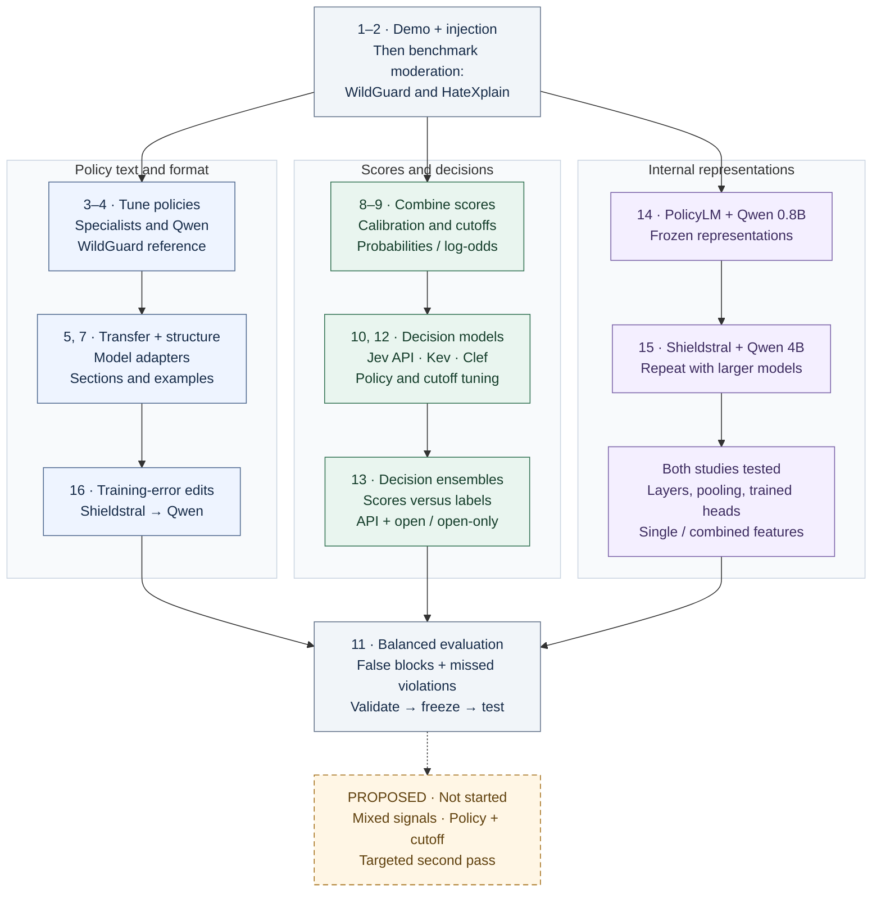

# Safeguard Eval

**A living research notebook on policy authoring and models for moderation.**

A moderation team writes a rule. A model interprets it. What happens when the team changes a definition, removes an example, switches models, or combines their decisions?

This repository follows those questions through a growing series of experiments. We test specialist policy models, general-purpose language models, and decision models sometimes called “System One” models. We change policy text, examine model-specific input formats, transfer policies between models, combine model scores, and train lightweight classifiers on frozen representations. The records include improvements, regressions, and inconclusive results.

The finding running through this work is that **policy authoring is deeply coupled with AI engineering**. A policy is an operational input: its wording, its delivery to the model, and the rule that turns a score into an action all need testing. Policy owners define the intended boundary; engineers help measure and implement it. Neither the model name nor a well-written document is sufficient on its own.

*Maintained by [Harsh Singhal](https://www.linkedin.com/in/harshsinghal). A growing collection of exploratory studies; the paper is an author-review draft.*

[Experiment map](#experiment-map) · [Experiment log](#experiment-log) · [Current leaderboard](#current-leaderboard) · [Next steps](docs/research-directions/REDUCING-MODERATION-ERRORS.md) · [Metric definitions](docs/leaderboard/METRICS.md) · [Engineering guide](docs/engineering-guardrails/README.md) · [Research paper](research-preprint/README.md) · [Agent skill](skills/safeguard-eval/README.md) · [Original demo](DEMO.md)

## Experiment map

We started by asking whether a model could apply a platform's written rules. That led to three branches: **change the policy, change how scores become decisions, or learn a classifier from the model's internal features**. The map shows how the questions connect; it is not one shared pipeline. Numbers refer to the entries in the [experiment log](#experiment-log).

**How to read the map:** solid boxes describe completed work; the dashed box is future work awaiting authorization. The separate **frontier-API pilot (6)** checked whether requests returned usable classifications; its full held-out experiment did not run. Not every branch covers both benchmarks: decision-model ensembles, representation classifiers, and training-error corrections were tested on WildGuard only. The representation and correction studies use separate validation protocols and are **not merged into the common leaderboard**.

| Follow a branch | Where to start |
|---|---|
| Policy wording, transfer, and structure | [WildGuard tuning](docs/wildguard/METHODS.md) → [Qwen comparison](docs/qwen-policy/READOUT.md) → [policy transfer](docs/policy-transfer/READOUT.md) → [HateXplain structure tests](docs/hatexplain/READOUT.md) → [training-error corrections](docs/policy-corrections/README.md) |
| Scores, calibration, cutoffs, and combinations | [Probability ensembles](docs/ensemble/READOUT.md) → [log-odds ensembles](docs/ensemble-logits/RESULTS.md) → [Jev](docs/jev/READOUT.md) → [Kev / Clef](docs/decision-models/README.md) → [decision-model ensembles](docs/decision-ensemble/README.md) |
| Frozen internal features and trained classifiers | [PolicyLM / Qwen](docs/activation-probe/README.md) → [Shieldstral / Qwen](docs/shield-probe/README.md) |
| Compare outcomes and see what is proposed | [Balanced metric guide](docs/leaderboard/METRICS.md) · [leaderboard](#current-leaderboard) · [next steps: reducing moderation errors](docs/research-directions/REDUCING-MODERATION-ERRORS.md) |

The next question is how these pieces can produce a complete classifier with fewer errors on unseen examples. The [recorded proposal](docs/research-directions/REDUCING-MODERATION-ERRORS.md) prioritizes checking which models make different mistakes, then combining useful signals. **Those experiments have not started; no new runs or spending are authorized by recording them.**

## What we are testing

The main studies ask whether we can improve classification by changing the **policy, model interface, decision cutoff, or combination of models**, without further fine-tuning the language models. Some experiments fit calibrators, ensemble classifiers, or classifiers on hidden representations using labeled data. “No additional language-model fine-tuning” does not mean “no training data” or “no learned components.”

| Benchmark | Our decision task | Final test population |
|---|---|---|
| [WildGuardMix / WildGuardTest](docs/wildguard/METHODS.md) | BLOCK harmful user requests; ALLOW benign requests. We evaluate **prompt harmfulness only**, not response harmfulness or refusal behavior. | 1,699 labeled prompts: 754 BLOCK, 945 ALLOW. The 26 prompts without a prompt-harmfulness label are excluded. |
| [HateXplain](docs/hatexplain/README.md) | BLOCK hate speech; ALLOW normal and offensive-but-not-hateful posts under this particular rule. | All 1,924 official test posts: 594 BLOCK, 1,330 ALLOW. |

The main comparisons are binary ALLOW/BLOCK tasks. The earlier demonstrations also explored REVIEW, but these two benchmarks do not establish a validated three-way review workflow. The DiffusionDB browsing demo and synthetic demonstrations are separate from the main benchmark evidence.

| Model family | Models tested | How they enter the experiments |
|---|---|---|
| Specialist policy models | PolicyLM 1.7B, Shieldstral 3B, CoPE-B-A4B, GPT-OSS Safeguard 20B | Authored rules delivered through each model's native interface. |
| General-purpose LLMs | Qwen3.5 2B, 4B, 9B, 27B, and 35B-A3B | Classification instructions and policy text; thinking disabled in these comparisons. |
| Decision / “System One” models | Jev 1.14, Kev 4B, Clef-Flash 9B | Native classification interfaces. Jev was accessed by API; Kev and Clef were self-hosted from open weights. |
| Fixed-task reference | WildGuard 7B | The released fine-tuned model and official inference template; no custom-policy tuning arm. |
| Ensembles | Averages, learned weights, logistic regression, random forests | Combinations of saved scores from specified component models. |
| Frozen-representation probes | Qwen3.5 0.8B with PolicyLM 1.7B; Qwen3.5 4B with Shieldstral 3B | Supervised logistic regression on individual or concatenated hidden states under a fixed harmfulness policy within each study; language-model weights stay frozen. |

Not every model has been tested on every dataset. The [interface audit](docs/research-directions/POLICY-INTERFACE-AUDIT.md), [model reference guide](skills/safeguard-eval/references/models.md), and [decision-model study](docs/decision-models/README.md) identify the checkpoints and adapters behind these names. Model size alone does not establish inference cost, speed, or suitability.

## Experiment log

The experiments follow the development of the research question. Each entry is named for what we tested; not every experiment improved the score. Earlier entries report their **original selection objective and metrics**. The leaderboard later in this page uses a common balanced-accuracy procedure; its selected configurations can therefore differ.

### 1. Custom platform rules: allow, block, or review

The project began with GPT-OSS Safeguard through Groq and a DiffusionDB prompt browser. We then compared four specialists on a fictional image-prompt policy with ALLOW, BLOCK, and REVIEW outcomes. On 48 synthetic test cases, Safeguard agreed with 40 draft labels, PolicyLM with 36, CoPE with 32, and Shieldstral with 19. CoPE matched all 32 clear binary cases but routed none of the ambiguous cases to REVIEW.

This made a practical distinction visible: classifying clear cases and handling uncertainty are different requirements. The labels were AI-drafted and await independent adjudication; this was a demonstration, not a validated safety benchmark.

[Original application and showcase](DEMO.md) · [Evaluation design](evals/README.md) · [Frozen results and predictions](published_runs/2026-10-21/README.md)

### 2. Prompt injection: detecting instruction-boundary attacks

We tested instruction-boundary detection on 116 held-out Deepset examples and a separate 80-case synthetic challenge. PolicyLM reached 81.6% macro-F1 on the Deepset test; Safeguard reached 88.7% on the challenge. Those scores describe different populations and should not be averaged into one ranking.

Some public examples lacked the context needed to resolve the written rule. That shifted attention toward the benchmark itself: a model-policy disagreement can also expose a mismatch between policy intent and dataset labels. These were detection tests, not demonstrations of downstream attack prevention.

[Methods and label provenance](evals/injection/README.md) · [Results, disagreements, and limitations](published_runs/2026-10-24-injection/README.md)

### 3. WildGuard: tuning policy text with fixed model weights

We developed policy candidates using WildGuardTrain, selected configurations on validation, and evaluated prompt harmfulness on WildGuardTest. Edits clarified harm categories, allowed discussion, and which instructions took precedence. Model weights stayed fixed.

Shieldstral's ordinary test accuracy rose from **87.93% to 90.82%** with its selected text. A cutoff-only control reached 90.11%, showing why we cannot attribute every improvement to prose. The released WildGuard model scored 90.35%; the small difference from Shieldstral was uncertain. Other specialists improved less, and Safeguard's selected revision slightly regressed.

[Methods](docs/wildguard/METHODS.md) · [Claims and limits](docs/wildguard/CLAIMS.md) · [Policies, selection, and full results](published_runs/2026-10-24-wildguard/README.md)

### 4. General-purpose LLMs: comparing nearby model sizes

We repeated policy-guided classification with five nearby-size Qwen models. The selected Qwen 2B configuration achieved 83.05% ordinary accuracy; Qwen 27B achieved 91.29%. In these studies, the small PolicyLM and Shieldstral specialists exceeded nearby-size Qwen configurations, while a larger Qwen remained competitive.

This supports considering small specialists alongside general models. It does not establish that specialization alone caused the difference, or that the searches found each model's best possible policy.

[Plain-language readout](docs/qwen-policy/READOUT.md) · [What changed in the prompts](docs/qwen-policy/PROMPT-CHANGES.md) · [Full results](published_runs/2026-10-25-qwen/README.md)

### 5. Policy transfer: when a rule helps one model and hurts another

We developed revisions from each model's training feedback, then applied the selected texts to other models through their native adapters. A Qwen 2B-selected policy raised Shieldstral's ordinary accuracy from **87.82% to 90.76%**. In the other direction, the Shieldstral-selected text reduced Qwen 2B from **80.11% to 75.10%**. It also reduced PolicyLM from 85.05% to 74.57%.

These are comparisons within the transfer study, with its own candidate pool. They show that transfer can help or hurt. A successful policy is a candidate to test on a new model, not a guarantee of portable behavior.

[Transfer readout](docs/policy-transfer/READOUT.md) · [Exact policy edits](docs/policy-transfer/POLICY-CHANGES.md) · [Complete transfer matrix](published_runs/2026-10-25-policy-transfer/README.md)

### 6. Frontier APIs: checking whether classification requests succeed

A separate pilot tested four frontier APIs with two reasoning settings on 32 fitting prompts: 256 observations. Some requests were filtered or produced unusable outputs. The full policy search and held-out comparison did not run within the available budget.

The lesson is operational: an API's ability to return the required classification is part of the system being evaluated. This pilot does not establish the accuracy ceiling of frontier models or justify adding them to the full-test leaderboard.

[Pilot findings](docs/frontier-api/READOUT.md) · [Requests, failures, and costs](published_runs/2026-10-25-frontier-pilot/README.md)

### 7. HateXplain: testing definitions, examples, and document structure

We moved beyond harmful requests to hate-speech classification. A common authoring document contained scope, definitions, blocking rules, permitted cases, exceptions, and examples. Model adapters mapped that content to native inputs: PolicyLM category fields, Shieldstral's prescribed wrapper, or Qwen's system instruction.

Removing the same four examples raised Shieldstral's ordinary accuracy from **52.4% to 61.0%**, but reduced Qwen 4B from **72.5% to 61.8%**. Reformatting the same clauses also changed outcomes. Removing PolicyLM's definitions increased accuracy while allowing **36 more hateful posts** through. The small automated wording revisions produced much smaller gains.

This supports testing both structure and substance, while checking which mistakes changed. It does not identify a universal policy format. Omitting sections also changes the information and document length, so these are not pure formatting effects.

[Readout](docs/hatexplain/READOUT.md) · [Policy edits and component tests](docs/hatexplain/POLICY-CHANGES.md) · [Native-interface audit](docs/research-directions/POLICY-INTERFACE-AUDIT.md) · [Full results](published_runs/2026-10-26-hatexplain/README.md)

### 8. Probability ensembles: calibration before combination

We compared probability averages, learned weights, logistic regression, and random forests. Before crediting an ensemble, we tested the individual models' decision settings. On HateXplain, changing Shieldstral's score-to-decision rule raised ordinary accuracy from **53.17% to 79.57%**, with no policy or model-weight change. False blocks fell from 885 to 177, but missed hate posts rose from 16 to 216.

Ensembles did not consistently improve on that calibrated single model. The mixed random forest reached 79.73%—only three additional correct cases overall. On WildGuard, a learned weighted average put 99.4% of its weight on Shieldstral. Combining models is an experiment, not an automatic upgrade.

[Readout](docs/ensemble/READOUT.md) · [Methods and results](docs/ensemble/RESULTS.md) · [Frozen evidence](published_runs/2026-10-27-ensemble/README.md)

### 9. Log-odds ensembles: another way to combine scores

We reused the saved binary scores, converted them to log-odds, and fitted new combiners. These are **binary score transformations**, not access to every model's raw vocabulary logits.

The selected mixed logistic ensemble reached 80.82% ordinary accuracy on HateXplain; the specialist logistic ensemble reached 91.29% on WildGuard. The HateXplain gain still involved a trade: fewer false blocks and more missed hate than the strong calibrated Shieldstral reference. Language-model weights remained fixed, but the supervised combiners needed labeled fitting data.

[Results and error trade-offs](docs/ensemble-logits/RESULTS.md) · [What we can claim](docs/ensemble-logits/CLAIMS.md) · [Reproducible archive](published_runs/2026-10-28-ensemble-logits/README.md)

### 10. Jev: policy tuning through a decision-model API

We tested Jev 1.14 through its native decision API with a brief policy, a detailed policy, and a detailed policy plus four training examples. It returned usable decisions for all 22,261 recorded classifications.

On HateXplain, ordinary accuracy at its native decision rule rose from **69.33% to 75.16%** across the brief-to-examples comparison. Selecting a higher cutoff raised accuracy further but missed substantially more hate. Jev was competitive without custom model fine-tuning; these results do not reveal its proprietary architecture or prove that “System One” is intrinsically better.

[Jev readout](docs/jev/READOUT.md) · [Policy changes](docs/jev/POLICY-CHANGES.md) · [API evidence and results](published_runs/2026-10-29-jev/README.md)

### 11. Balanced evaluation: measuring both kinds of mistakes

We assembled the saved outputs into a common comparison, choosing configurations on shared validation examples rather than taking each model's highest observed test accuracy. **Balanced accuracy** gives equal weight to catching violations and correctly allowing compliant content. Separate views ask for a 5% false-block limit or a 90% violation-catch target.

For Jev on HateXplain, the balanced selection caught **79.12%** of hate posts versus 59.93% for the earlier accuracy-selected configuration, while false blocks increased from 134 to 297. The choice of metric changed which policy and cutoff were selected. The original 18-entry reanalysis is preserved; the next study extends it to 20 entries per benchmark.

[How selection works](docs/leaderboard/README.md) · [Metric definitions](docs/leaderboard/METRICS.md) · [Original reanalysis](published_runs/2026-10-29-leaderboard/README.md)

### 12. Kev and Clef: testing open-weight decision models

Kev 4B and Clef-Flash 9B were self-hosted and tested with the same three policy types and benchmarks as Jev, without further fine-tuning. Kev selected the brief policy for both tasks; Clef selected the example-bearing policy with task-specific cutoffs.

On HateXplain, expanding Kev's brief policy reduced native balanced accuracy from **70.22% to 61.98%**. Clef's example policy scored worse at its native rule but better after validation-based cutoff selection. Their final balanced scores were 75.17% and 74.94%, versus Jev's 78.40%. More detailed policy text was not uniformly better, and policy and cutoff effects needed to be considered together.

[Study and deployment details](docs/decision-models/README.md) · [Frozen runs](published_runs/2026-10-29-decision-models/README.md) · [Expanded leaderboard](published_runs/2026-10-29-leaderboard-decision-models/README.md)

### 13. Decision-model ensembles: combining Jev, Kev, and Clef scores

We fitted combinations of Jev, Kev, and Clef BLOCK scores on 1,024 WildGuardTrain prompts, selected settings on 512 separate validation prompts, and evaluated frozen choices on 1,699 WildGuardTest prompts. The primary probability logistic ensemble reached **89.32% balanced accuracy**, versus 88.69% for its selected Jev individual and 89.81% for WildGuard. It caught 27 more harmful prompts than Jev but made 22 more false blocks; the gain was uncertain.

The primary open-only Kev/Clef combination reached **87.52% balanced accuracy**. We also tested averages, learned weights, random forests, and decision-only controls. Retaining scores did not establish a clear advantage over combining decisions. The current leaderboard includes all nine combination methods for each of the two groups; selection aliases are not counted as additional methods. All scores were cached, so added GPU/API cost was $0. The example-bearing policies lacked fitting scores and were excluded from the new feature pool; no model weights or policy wording changed.

[Findings and error trade-offs](docs/decision-ensemble/README.md) · [Registered plan](docs/decision-ensemble/PLAN.md) · [Full results and reproducible archive](published_runs/2026-10-30-decision-ensemble/README.md) · [Combined leaderboard](#current-leaderboard)

### 14. Frozen representations: learning a classifier from two small models

We extracted hidden representations from Qwen3.5-0.8B and PolicyLM-1.7B under a fixed policy, then trained logistic regressions on 4,096 WildGuardTrain prompts. Settings were selected on 1,536 separate validation prompts and frozen before testing. **PolicyLM features alone reached 88.43% balanced accuracy**, versus **86.18%** for its fresh native-score control. Combining the two models reached **87.09%**; Qwen features alone reached **82.44%**.

Adding Qwen reduced false blocks by 11 but missed 29 more harmful prompts than the PolicyLM feature classifier. Earlier layers looked better on validation but did not consistently improve test performance. Native PolicyLM's AUROC was already similar, so the observed gain is at the selected allow/block rule. The experiment supports a useful task-specific readout, with labeled training data; it does not show that combining representations helps or that an adapted classifier will follow a newly edited policy. None of the new methods exceeded the archived WildGuard or specialist score ensemble. Compute cost was **$0.38**, and the GPU was terminated.

[Readable findings](docs/activation-probe/README.md) · [Protocol and controls](docs/activation-probe/PLAN.md) · [All metrics and settings](docs/activation-probe/RESULTS.md) · [Frozen evidence](published_runs/2026-10-30-activation-probe/README.md)

### 15. Shieldstral representations: does reading inside the model add value?

We repeated the frozen-representation approach with Shieldstral-1.0-3B and Qwen3.5-4B, adding direct output-score and score-combination controls. The same 4,096 fitting, 1,536 validation and 1,699 test populations were used. **Shieldstral's direct score reached 90.53% balanced accuracy**, its learned feature classifier 90.39%, and the combined feature classifier 90.35%. Adding Qwen corrected six mistakes but introduced seven compared with the Shieldstral feature classifier. The primary combination did not establish an improvement.

Choosing an earlier Qwen layer and a different pooling method on validation raised its test balanced accuracy from **83.93% to 88.81%**, but combining the selected representations still reached only 90.14%. Shieldstral's native validation score was 98.73%, falling to 90.53% on test; the gap was present even without a learned feature head. None of the 11 selections under either the 5% false-block profile or the separate 90% recall profile carried its respective target to test. The result supports testing the simplest native-score baseline before adding a learned head or another model. Cost was **$0.37**, and the GPU was terminated.

[Readable findings](docs/shield-probe/README.md) · [Protocol](docs/shield-probe/PLAN.md) · [Full results](docs/shield-probe/RESULTS.md) · [Frozen evidence](published_runs/2026-10-30-shield-probe/README.md) · [Follow-up: corrections from training errors](docs/policy-corrections/README.md)

### 16. Policy corrections: do training mistakes lead to better rules?

We reviewed 58 Shieldstral training mistakes, froze four bounded policy revisions, and selected one on fresh validation. The chosen revision clarified permitted cases. We then transferred it unchanged to Qwen3.5-4B, selected each model's cutoffs, and evaluated an additional 2,048-example project holdout plus the reused WildGuardTest. No model weights or new classifier heads were trained.

**The revision did not improve Shieldstral.** Compared with the original policy's tuned cutoff, balanced accuracy went from **98.23% to 98.13%** on the additional holdout and **90.29% to 90.15%** on WildGuardTest. **Qwen improved from 88.85% to 89.77%** on the additional holdout, catching 30 more harmful prompts but falsely blocking 10 more legitimate ones. Its WildGuardTest change, **86.01% to 86.82%**, remained uncertain (paired 95% interval for the change: −0.04 to +1.63 points). Fixed-cutoff controls, unsuccessful candidates and newly introduced errors are also reported.

The useful finding is that a plausible correction can fail on its source model and help another interpreter. Policy edits need controlled evaluation; additional clauses and examples are not automatic improvements. The new holdout is unused in recorded project development but comes from WildGuardTrain's model-derived labels; it does not replace the human-labeled official test. None of eight separately selected operating-target configurations carried its respective target to WildGuardTest. Cost was **$0.72**, and the GPU was terminated.

[Readable findings](docs/policy-corrections/README.md) · [Exact policy edits](docs/policy-corrections/POLICY-EDITS.md) · [Registered protocol](docs/policy-corrections/PLAN.md) · [Full results](docs/policy-corrections/RESULTS.md) · [Frozen evidence](published_runs/2026-10-30-policy-corrections/README.md)

## What the evidence suggests for moderation teams

- **Version the policy with the system that interprets it.** Keep the model revision, native adapter, output mapping, and decision cutoff alongside the policy text. A model replacement requires another evaluation.
- **Review meaning as well as scores.** Definitions, exceptions, and examples express a policy owner's intent. A higher aggregate score does not justify silently narrowing that intent or ignoring a costly type of error.
- **Build a benchmark for the boundary you care about.** Include compliant lookalikes and difficult violations. Use training examples for authoring, validation for selection, and a separate test for the final assessment. Inspect errors by category as well as in aggregate.
- **Consider specialists, general LLMs, and decision models.** Different configured systems led on different tasks. Small models can be useful; neither size nor family guarantees the outcome. Ensembles add inference and maintenance requirements that a quality-only table does not price.

These experiments support a workflow in which policy owners and engineers test changes together. They do **not** show that policies never transfer, that specialists always win, or that fine-tuning is unnecessary. Our public tests have been examined repeatedly, model-development budgets differ, and prior training exposure is not fully known. The studies establish no enterprise-data, multilingual, or image-moderation benchmark. Proposed enterprise applications remain a [research direction](docs/research-directions/ENTERPRISE-AI-GOVERNANCE.md), not a validated capability.

## Explore, reproduce, or ask your agent

| Start here | What you will find |
|---|---|
| [Engineering article](docs/engineering-guardrails/README.md) | A shorter guide to building and evaluating a policy guardrail, with an editable Word version. |
| [Research paper](research-preprint/README.md) | Review draft v0.6: PDF, extracted text, LaTeX source, methods, citations, and fuller limitations. Covers through the Kev/Clef comparison; later decision-ensemble, representation-probe and policy-correction studies are linked above. Not peer reviewed or submitted to arXiv. |
| [Install the Safeguard Eval skill](skills/safeguard-eval/README.md) | A guided introduction and evidence-based Q&A in Codex, Claude Code, or Pi. The v0.5.0 release covers through the specialist probability/log-odds ensembles. The newer decision-model, representation and policy-correction studies are available in the research log above. |
| [Published runs](published_runs) | Dated experiment bundles with policies, predictions, selections, analysis, and provenance. Follow each study's reproduction instructions. |
| [Compute notes](docs/COMPUTE.md) | Recorded GPU/API use and budget controls. The research used GPU.ai and Runpod; these are not provider endorsements. |
| [Research directions](docs/research-directions/README.md) | Open questions and proposed work, distinguished from completed experiments. |
| [Original demo](DEMO.md) | Flask app, Groq configuration, DiffusionDB search, and the first policy showcase. |

The research archive grows separately from versioned skill releases. New studies should preserve older records, describe what changed, and report failures alongside successes. See [how to update this notebook](docs/RESEARCH-NOTEBOOK.md).

## Current leaderboard

The comparison now includes the **Jev/Kev/Clef score ensembles and decision-only controls**, alongside the earlier policy models, general-purpose LLMs, and specialist ensembles. There are **38 WildGuard entries and 20 HateXplain entries**, drawn from **261 eligible archived candidate records**. These are configured systems and methods, not 261 distinct models or independent experiments. The new decision-model combinations were tested on WildGuard only.

The [PolicyLM representation study](docs/activation-probe/README.md) and [Shieldstral representation study](docs/shield-probe/README.md) use a separate 1,536-row validation protocol. The [training-error policy-correction study](docs/policy-corrections/README.md) uses a newly reserved validation population and additional project holdout. Their results are reported separately and have not been inserted into these common-validation tables.

The [integration record](published_runs/2026-10-30-leaderboard-decision-ensembles/README.md) preserves every earlier selection and result. It adds the new study's frozen method selections without refitting or choosing replacements from test scores. Individual calibration controls and “best method” aliases remain in that study's report rather than becoming duplicate leaderboard entries.

Each entry's policy and decision rule were selected for balanced accuracy on common validation data: 512 WildGuard prompts or 1,920 HateXplain posts. The tables report those selections on the full test populations. They rank the observed test scores of the frozen selections, not each model's best test result. This is a retrospective comparison on reused public tests, with unequal candidate pools and development histories.

**Reading the columns:** balanced accuracy averages the violation-catch rate and the compliant-content allow rate. A false-block rate is the share of compliant items incorrectly blocked; a miss rate is the share of violations incorrectly allowed. Lower is better for both error rates. Unresolved outputs are counted as errors, not silently discarded or credited as REVIEW. See the [complete metric guide](docs/leaderboard/METRICS.md).

[Full tables, confidence intervals, selected policies, and operating targets](published_runs/2026-10-30-leaderboard-decision-ensembles/RESULTS.md) · [CSV](published_runs/2026-10-30-leaderboard-decision-ensembles/leaderboard.csv) · [Machine-readable results](published_runs/2026-10-30-leaderboard-decision-ensembles/results.json) · [Interactive HTML](published_runs/2026-10-30-leaderboard-decision-ensembles/index.html) *(download and open locally; GitHub displays its source)*

<!-- BEGIN GENERATED LEADERBOARD -->
<!-- Generated by tools/update_readme_leaderboard.py; point SOURCE at a reviewed new archive to update. -->

### WildGuardTest: prompt harmfulness

1,699 test items: 754 violations and 945 compliant items under the benchmark policy.

| Rank | Model / method | Balanced accuracy ↑ | Macro-F1 ↑ | False-block rate ↓ | Miss rate ↓ | Unresolved |
|---:|---|---:|---:|---:|---:|---:|
| 1 | Equal log-odds average · specialists | 91.08% | 91.30% | 5.50% | 12.33% | 0 |
| 2 | Logistic regression · log-odds · specialists | 91.00% | 91.14% | 6.46% | 11.54% | 0 |
| 3 | Logistic regression · probabilities · specialists | 90.98% | 91.09% | 6.77% | 11.27% | 0 |
| 4 | Calibrated probability average · specialists | 90.62% | 90.92% | 4.97% | 13.79% | 0 |
| 5 | Random forest · specialists | 90.58% | 90.77% | 6.24% | 12.60% | 0 |
| 6 | CoPE | 90.58% | 90.82% | 5.71% | 13.13% | 0 |
| 7 | Equal probability average · specialists | 90.58% | 90.86% | 5.19% | 13.66% | 0 |
| 8 | Learned weighted average · specialists | 90.53% | 90.71% | 6.35% | 12.60% | 0 |
| 9 | Shieldstral 3B | 90.26% | 90.56% | 5.29% | 14.19% | 0 |
| 10 | Qwen3.5 27B | 90.16% | 90.58% | 4.02% | 15.65% | 0 |
| 11 | WildGuard 7B | 89.81% | 90.13% | 5.40% | 14.99% | 0 |
| 12 | Equal log-odds average · Jev + Kev + Clef | 89.74% | 89.93% | 6.98% | 13.53% | 0 |
| 13 | Qwen3.5 35B-A3B | 89.64% | 89.99% | 5.08% | 15.65% | 0 |
| 14 | Equal probability average · Jev + Kev + Clef | 89.45% | 89.63% | 7.30% | 13.79% | 0 |
| 15 | Qwen3.5 9B | 89.32% | 89.42% | 8.36% | 13.00% | 0 |
| 16 | Logistic regression · probabilities · Jev + Kev + Clef | 89.32% | 89.51% | 7.30% | 14.06% | 0 |
| 17 | Random forest · Jev + Kev + Clef | 89.14% | 89.28% | 7.94% | 13.79% | 0 |
| 18 | GPT-OSS Safeguard 20B | 89.13% | 89.64% | 6.14% | 14.46% | 9 |
| 19 | Logistic regression · log-odds · Jev + Kev + Clef | 89.11% | 89.10% | 9.84% | 11.94% | 0 |
| 20 | Learned weighted average · Jev + Kev + Clef | 89.08% | 89.23% | 8.04% | 13.79% | 0 |
| 21 | Logistic regression · decisions only · Jev + Kev + Clef | 89.05% | 89.52% | 4.13% | 17.77% | 0 |
| 22 | Calibrated probability average · Jev + Kev + Clef | 88.76% | 88.92% | 8.15% | 14.32% | 0 |
| 23 | Majority vote · decisions only · Jev + Kev + Clef | 88.71% | 89.08% | 5.61% | 16.98% | 0 |
| 24 | Jev 1.14 | 88.69% | 89.12% | 4.97% | 17.64% | 0 |
| 25 | Random forest · Kev + Clef (open weights) | 88.10% | 88.08% | 10.79% | 13.00% | 0 |
| 26 | Logistic regression · decisions only · Kev + Clef (open weights) | 88.02% | 88.02% | 10.69% | 13.26% | 0 |
| 27 | Majority vote · decisions only · Kev + Clef (open weights) | 88.02% | 88.02% | 10.69% | 13.26% | 0 |
| 28 | Learned weighted average · Kev + Clef (open weights) | 87.88% | 87.89% | 10.58% | 13.66% | 0 |
| 29 | Calibrated probability average · Kev + Clef (open weights) | 87.72% | 87.98% | 7.72% | 16.84% | 0 |
| 30 | Equal log-odds average · Kev + Clef (open weights) | 87.64% | 87.83% | 8.68% | 16.05% | 0 |
| 31 | Clef-Flash 9B | 87.62% | 87.78% | 9.10% | 15.65% | 0 |
| 32 | Equal probability average · Kev + Clef (open weights) | 87.60% | 87.77% | 8.89% | 15.92% | 0 |
| 33 | Logistic regression · probabilities · Kev + Clef (open weights) | 87.52% | 87.87% | 6.67% | 18.30% | 0 |
| 34 | Logistic regression · log-odds · Kev + Clef (open weights) | 87.50% | 87.87% | 6.56% | 18.44% | 0 |
| 35 | Kev 4B | 86.93% | 87.27% | 7.30% | 18.83% | 0 |
| 36 | Qwen3.5 4B | 86.81% | 86.64% | 13.65% | 12.73% | 0 |
| 37 | PolicyLM 1.7B | 86.31% | 86.38% | 11.32% | 16.05% | 0 |
| 38 | Qwen3.5 2B | 83.41% | 83.42% | 14.60% | 18.57% | 0 |

### HateXplain: hate versus non-hate

1,924 test items: 594 violations and 1,330 compliant items under the benchmark policy.

| Rank | Model / method | Balanced accuracy ↑ | Macro-F1 ↑ | False-block rate ↓ | Miss rate ↓ | Unresolved |
|---:|---|---:|---:|---:|---:|---:|
| 1 | Logistic regression · log-odds · specialists + Qwen | 79.35% | 77.26% | 20.60% | 20.71% | 0 |
| 2 | Random forest · specialists + Qwen | 78.65% | 75.49% | 25.19% | 17.51% | 0 |
| 3 | Jev 1.14 | 78.40% | 76.07% | 22.33% | 20.88% | 0 |
| 4 | Logistic regression · log-odds · specialists | 77.26% | 75.38% | 21.58% | 23.91% | 0 |
| 5 | Learned weighted average · specialists + Qwen | 77.24% | 73.96% | 26.99% | 18.52% | 0 |
| 6 | Logistic regression · probabilities · specialists + Qwen | 77.19% | 74.16% | 26.09% | 19.53% | 0 |
| 7 | Shieldstral 3B | 77.02% | 74.77% | 23.23% | 22.73% | 0 |
| 8 | Random forest · specialists | 76.96% | 74.82% | 22.86% | 23.23% | 0 |
| 9 | Learned weighted average · specialists | 76.95% | 74.29% | 24.89% | 21.21% | 0 |
| 10 | Qwen3.5 4B | 76.21% | 74.19% | 23.01% | 24.58% | 0 |
| 11 | Calibrated probability average · specialists + Qwen | 75.67% | 73.21% | 25.26% | 23.40% | 0 |
| 12 | Kev 4B | 75.17% | 72.62% | 26.09% | 23.57% | 0 |
| 13 | Equal probability average · specialists + Qwen | 74.97% | 71.89% | 28.35% | 21.72% | 0 |
| 14 | Clef-Flash 9B | 74.94% | 73.39% | 22.18% | 27.95% | 0 |
| 15 | Logistic regression · probabilities · specialists | 74.83% | 70.74% | 32.33% | 18.01% | 0 |
| 16 | Equal log-odds average · specialists + Qwen | 74.59% | 71.42% | 29.10% | 21.72% | 0 |
| 17 | Calibrated probability average · specialists | 74.26% | 70.24% | 32.63% | 18.86% | 0 |
| 18 | Equal log-odds average · specialists | 72.35% | 68.72% | 33.08% | 22.22% | 0 |
| 19 | Equal probability average · specialists | 70.26% | 64.68% | 42.48% | 17.00% | 0 |
| 20 | PolicyLM 1.7B | 63.69% | 63.90% | 20.60% | 52.02% | 0 |

<!-- END GENERATED LEADERBOARD -->

The WildGuard specialist ensembles combine **PolicyLM, Shieldstral, and CoPE**. HateXplain specialist ensembles combine **PolicyLM and Shieldstral**; mixed ensembles add **Qwen 4B**. The decision-model combinations are labeled **Jev + Kev + Clef** or **Kev + Clef (open weights)**. Safeguard and WildGuard are reference models, not ensemble components. Models or combinations absent from a benchmark were not evaluated there in the eligible studies.

The new study registered **logistic regression on probabilities** as its primary method. Its three-model result is 89.32%; the equal log-odds average observed a higher test score of 89.74%, but was not promoted to the primary result after testing. All methods remain visible, including those that regressed. The open-only cohort uses Kev and Clef; using Jev requires its API.

Safeguard's nine unresolved WildGuard outputs include two compliant and seven violating prompts. They lower balanced accuracy and coverage in addition to the false blocks and misses shown. Binary MCC is unavailable for that row in the full report.

**Small gaps need context.** On WildGuard, the leading ensemble exceeded CoPE by 0.50 balanced-accuracy points, with a paired 95% interval of −0.07 to +1.11; that does not resolve a clear difference. Its lead over WildGuard was 1.27 points (+0.33 to +2.21). On HateXplain, the mixed logistic ensemble led Jev by 0.95 points (−1.03 to +2.94). These unadjusted, exploratory intervals do not account for the full history of policy search and repeated test use.

**An operational target can change the recommendation.** In the separate low-false-block view, the best HateXplain catch rate among configurations that met the 5% test limit was only 43.10%. On WildGuard, two of 35 eligible selections met that limit: logistic combinations of decisions only. The three-model version caught 82.23% of violations with 4.13% false blocks. Neither primary score ensemble met the limit. A useful aggregate score is not evidence that a deployment's error budget has been satisfied.

---

Have a proposed policy, benchmark, replication, or correction? [Open an issue](https://github.com/harshsinghal/safeguard-eval/issues). Include the task, intended decision boundary, and evidence needed to evaluate the claim. Linked models and datasets retain their publishers' terms.
