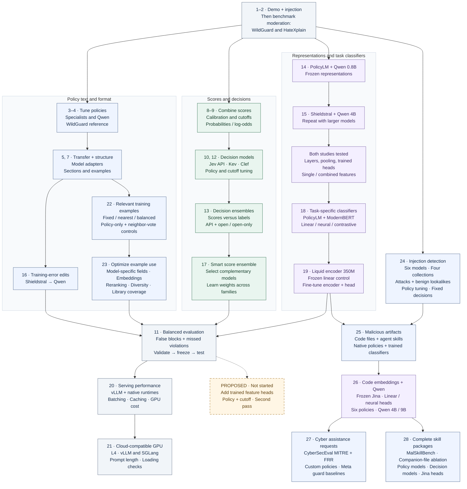

# Safeguard Eval

**A living research notebook on policy authoring and models for moderation.**

A moderation team writes a rule. A model interprets it. What happens when the team changes a definition, removes an example, switches models, or combines their decisions?

This repository follows those questions through a growing series of experiments. We test specialist policy models, general-purpose language models, and decision models sometimes called “System One” models. We change policy text, examine model-specific input formats, transfer policies between models, retrieve labeled examples, combine model scores, train classifiers on frozen representations, and fine-tune a compact encoder for a fixed task. We also measure serving latency, throughput and GPU cost, including how prompt length and inference engines affect deployment. The records include improvements, regressions, and inconclusive results.

The finding running through this work is that **policy authoring is deeply coupled with AI engineering**. A policy is an operational input: its wording, its delivery to the model, and the rule that turns a score into an action all need testing. Policy owners define the intended boundary; engineers help measure and implement it. Neither the model name nor a well-written document is sufficient on its own.

*Maintained by [Harsh Singhal](https://www.linkedin.com/in/harshsinghal). A growing collection of exploratory studies; the paper is an author-review draft.*

[Experiment map](#experiment-map) · [Experiment log](#experiment-log) · [Datasets](docs/datasets/README.md) · [Models](docs/models/README.md) · [Current leaderboard](#current-leaderboard) · [Next steps](docs/research-directions/REDUCING-MODERATION-ERRORS.md) · [Metric definitions](docs/leaderboard/METRICS.md) · [Engineering guide](docs/engineering-guardrails/README.md) · [Research paper](research-preprint/README.md) · [Agent skill](skills/safeguard-eval/README.md) · [Original demo](DEMO.md)

**Latest experiments:** [Cyberattack requests and complete skill packages](docs/cyber-skill-guardrails/README.md)
compare authored policies, Meta guard baselines and small classifiers trained on
frozen code embeddings. CyberSecEval supplies cyber-assistance requests;
MalSkillBench supplies complete textual agent packages. The skill study also
removes companion files while keeping each prompted model's selected policy fixed.
These are separate populations from the earlier code-file and skill-text tests.
[Results](docs/cyber-skill-guardrails/RESULTS.md) · [Methods](docs/cyber-skill-guardrails/METHODS.md)

## Experiment map

We started by asking whether a model could apply a platform's written rules. That led to three branches: **change the policy, change how scores become decisions, or learn a classifier from the model's internal features**. We also measure what it takes to serve representative systems. The map shows how the questions connect; it is not one shared pipeline. Numbers refer to the entries in the [experiment log](#experiment-log).

**How to read the map:** solid boxes describe completed work; dashed boxes describe proposed work or studies still awaiting completion. The separate **frontier-API pilot (6)** checked whether requests returned usable classifications; its full held-out experiment did not run. Not every branch covers both benchmarks: the first decision-model ensemble, the first two representation studies, training-error corrections, Liquid fine-tuning, and retrieved examples were tested on WildGuard only. The smart ensemble and task-specific contrastive-head study cover both benchmarks. The representation, correction, smart-ensemble, contrastive-head, Liquid, and retrieved-example studies use separate validation protocols and are **not merged into the common leaderboard**.

| Follow a branch | Where to start |
|---|---|
| Policy wording, transfer, structure, and examples | [WildGuard tuning](docs/wildguard/METHODS.md) → [Qwen comparison](docs/qwen-policy/READOUT.md) → [policy transfer](docs/policy-transfer/READOUT.md) → [HateXplain structure tests](docs/hatexplain/READOUT.md) → [training-error corrections](docs/policy-corrections/README.md) → [retrieved examples](docs/retrieved-examples/README.md) → [retrieval optimization](docs/retrieval-optimization/README.md) |
| Scores, calibration, cutoffs, and combinations | [Probability ensembles](docs/ensemble/READOUT.md) → [log-odds ensembles](docs/ensemble-logits/RESULTS.md) → [Jev](docs/jev/READOUT.md) → [Kev / Clef](docs/decision-models/README.md) → [decision-model ensembles](docs/decision-ensemble/README.md) → [smart ensemble](docs/smart-ensemble/README.md) |
| Representations and task-specific training | [PolicyLM / Qwen](docs/activation-probe/README.md) → [Shieldstral / Qwen](docs/shield-probe/README.md) → [linear, neural and contrastive task classifiers](docs/contrastive-heads/README.md) → [Liquid encoder fine-tuning](docs/liquid-finetune/README.md) |
| Deploy and operate | [Seven-model serving study](docs/serving/README.md) → [L4: prompt length and vLLM/SGLang](docs/cloud-serving/README.md) · [Self-hosting implications](docs/cloud-serving/DEPLOYMENT.md) |
| Test prompt and artifact security | [Injection and benign lookalikes](docs/prompt-injection/README.md) → [malicious source files and agent skills](docs/malicious-artifacts/README.md) → [code embeddings](docs/artifact-representations/README.md) → [cyber requests and complete packages](docs/cyber-skill-guardrails/README.md) |
| Compare outcomes and see what is proposed | [Balanced metric guide](docs/leaderboard/METRICS.md) · [leaderboard](#current-leaderboard) · [next steps: reducing moderation errors](docs/research-directions/REDUCING-MODERATION-ERRORS.md) |

The [smart-ensemble study](docs/smart-ensemble/README.md) takes the next step: learn which native model scores help each other, then test the frozen combination. Adding trained representation heads to that combination, broader policy-and-cutoff optimization, and a targeted second pass remain [proposed work](docs/research-directions/REDUCING-MODERATION-ERRORS.md), awaiting separate authorization.

## What we are testing

The main studies ask whether we can improve classification by changing the **policy, model interface, decision cutoff, or combination of models**, without further fine-tuning the language models. Some experiments fit calibrators, ensemble classifiers, or classifiers on hidden representations using labeled data. “No additional language-model fine-tuning” does not mean “no training data” or “no learned components.” A separate [Liquid encoder study](docs/liquid-finetune/README.md) now tests **end-to-end supervised fine-tuning** against a frozen-encoder control, using prompts and labels rather than a policy document at inference time.

| Benchmark | Our decision task | Final test population |
|---|---|---|
| [WildGuardMix / WildGuardTest](docs/wildguard/METHODS.md) | BLOCK harmful user requests; ALLOW benign requests. We evaluate **prompt harmfulness only**, not response harmfulness or refusal behavior. | 1,699 labeled prompts: 754 BLOCK, 945 ALLOW. The 26 prompts without a prompt-harmfulness label are excluded. |
| [HateXplain](docs/hatexplain/README.md) | BLOCK hate speech; ALLOW normal and offensive-but-not-hateful posts under this particular rule. | All 1,924 official test posts: 594 BLOCK, 1,330 ALLOW. |

The main comparisons are binary ALLOW/BLOCK tasks. The earlier demonstrations also explored REVIEW, but these two benchmarks do not establish a validated three-way review workflow. The DiffusionDB browsing demo and synthetic demonstrations are separate from the main benchmark evidence.

The [dataset directory](docs/datasets/README.md) covers all evaluation sources,
including the injection and jailbreak collections, original demonstrations,
source links, label mappings and study-specific splits. The
[model directory](docs/models/README.md) lists the classifiers, general LLMs,
decision models, encoders, retrievers and API pilots, with their roles and interfaces.

| Model family | Models tested | How they enter the experiments |
|---|---|---|
| Specialist policy models | PolicyLM 1.7B, Shieldstral 3B, CoPE-B-A4B, GPT-OSS Safeguard 20B | Authored rules delivered through each model's native interface. |
| General-purpose LLMs | Qwen3.5 2B, 4B, 9B, 27B, and 35B-A3B | Classification instructions and policy text; thinking disabled in these comparisons. |
| Decision / “System One” models | Jev 1.14, Kev 4B, Clef-Flash 9B | Native classification interfaces. Jev was accessed by API; Kev and Clef were self-hosted from open weights. |
| Meta guard controls | Llama Guard 4 12B; Prompt Guard 2 86M | Llama Guard native/default and custom categories; Prompt Guard is a narrower injection diagnostic in the cyber/skill study. |
| Code embedding classifiers | Jina v2 code 161M; Jina code 0.5B | Frozen representations with task-trained linear and neural heads; separate code and skill populations. |
| Fixed-task reference | WildGuard 7B | The released fine-tuned model and official inference template; no custom-policy tuning arm. |
| Ensembles | Averages, learned weights, logistic regression, random forests, shallow gradient boosting | Combinations of specified component scores; the smart-ensemble study also selects a small subset using training folds. |
| Frozen-representation probes | Qwen3.5 0.8B with PolicyLM 1.7B; Qwen3.5 4B with Shieldstral 3B | Supervised logistic regression on individual or concatenated hidden states under a fixed harmfulness policy within each study; language-model weights stay frozen. |
| Task-specific classifiers | PolicyLM 1.7B and ModernBERT-base 149M | Matched linear, neural and contrastive heads on frozen features; separately trained on WildGuard and HateXplain with three neural seeds. |
| Supervised encoder fine-tuning | Liquid LFM2.5-Encoder-350M | Frozen encoder with logistic regression versus updating the encoder and a binary head; WildGuard only, three fine-tuning seeds. |

Not every model has been tested on every dataset. The [model directory](docs/models/README.md), [interface audit](docs/research-directions/POLICY-INTERFACE-AUDIT.md), and [decision-model study](docs/decision-models/README.md) identify the checkpoints and adapters behind these names. Model size alone does not establish inference cost, speed, or suitability.

## Experiment log

The experiments follow the development of the research question. Each entry is named for what we tested; not every experiment improved the score. Earlier entries report their **original selection objective and metrics**. The leaderboard later in this page uses a common balanced-accuracy procedure; its selected configurations can therefore differ.

### 1. Custom platform rules: allow, block, or review

The project began with GPT-OSS Safeguard through Groq and a DiffusionDB prompt browser. We then compared four specialists on a fictional image-prompt policy with ALLOW, BLOCK, and REVIEW outcomes. On 48 synthetic test cases, Safeguard agreed with 40 draft labels, PolicyLM with 36, CoPE with 32, and Shieldstral with 19. CoPE matched all 32 clear binary cases but routed none of the ambiguous cases to REVIEW.

This made a practical distinction visible: classifying clear cases and handling uncertainty are different requirements. The labels were AI-drafted and await independent adjudication; this was a demonstration, not a validated safety benchmark.

[Original application and showcase](DEMO.md) · [Evaluation design](evals/README.md) · [Frozen results and predictions](published_runs/2026-10-21/README.md)

### 2. Prompt injection: detecting instruction-boundary attacks

We tested instruction-boundary detection on 116 held-out Deepset examples and a separate 80-case synthetic challenge. PolicyLM reached 81.6% macro-F1 on the Deepset test; Safeguard reached 88.7% on the challenge. Those scores describe different populations and should not be averaged into one ranking.

Some public examples lacked the context needed to resolve the written rule. That shifted attention toward the benchmark itself: a model-policy disagreement can also expose a mismatch between policy intent and dataset labels. These were detection tests, not demonstrations of downstream attack prevention.

[Methods and label provenance](evals/injection/README.md) · [Results, disagreements, and limitations](published_runs/2026-10-24-injection/README.md)

### 3. WildGuard: tuning policy text with fixed model weights

We developed policy candidates using WildGuardTrain, selected configurations on validation, and evaluated prompt harmfulness on WildGuardTest. Edits clarified harm categories, allowed discussion, and which instructions took precedence. Model weights stayed fixed.

Shieldstral's ordinary test accuracy rose from **87.93% to 90.82%** with its selected text. A cutoff-only control reached 90.11%, showing why we cannot attribute every improvement to prose. The released WildGuard model scored 90.35%; the small difference from Shieldstral was uncertain. Other specialists improved less, and Safeguard's selected revision slightly regressed.

[Methods](docs/wildguard/METHODS.md) · [Claims and limits](docs/wildguard/CLAIMS.md) · [Policies, selection, and full results](published_runs/2026-10-24-wildguard/README.md)

### 4. General-purpose LLMs: comparing nearby model sizes

We repeated policy-guided classification with five nearby-size Qwen models. The selected Qwen 2B configuration achieved 83.05% ordinary accuracy; Qwen 27B achieved 91.29%. In these studies, the small PolicyLM and Shieldstral specialists exceeded nearby-size Qwen configurations, while a larger Qwen remained competitive.

This supports considering small specialists alongside general models. It does not establish that specialization alone caused the difference, or that the searches found each model's best possible policy.

[Plain-language readout](docs/qwen-policy/READOUT.md) · [What changed in the prompts](docs/qwen-policy/PROMPT-CHANGES.md) · [Full results](published_runs/2026-10-25-qwen/README.md)

### 5. Policy transfer: when a rule helps one model and hurts another

We developed revisions from each model's training feedback, then applied the selected texts to other models through their native adapters. A Qwen 2B-selected policy raised Shieldstral's ordinary accuracy from **87.82% to 90.76%**. In the other direction, the Shieldstral-selected text reduced Qwen 2B from **80.11% to 75.10%**. It also reduced PolicyLM from 85.05% to 74.57%.

These are comparisons within the transfer study, with its own candidate pool. They show that transfer can help or hurt. A successful policy is a candidate to test on a new model, not a guarantee of portable behavior.

[Transfer readout](docs/policy-transfer/READOUT.md) · [Exact policy edits](docs/policy-transfer/POLICY-CHANGES.md) · [Complete transfer matrix](published_runs/2026-10-25-policy-transfer/README.md)

### 6. Frontier APIs: checking whether classification requests succeed

A separate pilot tested four frontier APIs with two reasoning settings on 32 fitting prompts: 256 observations. Some requests were filtered or produced unusable outputs. The full policy search and held-out comparison did not run within the available budget.

The lesson is operational: an API's ability to return the required classification is part of the system being evaluated. This pilot does not establish the accuracy ceiling of frontier models or justify adding them to the full-test leaderboard.

[Pilot findings](docs/frontier-api/READOUT.md) · [Requests, failures, and costs](published_runs/2026-10-25-frontier-pilot/README.md)

### 7. HateXplain: testing definitions, examples, and document structure

We moved beyond harmful requests to hate-speech classification. A common authoring document contained scope, definitions, blocking rules, permitted cases, exceptions, and examples. Model adapters mapped that content to native inputs: PolicyLM category fields, Shieldstral's prescribed wrapper, or Qwen's system instruction.

Removing the same four examples raised Shieldstral's ordinary accuracy from **52.4% to 61.0%**, but reduced Qwen 4B from **72.5% to 61.8%**. Reformatting the same clauses also changed outcomes. Removing PolicyLM's definitions increased accuracy while allowing **36 more hateful posts** through. The small automated wording revisions produced much smaller gains.

This supports testing both structure and substance, while checking which mistakes changed. It does not identify a universal policy format. Omitting sections also changes the information and document length, so these are not pure formatting effects.

[Readout](docs/hatexplain/READOUT.md) · [Policy edits and component tests](docs/hatexplain/POLICY-CHANGES.md) · [Native-interface audit](docs/research-directions/POLICY-INTERFACE-AUDIT.md) · [Full results](published_runs/2026-10-26-hatexplain/README.md)

### 8. Probability ensembles: calibration before combination

We compared probability averages, learned weights, logistic regression, and random forests. Before crediting an ensemble, we tested the individual models' decision settings. On HateXplain, changing Shieldstral's score-to-decision rule raised ordinary accuracy from **53.17% to 79.57%**, with no policy or model-weight change. False blocks fell from 885 to 177, but missed hate posts rose from 16 to 216.

Ensembles did not consistently improve on that calibrated single model. The mixed random forest reached 79.73%—only three additional correct cases overall. On WildGuard, a learned weighted average put 99.4% of its weight on Shieldstral. Combining models is an experiment, not an automatic upgrade.

[Readout](docs/ensemble/READOUT.md) · [Methods and results](docs/ensemble/RESULTS.md) · [Frozen evidence](published_runs/2026-10-27-ensemble/README.md)

### 9. Log-odds ensembles: another way to combine scores

We reused the saved binary scores, converted them to log-odds, and fitted new combiners. These are **binary score transformations**, not access to every model's raw vocabulary logits.

The selected mixed logistic ensemble reached 80.82% ordinary accuracy on HateXplain; the specialist logistic ensemble reached 91.29% on WildGuard. The HateXplain gain still involved a trade: fewer false blocks and more missed hate than the strong calibrated Shieldstral reference. Language-model weights remained fixed, but the supervised combiners needed labeled fitting data.

[Results and error trade-offs](docs/ensemble-logits/RESULTS.md) · [What we can claim](docs/ensemble-logits/CLAIMS.md) · [Reproducible archive](published_runs/2026-10-28-ensemble-logits/README.md)

### 10. Jev: policy tuning through a decision-model API

We tested Jev 1.14 through its native decision API with a brief policy, a detailed policy, and a detailed policy plus four training examples. It returned usable decisions for all 22,261 recorded classifications.

On HateXplain, ordinary accuracy at its native decision rule rose from **69.33% to 75.16%** across the brief-to-examples comparison. Selecting a higher cutoff raised accuracy further but missed substantially more hate. Jev was competitive without custom model fine-tuning; these results do not reveal its proprietary architecture or prove that “System One” is intrinsically better.

[Jev readout](docs/jev/READOUT.md) · [Policy changes](docs/jev/POLICY-CHANGES.md) · [API evidence and results](published_runs/2026-10-29-jev/README.md)

### 11. Balanced evaluation: measuring both kinds of mistakes

We assembled the saved outputs into a common comparison, choosing configurations on shared validation examples rather than taking each model's highest observed test accuracy. **Balanced accuracy** gives equal weight to catching violations and correctly allowing compliant content. Separate views ask for a 5% false-block limit or a 90% violation-catch target.

For Jev on HateXplain, the balanced selection caught **79.12%** of hate posts versus 59.93% for the earlier accuracy-selected configuration, while false blocks increased from 134 to 297. The choice of metric changed which policy and cutoff were selected. The original 18-entry reanalysis is preserved; the next study extends it to 20 entries per benchmark.

[How selection works](docs/leaderboard/README.md) · [Metric definitions](docs/leaderboard/METRICS.md) · [Original reanalysis](published_runs/2026-10-29-leaderboard/README.md)

### 12. Kev and Clef: testing open-weight decision models

Kev 4B and Clef-Flash 9B were self-hosted and tested with the same three policy types and benchmarks as Jev, without further fine-tuning. Kev selected the brief policy for both tasks; Clef selected the example-bearing policy with task-specific cutoffs.

On HateXplain, expanding Kev's brief policy reduced native balanced accuracy from **70.22% to 61.98%**. Clef's example policy scored worse at its native rule but better after validation-based cutoff selection. Their final balanced scores were 75.17% and 74.94%, versus Jev's 78.40%. More detailed policy text was not uniformly better, and policy and cutoff effects needed to be considered together.

[Study and deployment details](docs/decision-models/README.md) · [Frozen runs](published_runs/2026-10-29-decision-models/README.md) · [Expanded leaderboard](published_runs/2026-10-29-leaderboard-decision-models/README.md)

### 13. Decision-model ensembles: combining Jev, Kev, and Clef scores

We fitted combinations of Jev, Kev, and Clef BLOCK scores on 1,024 WildGuardTrain prompts, selected settings on 512 separate validation prompts, and evaluated frozen choices on 1,699 WildGuardTest prompts. The primary probability logistic ensemble reached **89.32% balanced accuracy**, versus 88.69% for its selected Jev individual and 89.81% for WildGuard. It caught 27 more harmful prompts than Jev but made 22 more false blocks; the gain was uncertain.

The primary open-only Kev/Clef combination reached **87.52% balanced accuracy**. We also tested averages, learned weights, random forests, and decision-only controls. Retaining scores did not establish a clear advantage over combining decisions. The current leaderboard includes all nine combination methods for each of the two groups; selection aliases are not counted as additional methods. All scores were cached, so added GPU/API cost was $0. The example-bearing policies lacked fitting scores and were excluded from the new feature pool; no model weights or policy wording changed.

[Findings and error trade-offs](docs/decision-ensemble/README.md) · [Registered plan](docs/decision-ensemble/PLAN.md) · [Full results and reproducible archive](published_runs/2026-10-30-decision-ensemble/README.md) · [Combined leaderboard](#current-leaderboard)

### 14. Frozen representations: learning a classifier from two small models

We extracted hidden representations from Qwen3.5-0.8B and PolicyLM-1.7B under a fixed policy, then trained logistic regressions on 4,096 WildGuardTrain prompts. Settings were selected on 1,536 separate validation prompts and frozen before testing. **PolicyLM features alone reached 88.43% balanced accuracy**, versus **86.18%** for its fresh native-score control. Combining the two models reached **87.09%**; Qwen features alone reached **82.44%**.

Adding Qwen reduced false blocks by 11 but missed 29 more harmful prompts than the PolicyLM feature classifier. Earlier layers looked better on validation but did not consistently improve test performance. Native PolicyLM's AUROC was already similar, so the observed gain is at the selected allow/block rule. The experiment supports a useful task-specific readout, with labeled training data; it does not show that combining representations helps or that an adapted classifier will follow a newly edited policy. None of the new methods exceeded the archived WildGuard or specialist score ensemble. Compute cost was **$0.38**, and the GPU was terminated.

[Readable findings](docs/activation-probe/README.md) · [Protocol and controls](docs/activation-probe/PLAN.md) · [All metrics and settings](docs/activation-probe/RESULTS.md) · [Frozen evidence](published_runs/2026-10-30-activation-probe/README.md)

### 15. Shieldstral representations: does reading inside the model add value?

We repeated the frozen-representation approach with Shieldstral-1.0-3B and Qwen3.5-4B, adding direct output-score and score-combination controls. The same 4,096 fitting, 1,536 validation and 1,699 test populations were used. **Shieldstral's direct score reached 90.53% balanced accuracy**, its learned feature classifier 90.39%, and the combined feature classifier 90.35%. Adding Qwen corrected six mistakes but introduced seven compared with the Shieldstral feature classifier. The primary combination did not establish an improvement.

Choosing an earlier Qwen layer and a different pooling method on validation raised its test balanced accuracy from **83.93% to 88.81%**, but combining the selected representations still reached only 90.14%. Shieldstral's native validation score was 98.73%, falling to 90.53% on test; the gap was present even without a learned feature head. None of the 11 selections under either the 5% false-block profile or the separate 90% recall profile carried its respective target to test. The result supports testing the simplest native-score baseline before adding a learned head or another model. Cost was **$0.37**, and the GPU was terminated.

[Readable findings](docs/shield-probe/README.md) · [Protocol](docs/shield-probe/PLAN.md) · [Full results](docs/shield-probe/RESULTS.md) · [Frozen evidence](published_runs/2026-10-30-shield-probe/README.md) · [Follow-up: corrections from training errors](docs/policy-corrections/README.md)

### 16. Policy corrections: do training mistakes lead to better rules?

We reviewed 58 Shieldstral training mistakes, froze four bounded policy revisions, and selected one on fresh validation. The chosen revision clarified permitted cases. We then transferred it unchanged to Qwen3.5-4B, selected each model's cutoffs, and evaluated an additional 2,048-example project holdout plus the reused WildGuardTest. No model weights or new classifier heads were trained.

**The revision did not improve Shieldstral.** Compared with the original policy's tuned cutoff, balanced accuracy went from **98.23% to 98.13%** on the additional holdout and **90.29% to 90.15%** on WildGuardTest. **Qwen improved from 88.85% to 89.77%** on the additional holdout, catching 30 more harmful prompts but falsely blocking 10 more legitimate ones. Its WildGuardTest change, **86.01% to 86.82%**, remained uncertain (paired 95% interval for the change: −0.04 to +1.63 points). Fixed-cutoff controls, unsuccessful candidates and newly introduced errors are also reported.

The useful finding is that a plausible correction can fail on its source model and help another interpreter. Policy edits need controlled evaluation; additional clauses and examples are not automatic improvements. The new holdout is unused in recorded project development but comes from WildGuardTrain's model-derived labels; it does not replace the human-labeled official test. None of eight separately selected operating-target configurations carried its respective target to WildGuardTest. Cost was **$0.72**, and the GPU was terminated.

[Readable findings](docs/policy-corrections/README.md) · [Exact policy edits](docs/policy-corrections/POLICY-EDITS.md) · [Registered protocol](docs/policy-corrections/PLAN.md) · [Full results](docs/policy-corrections/RESULTS.md) · [Frozen evidence](published_runs/2026-10-30-policy-corrections/README.md)

### 17. Smart ensembles: learn which models help each other

We aligned seven native score sources on WildGuard and six on HateXplain, spanning specialists, Qwen and decision models. Five fitting folds selected a small combination and learned its coefficients; separate validation chose the decision cutoffs. Policies and backbone weights stayed fixed. We froze the choices before scoring the reused public tests and retained individual, equal-average, all-model, open-only and nonlinear controls.

On **HateXplain**, selection retained **Jev + Kev + Shieldstral**, reaching **79.97% balanced accuracy**. Compared with simply averaging all six models' log-odds, it made **48 fewer false blocks and four fewer misses**: a +2.14-point change (paired 95% interval +1.00 to +3.29). Against the validation-selected Jev individual at 78.42%, it made **86 fewer false blocks but 20 more misses**; that +1.55-point gain remained uncertain (−0.04 to +3.14). The predeclared all-model logistic and shallow gradient-boosting controls reached 81.03% and 81.08%, respectively; neither replaced the primary after testing.

On **WildGuard**, no added model met the fitting-fold improvement rule, so selection retained **Shieldstral alone at 90.53%**. The all-model logistic combination reached 90.43%. An equal log-odds average reached 90.91%, with seven fewer errors than Shieldstral, but the gain was uncertain. This supports measuring useful complementarity rather than assuming more model families will help. The low-false-block and high-recall profiles both missed their respective targets on WildGuardTest. On HateXplain, they met the targets with substantial tradeoffs.

The evidence includes all coefficients, rejected additions, component-removal checks, both error types and paired intervals. Accounted GPU/API cost was **$1.42**; the GPU was terminated. Both datasets reproduce on CPU from the published scores. These results use a separate validation protocol and remain outside the common leaderboard below.

[Readable findings and chart](docs/smart-ensemble/README.md) · [How selection works](docs/smart-ensemble/METHODS.md) · [Registered plan](docs/smart-ensemble/PLAN.md) · [Full results](docs/smart-ensemble/RESULTS.md) · [Frozen evidence and reproduction](published_runs/2026-10-31-smart-ensemble/README.md)

### 18. Task-specific classifiers: does contrastive learning improve frozen features?

We trained logistic regression, a small neural network, and the same network with supervised contrastive loss on frozen PolicyLM and ModernBERT features. Each task used 4,096 fitting and 1,536 validation examples; neural settings were selected across three seeds. No backbone weights changed. **Contrastive training did not establish a consistent gain.**

On WildGuard, validation selected PolicyLM's contrastive head, but its primary test balanced accuracy was **84.78%**, versus **88.37%** for the linear control. It made 10 fewer false blocks but missed 62 more harmful prompts. All three contrastive seeds remained below the linear control. On HateXplain, validation selected PolicyLM's linear head at **78.01% balanced accuracy**; the contrastive head's primary 78.21% was an uncertain difference, and its three-seed mean was also 78.01%.

A separate accuracy-optimized HateXplain linear configuration reached **80.46% accuracy**, but missed 236 hate posts versus 113 at the balanced setting. This change includes regularization and cutoff selection. The task-specific heads require labeled data and have not been shown to follow newly edited policies without retraining. All 164 checkpoints reproduced exactly; extraction cost **$0.11**, and the GPU was terminated. These reused-test results remain separate from the common leaderboard.

[Readable results and all backends](docs/contrastive-heads/README.md) · [Methods](docs/contrastive-heads/METHODS.md) · [All seeds and operating profiles](docs/contrastive-heads/RESULTS.md) · [Frozen evidence](published_runs/2026-10-31-contrastive-heads/README.md)

### 19. Fine-tuning a Liquid encoder: learning a fixed moderation boundary

We fine-tuned Liquid's 350M encoder and a binary head on 4,096 WildGuard prompts, with 1,536 separate validation prompts. The control trained logistic regression on the same encoder's frozen features. Validation selected learning rate, epoch and cutoff across three seeds before the test prompts were uploaded. This time the encoder weights changed; no policy document was supplied at inference.

The primary fine-tuned run reached **86.40% test accuracy**, versus **82.22%** for the frozen control. It made **71 fewer errors**: eight fewer false blocks and 63 fewer missed harmful prompts. Across all three fine-tuning seeds, accuracy averaged **86.23%** (85.52–86.76%). The improvement over the frozen control was supported by a paired interval, but this bounded run remained below our earlier PolicyLM linear-head and released WildGuard results. It is a separate protocol, not an addition to the common leaderboard.

Validation accuracy was about 94%; test accuracy was lower. The validation-selected 5% false-block and 90% harmful-recall targets also failed on test. Fine-tuning improved this task-specific pipeline, but the labeling boundary, validation setting and deployment benchmark still matter. The readout includes default-cutoff controls and every seed, without substituting the best observed test result for the preselected result.

[Readable findings](docs/liquid-finetune/README.md) · [All seeds and operating points](docs/liquid-finetune/RESULTS.md) · [Registered plan](docs/liquid-finetune/PLAN.md) · [Evidence and reproduction](published_runs/2026-10-31-liquid-finetune/README.md)

### 20. Serving moderation: latency, batching and GPU cost

We served seven previously studied systems on one L40S: Shieldstral, Qwen and WildGuard through **vLLM 0.32.0**, and PolicyLM, Kev, Clef-Flash and the fine-tuned Liquid encoder through their native scoring implementations. We selected serving settings on 96 fitting prompts, then measured 384 separate WildGuardTest prompts three times at each load. Policies, weights and decision cutoffs stayed fixed.

At 32 requests in flight, shared-policy caching raised Shieldstral from **35.9 to 237.0 classifications/second**; Qwen had no prefix-cache hits and little change. Kev's optimized native runtime rose from **29.0 to 61.2/second**. The fine-tuned 350M Liquid classifier reached **358.4/second**, but it has a fixed learned boundary and no policy document at inference. Larger PolicyLM batches were rejected after score drift and an out-of-memory failure. Higher concurrency often increased waiting time, and some runtime changes shifted decisions near a cutoff.

These are deployment profiles, not an equal-accuracy model ranking. The readout explains latency, batching, sustained-load GPU cost and why an idle GPU changes the economics. The experiment cost **$1.65**; the GPU was terminated. The classification leaderboard below is unchanged.

[Plain-language findings and curves](docs/serving/README.md) · [All operating profiles](docs/serving/RESULTS.md) · [Plan and limits](docs/serving/PLAN.md) · [Evidence and reproduction](published_runs/2026-10-31-serving/README.md)

### 21. A cloud-compatible GPU: prompt length and engine choice

We tested **Qwen3.5 4B on one NVIDIA L4**, a GPU offered in AWS G6 and Google Cloud G2, rented through GPU.ai. vLLM and SGLang received identical input tokens, with the same policy and generation settings. Neither AWS nor GCP was accessed. Content lengths ranged from 64 to 4,096 tokens, plus a mixed workload; the policy and template added 402 tokens. Each engine selected a processing-chunk setting on separate fitting prompts before the length tests.

**The engines performed similarly; prompt length and queueing mattered much more.** A single short request took about 159 ms on vLLM and 157 ms on SGLang; a long one took 829 ms and 815 ms. At eight requests in flight, long-input median latency rose to roughly six seconds. A subsequent larger-chunk control did not improve throughput. These are small, warm, local-HTTP load tests, not production latency guarantees or new accuracy scores. One of 32 natural fitting labels differed between engines, reinforcing the need to recheck quality when changing runtimes.

A separate **Shieldstral 3B compatibility check** initially failed on SGLang's text-only setting and then its weight-loading path. Selecting the published Hugging Face-format files resolved the loader error: both engines passed the scoring check, agreed on all 32 serial labels, and showed very small score differences. That is interface evidence, not a Shieldstral speed ranking. Across the Qwen primary and control measurements, all **4,352 timed requests** returned valid classifications. The study cost **$0.62**; the GPU was terminated and temporary access keys removed.

[Findings and length curves](docs/cloud-serving/README.md) · [Deployment implications](docs/cloud-serving/DEPLOYMENT.md) · [All operating profiles](docs/cloud-serving/RESULTS.md) · [Plan and amendments](docs/cloud-serving/PLAN.md) · [Frozen evidence and reproduction](published_runs/2026-11-01-cloud-serving/README.md)

### 22. Relevant examples: does retrieval improve a fixed policy?

We gave PolicyLM, Shieldstral, Kev and Jev either their existing policy, four fixed training examples, four nearest examples, or two nearest examples per class. A frozen E5 encoder searched 1,814 eligible training groups. Validation nominated a condition before all four were tested on the same 1,699 WildGuardTest prompts. Model weights and native decision rules stayed fixed; there was no new calibration or latency benchmark.

**Retrieval had different effects on different models.** Four nearest examples reduced ordinary accuracy from 86.70% to 84.34% for PolicyLM and from 90.82% to 89.70% for Shieldstral. It raised Kev from 87.52% to 88.17% and Jev from 89.29% to 89.46%, but those gains versus policy-only were uncertain. Validation selected policy-only for the specialists and balanced examples for the decision models; those balanced selections scored 88.11% for Kev and 89.76% for Jev, with intervals for their gains including zero. Neighbor voting alone scored 70.04%.

The errors explain more than accuracy alone. PolicyLM's nearest examples caught 57 more harmful prompts but created 97 more false blocks. Kev's selected balanced examples reduced misses by 36 while adding 26 false blocks. Jev's balanced examples reduced both errors, by only eight cases overall. The example library and retrieval rule need evaluation alongside the policy and its interpreter. This exploratory study cost **$0.875 of a fresh $20 allowance**; the GPU was terminated and temporary access keys removed.

[Findings and accuracy chart](docs/retrieved-examples/README.md) · [All conditions and error counts](docs/retrieved-examples/RESULTS.md) · [Retrieval diagnosis and proposed improvements](docs/retrieved-examples/RETRIEVAL-AUDIT.md) · [Plan and amendments](docs/retrieved-examples/NOTES.md) · [Frozen evidence and CPU reproduction](published_runs/2026-11-01-retrieved-examples/README.md)

### 23. Smarter retrieval: format, embeddings, selection and coverage

We followed the initial retrieval study with four stages: model-specific example placement; E5, Qwen 0.6B/4B and BM25 retrieval; reranking, diversity, label contrasts and relevance gating; then a larger training library. Each classifier had 18 validation configurations. Choices were published before new test inference, with fixed model weights and output cutoffs.

**Better retrieval repaired some losses, but did not reliably beat policy alone.** PolicyLM's selected retrieval recipe rose from the original 84.34% to 86.52% test accuracy, still below its 86.70% policy-only control. Shieldstral's selected retrieval scored 89.94%, versus 90.82% alone. Overall validation selection retained policy-only for both. Kev selected diverse examples, but scored 87.35% on test versus 87.64% alone. Jev selected nearby label contrasts and scored 89.41% versus 89.29% alone—two additional correct cases, with the interval for its gain including zero. Kev's controls were recomputed serially after a fitting check and differ slightly from the preceding study.

All four selected retrieval recipes caught more harmful prompts **and** created more false blocks. Kev's balanced accuracy rose while ordinary accuracy fell, demonstrating why the error objective matters. Qwen 4B won none of the retriever comparisons, and no expanded-library condition became a final choice. This was a staged search on reused WildGuard data, not proof that retrieval cannot help. The follow-up cost **$1.821**, bringing the two retrieval studies to **$2.696 of the fresh $20 allowance**. The GPU was terminated and temporary access keys removed.

[Readout and chart](docs/retrieval-optimization/README.md) · [All configurations and paired changes](docs/retrieval-optimization/RESULTS.md) · [Plan and amendments](docs/retrieval-optimization/NOTES.md) · [Pre-test selections](docs/retrieval-optimization/freeze.json) · [Frozen evidence and CPU reproduction](published_runs/2026-11-01-retrieval-optimization/README.md)

### 24. Prompt injection: attacks, obfuscation and benign lookalikes

Six models were compared on the original xTRam1 and deepset binary tests,
NotInject's benign lookalikes, and released JailbreakBench GCG/PAIR attempts.
The 2,697 final examples stay in separate comparisons: attack-only and benign-only
sets do not receive artificial balanced-accuracy scores.

The study compares brief, structured and example-bearing policies. Validation
selected examples for PolicyLM, Safeguard and Jev; structured for Shieldstral;
and brief for Kev and Clef. All selections were published before test inference.
The native decision rules remained fixed, with no new calibration, threshold
search or fine-tuning. Shieldstral's xTRam1 balanced accuracy rose from **71.66%
to 84.32%** after policy revision. Clef and PolicyLM finished near **95.3%**, but
Clef made one false block and 60 misses versus PolicyLM's 43 false blocks and 41
misses. PolicyLM detected 172 of 182 jailbreak attempts, while falsely blocking
26 of 339 NotInject benign cases. These trade-offs prevent a single pooled
security ranking. The readout retains uncertainty, failures and source-label limits.

[Study and findings](docs/prompt-injection/README.md) · [Results and baseline changes](docs/prompt-injection/RESULTS.md) · [Policy edits](docs/prompt-injection/POLICY-CHANGES.md) · [Frozen evidence and reproduction](published_runs/2026-11-02-prompt-injection/README.md)

### 25. Malicious code and agent skills across model families

Eight systems classify two kinds of artifact: source files and agent-skill text.
PolicyLM, Shieldstral, Qwen 4B, Kev, Clef and Jev each compare three prespecified
policies through their native interfaces. Separate Liquid 350M and character
TF-IDF classifiers learn from fitting labels. All selections were published
before final inference; no new calibration, cutoff search or ensemble was added.

PolicyLM's code balanced accuracy rose from **70.00% to
86.88%** with its selected evidence-focused policy. The
report shows the corresponding false blocks and misses: PolicyLM reduced false
blocks from 48 to 6 while introducing 15 misses. It also retains cases where
validation-selected policies regressed on test. Skill screening is a separate,
harder transfer in this panel: the source holdout and the bounded text view can
expose weaknesses that a code or prompt-injection score does not reveal.

The code test has 160 files and largely model-assisted labels. The skill test
retains 1,384 source-held-out records but shares some attack families with fitting.
These are static classification results, not proof of safe execution. Trained
classifiers use labels differently from frozen prompted models. Total GPU/API
cost was **$1.383**; the GPU was terminated. The two new
leaderboards remain separate from WildGuard, HateXplain and injection detection.

[Readout](docs/malicious-artifacts/README.md) · [All scores, policy changes and uncertainty](docs/malicious-artifacts/RESULTS.md) · [Methods](docs/malicious-artifacts/METHODS.md) · [Pre-test selections](docs/malicious-artifacts/preparation/README.md) · [Frozen evidence and reproduction](published_runs/2026-11-03-malicious-artifacts/README.md)

### 26. Code embeddings and general LLMs for artifact screening

Can a small trained head make good use of code representations? We freeze two
Jina models—a 161M bidirectional encoder and a 0.5B Qwen-Coder-derived embedding
model—and fit separate logistic and one-hidden-layer neural classifiers for
source files and skills. Qwen 4B and 9B instead select from six policies, including
behavior checklists, paired benign/malicious examples and authority/scope rules.
All choices freeze before new test inference, with no output calibration.

The older Jina v2 model with logistic regression reaches **88.75%** code balanced
accuracy, matching Qwen 9B's observed score with a different mix of errors.
Jina code 0.5B with logistic regression scores **84.38%**
balanced accuracy on code and **57.26%** on skills; its
neural head scores **84.38%** and
**54.58%** using the first registered seed. All three
neural seeds are reported; none is selected by test performance. Qwen 4B's selected
policies score **86.88% / 54.85%**, and Qwen
9B's **88.75% / 55.48%** (code / skills).
None of the new systems improves on the earlier skill baseline.

These heads learn a fixed binary task from labels; they do not accept a newly
written policy at inference. The study therefore compares useful approaches,
not interchangeable capabilities. Code labels remain largely model-assisted;
skill sources are held out but some attack families overlap fitting. The report
retains both errors and grouped uncertainty. GPU cost was **$0.60**
against a $4 ceiling; the GPU was terminated. No paid model API was used.

[Readout](docs/artifact-representations/README.md) · [Full results and seed sensitivity](docs/artifact-representations/RESULTS.md) · [Policy changes and methods](docs/artifact-representations/METHODS.md) · [Pre-test freeze](docs/artifact-representations/preparation/README.md) · [Frozen evidence](published_runs/2026-11-03-artifact-representations/README.md)

### 27. Cyber assistance: custom policies and Meta guard baselines

We adapt CyberSecEval MITRE and benign FRR requests into a binary classification
task. The 330 test requests are balanced and group-separated from development.
Seven editable models select among three policies; Llama Guard's default taxonomy,
Prompt Guard's fixed injection detector, and supervised Jina heads add controls.
This is agreement with source-derived labels, not Meta's native attack-generation
score or proof of a user's malicious intent.

Jev scores **83.33%**, Qwen 4B **60.91%**, and
Llama Guard's selected custom policy **77.27%** balanced accuracy.
Jina's logistic head scores **99.70%** after learning from fitting
labels; the primary neural head matches all 330 source labels. Because each label
comes from a different collection, the trained head may learn residual corpus
cues. This is **not evidence of perfect malicious-intent detection**.
Shieldstral and Jev both score **83.33%**, but Shieldstral has 18 false
blocks / 37 misses versus Jev's 7 / 48. All systems and intervals appear below. A source
formatting shortcut was repaired before testing, with original split assignments
preserved; remaining dual-use ambiguity and source differences limit the claim.

[Readout](docs/cyber-skill-guardrails/README.md) · [Scores and policy comparisons](docs/cyber-skill-guardrails/RESULTS.md) · [Pre-test selection](docs/cyber-skill-guardrails/preparation/README.md)

### 28. Agent packages: does the model need companion files?

A separate MalSkillBench test contains 512 complete textual packages. Each prompted
model sees the full package, then SKILL.md alone under the **same selected policy**.
The 177 packages with companion files provide the direct comparison; 335 single-file
packages provide an identical-request repeat check. No package is executed.

Clef's selected policy raises skill-package accuracy from **80.86% to 90.82%**:
misses fall from 96 to 39 while false blocks rise from 2 to 8.
Jev scores **95.51%** on full packages and
**88.09%**
on SKILL.md alone. The results retain repeat variability as well as differences
caused by available evidence. The Jina document-only heads are trained separately,
so their comparison changes both the input and the fitted classifier.

Only three malicious test packages are wild; most are generated. This is a
different dataset from ProtectSkills/MaliciousSkillBench in experiments 25–26.
A higher score across those datasets cannot be attributed to adding companion
files. The paired test within this study addresses that question. Both studies
cost **$2.115** in total, including setup and preserved
failed attempts; the GPU was terminated.

[Readout](docs/cyber-skill-guardrails/README.md) · [Paired results and uncertainty](docs/cyber-skill-guardrails/RESULTS.md) · [Methods](docs/cyber-skill-guardrails/METHODS.md) · [Frozen evidence and reproduction](published_runs/2026-11-03-cyber-skill-guardrails/README.md)

## What the evidence suggests for moderation teams

- **Version the policy with the system that interprets it.** Keep the model revision, native adapter, output mapping, and decision cutoff alongside the policy text. If examples are retrieved, include the labeled library, encoder and selection rule. A model replacement requires another evaluation.
- **Review meaning as well as scores.** Definitions, exceptions, and examples express a policy owner's intent. A higher aggregate score does not justify silently narrowing that intent or ignoring a costly type of error.
- **Build a benchmark for the boundary you care about.** Include compliant lookalikes and difficult violations. Use training examples for authoring, validation for selection, and a separate test for the final assessment. Inspect errors by category as well as in aggregate.
- **Test the serving configuration as well as the classifier.** Batching and shared-policy caching change throughput and waiting time. Changes to kernels or batch composition can also shift scores near a cutoff. A fast response and a correct response are separate requirements.
- **Consider specialists, general LLMs, and decision models.** Different configured systems led on different tasks. Small models can be useful; neither size nor family guarantees the outcome. Ensembles add inference and maintenance requirements that a quality-only table does not price.

These experiments support a workflow in which policy owners and engineers test changes together. They do **not** show that policies never transfer, that specialists always win, or that fine-tuning is unnecessary. Our public tests have been examined repeatedly, model-development budgets differ, and prior training exposure is not fully known. The studies establish no enterprise-data, multilingual, or image-moderation benchmark. Proposed enterprise applications remain a [research direction](docs/research-directions/ENTERPRISE-AI-GOVERNANCE.md), not a validated capability.

## Explore, reproduce, or ask your agent

| Start here | What you will find |
|---|---|
| [Dataset directory](docs/datasets/README.md) | Every evaluation source: where to find it, the tasks and labels it contains, our mappings and test populations, and links to experiment evidence. Demonstrations and serving workloads are identified separately. |
| [Model directory](docs/models/README.md) | Publisher links, model sizes, open-weight/API access, native policy interfaces and which studies used each model. Includes supporting encoders, retrievers and clearly labeled pilots. |
| [Engineering article](docs/engineering-guardrails/README.md) | A shorter guide to building and evaluating a policy guardrail, with an editable Word version. |
| [Self-hosting guide](docs/cloud-serving/DEPLOYMENT.md) | Model interfaces, vLLM/SGLang, input lengths, batching, cloud GPU selection and the operational responsibilities behind a moderation endpoint. |
| [Backbone and cloud-serving survey](docs/research-directions/POLICY-BACKBONES-AND-CLOUD-SERVING.md) | Gemma, Liquid, Qwen and smaller encoders; what TPU throughput headlines mean for a policy classifier. Source review and proposed checks, not new benchmark results. |
| [Concurrent task specialists](docs/research-directions/PARALLEL-TASK-SPECIALISTS.md) | Proposed any-block endpoint with WildGuard and HateXplain classifiers; combined-label requirements and scaling from two to ten checks. Not yet run. |
| [Agent-action SFT dataset design](docs/security-cognition/README.md) | A prototype enterprise policy and 24 illustrative examples for judging tool calls in context. Separates trusted lookups from human approvals. Includes a [Shieldstral adaptation proposal](docs/security-cognition/SHIELDSTRAL-PLAN.md) using StepGuard and ToolSafety. Drafts only; no model training or benchmark results. |
| [Research paper](research-preprint/README.md) | Review draft v0.6: PDF, extracted text, LaTeX source, methods, citations, and fuller limitations. Covers through the Kev/Clef comparison; later ensemble, representation-probe and policy-correction studies are linked above. Not peer reviewed or submitted to arXiv. |
| [Install the Safeguard Eval skill](skills/safeguard-eval/README.md) | A guided introduction and evidence-based Q&A in Codex, Claude Code, or Pi. The v0.5.0 release covers through the specialist probability/log-odds ensembles. The newer decision-model, representation and policy-correction studies are available in the research log above. |
| [Published runs](published_runs) | Dated experiment bundles with policies, predictions, selections, analysis, and provenance. Follow each study's reproduction instructions. |
| [Compute notes](docs/COMPUTE.md) | Recorded GPU/API use and budget controls. The research used GPU.ai and Runpod; these are not provider endorsements. |
| [Research directions](docs/research-directions/README.md) | Open questions and proposed work, distinguished from completed experiments. |
| [Original demo](DEMO.md) | Flask app, Groq configuration, DiffusionDB search, and the first policy showcase. |

The research archive grows separately from versioned skill releases. New studies should preserve older records, describe what changed, and report failures alongside successes. See [how to update this notebook](docs/RESEARCH-NOTEBOOK.md).

## Current leaderboard

The comparison now includes the **Jev/Kev/Clef score ensembles and decision-only controls**, alongside the earlier policy models, general-purpose LLMs, and specialist ensembles. There are **38 WildGuard entries and 20 HateXplain entries**, drawn from **261 eligible archived candidate records**. These are configured systems and methods, not 261 distinct models or independent experiments. The new decision-model combinations were tested on WildGuard only.

The [PolicyLM representation study](docs/activation-probe/README.md), [Shieldstral representation study](docs/shield-probe/README.md), [smart-ensemble study](docs/smart-ensemble/README.md), [contrastive-head study](docs/contrastive-heads/README.md), [Liquid fine-tuning study](docs/liquid-finetune/README.md), [retrieved-example study](docs/retrieved-examples/README.md), and [retrieval optimization follow-up](docs/retrieval-optimization/README.md) use separate 1,536-row validation protocols. Both retrieval studies keep native cutoffs fixed and nominate conditions by ordinary accuracy. The [training-error policy-correction study](docs/policy-corrections/README.md) uses a newly reserved validation population and additional project holdout. Their results are reported separately and have not been inserted into these common-validation tables.

The [integration record](published_runs/2026-10-30-leaderboard-decision-ensembles/README.md) preserves every earlier selection and result. It adds the new study's frozen method selections without refitting or choosing replacements from test scores. Individual calibration controls and “best method” aliases remain in that study's report rather than becoming duplicate leaderboard entries.

Each entry's policy and decision rule were selected for balanced accuracy on common validation data: 512 WildGuard prompts or 1,920 HateXplain posts. The tables report those selections on the full test populations. They rank the observed test scores of the frozen selections, not each model's best test result. This is a retrospective comparison on reused public tests, with unequal candidate pools and development histories.

**Reading the columns:** balanced accuracy averages the violation-catch rate and the compliant-content allow rate. A false-block rate is the share of compliant items incorrectly blocked; a miss rate is the share of violations incorrectly allowed. Lower is better for both error rates. Unresolved outputs are counted as errors, not silently discarded or credited as REVIEW. See the [complete metric guide](docs/leaderboard/METRICS.md).

[Full tables, confidence intervals, selected policies, and operating targets](published_runs/2026-10-30-leaderboard-decision-ensembles/RESULTS.md) · [CSV](published_runs/2026-10-30-leaderboard-decision-ensembles/leaderboard.csv) · [Machine-readable results](published_runs/2026-10-30-leaderboard-decision-ensembles/results.json) · [Interactive HTML](published_runs/2026-10-30-leaderboard-decision-ensembles/index.html) *(download and open locally; GitHub displays its source)*

<!-- BEGIN GENERATED LEADERBOARD -->
<!-- Generated by tools/update_readme_leaderboard.py; point SOURCE at a reviewed new archive to update. -->

### WildGuardTest: prompt harmfulness

1,699 test items: 754 violations and 945 compliant items under the benchmark policy.

| Rank | Model / method | Balanced accuracy ↑ | Macro-F1 ↑ | False-block rate ↓ | Miss rate ↓ | Unresolved |
|---:|---|---:|---:|---:|---:|---:|
| 1 | Equal log-odds average · specialists | 91.08% | 91.30% | 5.50% | 12.33% | 0 |
| 2 | Logistic regression · log-odds · specialists | 91.00% | 91.14% | 6.46% | 11.54% | 0 |
| 3 | Logistic regression · probabilities · specialists | 90.98% | 91.09% | 6.77% | 11.27% | 0 |
| 4 | Calibrated probability average · specialists | 90.62% | 90.92% | 4.97% | 13.79% | 0 |
| 5 | Random forest · specialists | 90.58% | 90.77% | 6.24% | 12.60% | 0 |
| 6 | CoPE | 90.58% | 90.82% | 5.71% | 13.13% | 0 |
| 7 | Equal probability average · specialists | 90.58% | 90.86% | 5.19% | 13.66% | 0 |
| 8 | Learned weighted average · specialists | 90.53% | 90.71% | 6.35% | 12.60% | 0 |
| 9 | Shieldstral 3B | 90.26% | 90.56% | 5.29% | 14.19% | 0 |
| 10 | Qwen3.5 27B | 90.16% | 90.58% | 4.02% | 15.65% | 0 |
| 11 | WildGuard 7B | 89.81% | 90.13% | 5.40% | 14.99% | 0 |
| 12 | Equal log-odds average · Jev + Kev + Clef | 89.74% | 89.93% | 6.98% | 13.53% | 0 |
| 13 | Qwen3.5 35B-A3B | 89.64% | 89.99% | 5.08% | 15.65% | 0 |
| 14 | Equal probability average · Jev + Kev + Clef | 89.45% | 89.63% | 7.30% | 13.79% | 0 |
| 15 | Qwen3.5 9B | 89.32% | 89.42% | 8.36% | 13.00% | 0 |
| 16 | Logistic regression · probabilities · Jev + Kev + Clef | 89.32% | 89.51% | 7.30% | 14.06% | 0 |
| 17 | Random forest · Jev + Kev + Clef | 89.14% | 89.28% | 7.94% | 13.79% | 0 |
| 18 | GPT-OSS Safeguard 20B | 89.13% | 89.64% | 6.14% | 14.46% | 9 |
| 19 | Logistic regression · log-odds · Jev + Kev + Clef | 89.11% | 89.10% | 9.84% | 11.94% | 0 |
| 20 | Learned weighted average · Jev + Kev + Clef | 89.08% | 89.23% | 8.04% | 13.79% | 0 |
| 21 | Logistic regression · decisions only · Jev + Kev + Clef | 89.05% | 89.52% | 4.13% | 17.77% | 0 |
| 22 | Calibrated probability average · Jev + Kev + Clef | 88.76% | 88.92% | 8.15% | 14.32% | 0 |
| 23 | Majority vote · decisions only · Jev + Kev + Clef | 88.71% | 89.08% | 5.61% | 16.98% | 0 |
| 24 | Jev 1.14 | 88.69% | 89.12% | 4.97% | 17.64% | 0 |
| 25 | Random forest · Kev + Clef (open weights) | 88.10% | 88.08% | 10.79% | 13.00% | 0 |
| 26 | Logistic regression · decisions only · Kev + Clef (open weights) | 88.02% | 88.02% | 10.69% | 13.26% | 0 |
| 27 | Majority vote · decisions only · Kev + Clef (open weights) | 88.02% | 88.02% | 10.69% | 13.26% | 0 |
| 28 | Learned weighted average · Kev + Clef (open weights) | 87.88% | 87.89% | 10.58% | 13.66% | 0 |
| 29 | Calibrated probability average · Kev + Clef (open weights) | 87.72% | 87.98% | 7.72% | 16.84% | 0 |
| 30 | Equal log-odds average · Kev + Clef (open weights) | 87.64% | 87.83% | 8.68% | 16.05% | 0 |
| 31 | Clef-Flash 9B | 87.62% | 87.78% | 9.10% | 15.65% | 0 |
| 32 | Equal probability average · Kev + Clef (open weights) | 87.60% | 87.77% | 8.89% | 15.92% | 0 |
| 33 | Logistic regression · probabilities · Kev + Clef (open weights) | 87.52% | 87.87% | 6.67% | 18.30% | 0 |
| 34 | Logistic regression · log-odds · Kev + Clef (open weights) | 87.50% | 87.87% | 6.56% | 18.44% | 0 |
| 35 | Kev 4B | 86.93% | 87.27% | 7.30% | 18.83% | 0 |
| 36 | Qwen3.5 4B | 86.81% | 86.64% | 13.65% | 12.73% | 0 |
| 37 | PolicyLM 1.7B | 86.31% | 86.38% | 11.32% | 16.05% | 0 |
| 38 | Qwen3.5 2B | 83.41% | 83.42% | 14.60% | 18.57% | 0 |

### HateXplain: hate versus non-hate

1,924 test items: 594 violations and 1,330 compliant items under the benchmark policy.

| Rank | Model / method | Balanced accuracy ↑ | Macro-F1 ↑ | False-block rate ↓ | Miss rate ↓ | Unresolved |
|---:|---|---:|---:|---:|---:|---:|
| 1 | Logistic regression · log-odds · specialists + Qwen | 79.35% | 77.26% | 20.60% | 20.71% | 0 |
| 2 | Random forest · specialists + Qwen | 78.65% | 75.49% | 25.19% | 17.51% | 0 |
| 3 | Jev 1.14 | 78.40% | 76.07% | 22.33% | 20.88% | 0 |
| 4 | Logistic regression · log-odds · specialists | 77.26% | 75.38% | 21.58% | 23.91% | 0 |
| 5 | Learned weighted average · specialists + Qwen | 77.24% | 73.96% | 26.99% | 18.52% | 0 |
| 6 | Logistic regression · probabilities · specialists + Qwen | 77.19% | 74.16% | 26.09% | 19.53% | 0 |
| 7 | Shieldstral 3B | 77.02% | 74.77% | 23.23% | 22.73% | 0 |
| 8 | Random forest · specialists | 76.96% | 74.82% | 22.86% | 23.23% | 0 |
| 9 | Learned weighted average · specialists | 76.95% | 74.29% | 24.89% | 21.21% | 0 |
| 10 | Qwen3.5 4B | 76.21% | 74.19% | 23.01% | 24.58% | 0 |
| 11 | Calibrated probability average · specialists + Qwen | 75.67% | 73.21% | 25.26% | 23.40% | 0 |
| 12 | Kev 4B | 75.17% | 72.62% | 26.09% | 23.57% | 0 |
| 13 | Equal probability average · specialists + Qwen | 74.97% | 71.89% | 28.35% | 21.72% | 0 |
| 14 | Clef-Flash 9B | 74.94% | 73.39% | 22.18% | 27.95% | 0 |
| 15 | Logistic regression · probabilities · specialists | 74.83% | 70.74% | 32.33% | 18.01% | 0 |
| 16 | Equal log-odds average · specialists + Qwen | 74.59% | 71.42% | 29.10% | 21.72% | 0 |
| 17 | Calibrated probability average · specialists | 74.26% | 70.24% | 32.63% | 18.86% | 0 |
| 18 | Equal log-odds average · specialists | 72.35% | 68.72% | 33.08% | 22.22% | 0 |
| 19 | Equal probability average · specialists | 70.26% | 64.68% | 42.48% | 17.00% | 0 |
| 20 | PolicyLM 1.7B | 63.69% | 63.90% | 20.60% | 52.02% | 0 |

<!-- END GENERATED LEADERBOARD -->

The WildGuard specialist ensembles combine **PolicyLM, Shieldstral, and CoPE**. HateXplain specialist ensembles combine **PolicyLM and Shieldstral**; mixed ensembles add **Qwen 4B**. The decision-model combinations are labeled **Jev + Kev + Clef** or **Kev + Clef (open weights)**. Safeguard and WildGuard are reference models, not ensemble components. Models or combinations absent from a benchmark were not evaluated there in the eligible studies.

The new study registered **logistic regression on probabilities** as its primary method. Its three-model result is 89.32%; the equal log-odds average observed a higher test score of 89.74%, but was not promoted to the primary result after testing. All methods remain visible, including those that regressed. The open-only cohort uses Kev and Clef; using Jev requires its API.

Safeguard's nine unresolved WildGuard outputs include two compliant and seven violating prompts. They lower balanced accuracy and coverage in addition to the false blocks and misses shown. Binary MCC is unavailable for that row in the full report.

**Small gaps need context.** On WildGuard, the leading ensemble exceeded CoPE by 0.50 balanced-accuracy points, with a paired 95% interval of −0.07 to +1.11; that does not resolve a clear difference. Its lead over WildGuard was 1.27 points (+0.33 to +2.21). On HateXplain, the mixed logistic ensemble led Jev by 0.95 points (−1.03 to +2.94). These unadjusted, exploratory intervals do not account for the full history of policy search and repeated test use.

**An operational target can change the recommendation.** In the separate low-false-block view, the best HateXplain catch rate among configurations that met the 5% test limit was only 43.10%. On WildGuard, two of 35 eligible selections met that limit: logistic combinations of decisions only. The three-model version caught 82.23% of violations with 4.13% false blocks. Neither primary score ensemble met the limit. A useful aggregate score is not evidence that a deployment's error budget has been satisfied.

### Prompt injection: separate benchmark populations

| Model | xTRam1 balanced accuracy | Deepset balanced accuracy | NotInject false blocks ↓ | JBB attempt detection ↑ | Unresolved / 2,697 |
|---|---:|---:|---:|---:|---:|
| Clef-Flash | 95.35% | 67.50% | 2.95% | 91.21% | 0 |
| PolicyLM 1.7B | 95.32% | 76.67% | 7.67% | 94.51% | 0 |
| Kev 4B | 93.50% | 69.17% | 2.65% | 89.56% | 0 |
| Jev 1.14 | 90.15% | 73.33% | 0.88% | 50.00% | 0 |
| GPT-OSS Safeguard 20B | 88.24% | 60.77% | 1.18% | 93.96% | 20 |
| Shieldstral 3B | 84.32% | 63.33% | 0.29% | 90.11% | 0 |

Each row uses a policy frozen on validation. Higher balanced accuracy and attack detection are better; lower false-block rates are better. Unresolved outcomes stay in accuracy/recall denominators and are reported separately from actual false blocks. These are distinct test populations, not a combined security score. [Counts, baseline changes and uncertainty](docs/prompt-injection/RESULTS.md) · [Study limits](docs/prompt-injection/README.md) · [Metric definitions](docs/leaderboard/METRICS.md).

### Malicious artifacts: separate code and skill benchmarks

Validation-selected systems, with fixed decision rules. The trained Liquid and TF-IDF classifiers use fitting labels; the other six select a supplied policy. This is not an architecture-only comparison.

#### Code files

160 files: 80 benign and 80 malicious.

| Model / system | Accuracy | Balanced accuracy | False blocks | Missed threats | Unresolved |
|---|---:|---:|---:|---:|---:|
| Fine-tuned Liquid 350M | 91.25% | 91.25% | 3 | 11 | 0 |
| Jev 1.14 (API) | 90.00% | 90.00% | 0 | 16 | 0 |
| Clef-Flash | 88.75% | 88.75% | 0 | 18 | 0 |
| Character TF-IDF + logistic regression | 88.12% | 88.12% | 0 | 19 | 0 |
| PolicyLM 1.7B | 86.88% | 86.88% | 6 | 15 | 0 |
| Qwen3.5 4B | 86.88% | 86.88% | 0 | 21 | 0 |
| Kev 4B | 78.75% | 78.75% | 0 | 34 | 0 |
| Shieldstral 3B | 76.25% | 76.25% | 1 | 37 | 0 |

#### Agent-skill text

1,384 skills: 545 benign and 839 malicious.

| Model / system | Accuracy | Balanced accuracy | False blocks | Missed threats | Unresolved |
|---|---:|---:|---:|---:|---:|
| Character TF-IDF + logistic regression | 73.92% | 70.19% | 258 | 103 | 0 |
| Fine-tuned Liquid 350M | 68.86% | 65.06% | 288 | 143 | 0 |
| PolicyLM 1.7B | 55.27% | 61.86% | 39 | 580 | 0 |
| Jev 1.14 (API) | 48.12% | 57.21% | 0 | 718 | 0 |
| Clef-Flash | 45.74% | 55.24% | 0 | 751 | 0 |
| Qwen3.5 4B | 44.44% | 54.17% | 0 | 769 | 0 |
| Kev 4B | 43.71% | 53.51% | 2 | 777 | 0 |
| Shieldstral 3B | 42.34% | 52.44% | 0 | 798 | 0 |

The code labels are largely model-assisted; skill sources are held out but not all attack families. The shared bounded view can omit decisive content. These results do not establish that artifacts are safe to execute. [Confidence intervals, macro F1, MCC and policy deltas](docs/malicious-artifacts/RESULTS.md) · [Data and label limits](docs/malicious-artifacts/METHODS.md) · [Metric definitions](docs/leaderboard/METRICS.md).

### Code embeddings and expanded Qwen policy search

Same code and skill tests as above. Four Jina systems train heads on fitting
labels; Qwen selects policies. Neural rows use the first registered seed. The
earlier Qwen 4B row above uses the original three-candidate search; both study
versions remain visible. No test-score-based replacement is made.

| System | Code accuracy / BA | Code false blocks / misses | Skill accuracy | Skill BA | Skill false blocks / misses |
|---|---:|---:|---:|---:|---:|
| Jina code 0.5B + logistic | 84.38% | 5 / 20 | 59.18% | 57.26% | 282 / 283 |
| Jina code 0.5B + neural head | 84.38% | 4 / 21 | 57.37% | 54.58% | 319 / 271 |
| Jina v2 code + logistic | 88.75% | 7 / 11 | 57.73% | 54.88% | 319 / 266 |
| Jina v2 code + neural head | 88.75% | 6 / 12 | 50.29% | 48.49% | 327 / 361 |
| Qwen3.5 4B · six-policy search | 86.88% | 0 / 21 | 45.30% | 54.85% | 1 / 756 |
| Qwen3.5 9B · six-policy search | 88.75% | 0 / 18 | 46.10% | 55.48% | 2 / 744 |

Code denominators: 80 benign, 80 malicious. Skill denominators: 545 benign,
839 malicious. All outputs resolved. [Intervals, macro F1, MCC, seed ranges and
paired comparisons](docs/artifact-representations/RESULTS.md). Jina code 0.5B
uses a noncommercial license; this is a research comparison, not a production
deployment recommendation.

### Cyber requests and complete skill packages

These are **two new populations**, not additions to the shared WildGuard/HateXplain
ranking or a rerun of the earlier skill-text cohort. Policies and head settings
were selected on validation before final inference. Accuracy equals balanced
accuracy on these balanced test sets; the two error counts remain useful.

#### CyberSecEval-derived requests: 330, with 165 per class

The Jina neural head’s 100% cyber score is agreement with this source-derived
cohort. The labels coincide with source collections, so residual corpus cues may
help a trained classifier. Its degenerate bootstrap interval does not establish
zero future error or perfect malicious-intent recognition.

| System | Balanced accuracy | False blocks | Misses |
|---|---:|---:|---:|
| Jina v2 + neural head | 100.00% | 0/165 | 0/165 |
| Jina v2 + logistic | 99.70% | 1/165 | 0/165 |
| Kev 4B | 84.55% | 7/165 | 44/165 |
| Jev 1.14 (API) | 83.33% | 7/165 | 48/165 |
| Shieldstral 3B | 83.33% | 18/165 | 37/165 |
| Clef-Flash 9B | 78.48% | 29/165 | 42/165 |
| Llama Guard 4 12B, custom policy | 77.27% | 14/165 | 61/165 |
| PolicyLM 1.7B | 70.91% | 35/165 | 61/165 |
| Qwen3.5 4B | 60.91% | 0/165 | 129/165 |
| Llama Guard 4, fixed default taxonomy | 72.42% | 10/165 | 81/165 |

Prompt Guard's narrower, windowed diagnostic scores 55.76% BA (2 false blocks, 144 misses). It is not ranked as a general cyber-abuse or malicious-package detector.

#### MalSkillBench text packages: 512, with 256 per class

| System | Balanced accuracy | False blocks | Misses |
|---|---:|---:|---:|
| Jev 1.14 (API) | 95.51% | 1/256 | 22/256 |
| Clef-Flash 9B | 90.82% | 8/256 | 39/256 |
| Qwen3.5 4B | 85.55% | 0/256 | 74/256 |
| Jina v2 + neural head | 81.64% | 43/256 | 51/256 |
| Jina v2 + logistic | 79.49% | 48/256 | 57/256 |
| Kev 4B | 73.24% | 6/256 | 131/256 |
| Llama Guard 4 12B, custom policy | 70.70% | 37/256 | 113/256 |
| PolicyLM 1.7B | 61.72% | 135/256 | 61/256 |
| Shieldstral 3B | 58.01% | 0/256 | 215/256 |
| Llama Guard 4, fixed default taxonomy | 70.31% | 21/256 | 131/256 |

Prompt Guard's narrower, windowed diagnostic scores 50.00% BA (57 false blocks, 199 misses). It is not ranked as a general cyber-abuse or malicious-package detector.

Jina heads use supervised fitting labels; neural rows use the first registered
seed. These are fixed-task classifiers, not policy-only methods. Cyber labels
follow the source task, and the skill test is predominantly generated.
See [full results](docs/cyber-skill-guardrails/RESULTS.md) for macro F1, MCC, grouped
intervals, all neural seeds, policy changes, companion-file comparisons and
unresolved outputs. [Metric definitions](docs/leaderboard/METRICS.md).

---

Have a proposed policy, benchmark, replication, or correction? [Open an issue](https://github.com/harshsinghal/safeguard-eval/issues). Include the task, intended decision boundary, and evidence needed to evaluate the claim. Linked models and datasets retain their publishers' terms.
