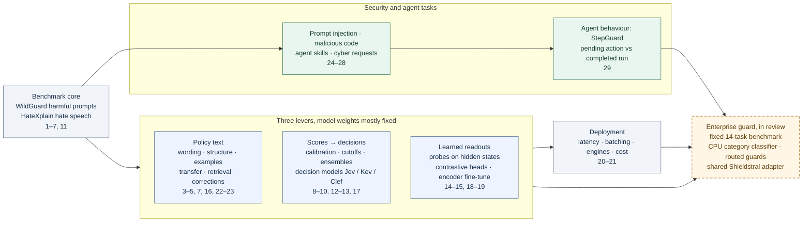

# Safeguard Eval

**An open research notebook on building and evaluating policy-driven moderation, from single classifiers to an enterprise guard system.**

A moderation system is more than a model. It is a **written policy**, a **model that interprets it**, and a **decision rule** that turns the model's score into ALLOW, BLOCK or REVIEW. This repository studies how those three parts interact. It asks which changes improve outcomes, and how to measure that honestly enough to trust it in deployment.

The work started with harmful-request and hate-speech classification. It then moved to prompt injection, malicious code and agent skills, cyber requests and agent behaviour, and is now assembling these into a single **enterprise guard**: a fixed multi-task benchmark, a CPU classifier that sorts each request by risk category, and a serving layer that routes every request to a policy model.

*Maintained by [Harsh Singhal](https://www.linkedin.com/in/harshsinghal). Exploratory research on public benchmarks. The paper is an author-review draft, not peer reviewed.*

[Key findings](#key-findings) · [Research map](#experiment-map) · [How we evaluate](#how-we-evaluate) · [Results](#current-leaderboard) · [Study index](#study-index) · [In progress](#work-in-progress-the-enterprise-guard) · [Where to start](#where-to-start) · [Full experiment log](docs/EXPERIMENT-LOG.md)

## Key findings

- **Policy text changes outcomes, but not portably.** Definitions, examples and document structure changed decisions with model weights fixed. An edit that helped one model often hurt another. On HateXplain, removing the same four examples raised Shieldstral from 52.4% to 61.0% accuracy and cut Qwen 4B from 72.5% to 61.8%. [Policy structure](docs/hatexplain/READOUT.md) · [Transfer](docs/policy-transfer/READOUT.md)
- **No model wins everywhere.** On harmful requests, a 3B specialist matched general LLMs nine times its size. That strength did not carry over to injections, skills or agent actions, and a different system led almost every benchmark below. [Model directory](docs/models/README.md)
- **The decision rule is half the result.** Re-choosing Shieldstral's score cutoff on HateXplain moved accuracy from 53.2% to 79.6% with no policy or weight change. Ensembles rarely beat a well-calibrated single model, and adding more models did not reliably help. [Calibration and ensembles](docs/ensemble/READOUT.md) · [Smart ensemble](docs/smart-ensemble/README.md)
- **One accuracy number hides the errors that matter.** Systems with similar scores make very different mixes of wrongful blocks and missed violations. We report both, and the choice of metric changes which configuration wins. [Metric guide](docs/leaderboard/METRICS.md)
- **Deployment is part of the evaluation.** Input length and queueing affected latency far more than the choice of inference engine. Runtime and batching changes also flipped some decisions near the cutoff. [Serving](docs/serving/README.md) · [Cloud GPU and prompt length](docs/cloud-serving/README.md)

**The practical conclusion:** policy authoring and AI engineering are one discipline. Version the policy together with the model, adapter and cutoff that interpret it. Tune on development data, select on validation, and measure once on held-out cases that reflect the rules you actually intend.

## Experiment map

The research has a **benchmark core**, three **levers** that can improve a moderation system, an expansion into **security and agent tasks**, and a **deployment** track. These now feed the enterprise guard work in review. Boxes are groups of studies; numbers refer to entries in the [study index](#study-index).

Arrows connect research questions, not one shared pipeline: studies use different populations and validation protocols. The [full experiment log](docs/EXPERIMENT-LOG.md#experiment-map) keeps the original, detailed per-study map.

## How we evaluate

Every completed study follows the same contract. Most of the repository's value is in sticking to it:

1. **Register the plan** before running: populations, candidates, selection objective and stopping rules.
2. **Fit** policies, cutoffs or heads on development data only.
3. **Select** on a separate validation set and **freeze** the choice, publishing it before any test inference.
4. **Test once.** A test result never replaces the frozen selection, even when another configuration scored higher.
5. **Report both errors**: false blocks *and* missed violations, plus balanced accuracy and paired uncertainty intervals. Failed, unparseable or timed-out outputs count as wrong. They are never dropped or credited as REVIEW.
6. **Keep everything**: failed attempts, amendments, negative results, GPU/API cost and resource clean-up. Each study ships a dated evidence bundle under [`published_runs/`](published_runs) that reproduces its metrics on CPU.

The limits are stated up front. These are public benchmarks that have been reused many times. Candidate pools and development budgets differ between models. Prior training exposure is unknown. Several newer task labels are synthetic or AI-drafted. Treat small differences as unresolved unless the paired interval says otherwise.

## Current leaderboard

Each benchmark is a separate population with its own task policy, and results are **not pooled**. The table shows the leading frozen selections. Full rankings, intervals and the systems that regressed are on the [leaderboards page](docs/leaderboard/CURRENT.md).

| Benchmark (test size) | Task | Leading frozen selections, balanced accuracy | Notes |
|---|---|---|---|
| [WildGuardTest](docs/leaderboard/CURRENT.md#wildguardtest-prompt-harmfulness) (1,699) | Block harmful requests | Specialist log-odds ensemble **91.08%** · CoPE 90.58% · Shieldstral 3B 90.26% · WildGuard 7B 89.81% | Top entries are within each other's intervals |
| [HateXplain](docs/leaderboard/CURRENT.md#hatexplain-hate-versus-non-hate) (1,924) | Hate vs. non-hate | Mixed logistic ensemble **79.35%** · Jev 1.14 78.40% · Shieldstral 77.02% | ~20% false-block and miss rates remain |
| [Prompt injection](docs/leaderboard/CURRENT.md#prompt-injection-separate-benchmark-populations) (2,697, four sets) | Instruction-boundary attacks | xTRam1: Clef **95.35%** · PolicyLM 95.32% | Rankings change across Deepset, benign lookalikes and jailbreaks |
| [Malicious code](docs/leaderboard/CURRENT.md#code-files) (160) | Static source-file screening | Fine-tuned Liquid 350M **91.25%** · Jev 90.00% | Labels largely model-assisted |
| [Agent-skill text](docs/leaderboard/CURRENT.md#agent-skill-text) (1,384) | Malicious skill screening | Char TF-IDF **70.19%** · Liquid 65.06% · best prompted model 61.86% | Hardest task here; prompted models miss most attacks |
| [Cyber requests](docs/leaderboard/CURRENT.md#cyberseceval-derived-requests-330-with-165-per-class) (330) | Abuse vs. legitimate admin | Best prompted: Kev **84.55%** · Jev / Shieldstral 83.33% | Trained heads score ~100% by learning source cues |
| [Skill packages](docs/leaderboard/CURRENT.md#malskillbench-text-packages-512-with-256-per-class) (512) | Complete package screening | Jev **95.51%** · Clef 90.82% | Mostly generated packages |
| [StepGuard agent behaviour](docs/security-cognition/STEPGUARD-RESULTS.md) (865 / 894) | Pending action / completed run | Jev **83.93% / 93.26%** · next best 69.58% / 77.78% | Synthetic reference judgments |

## Study index

Twenty-nine completed studies, grouped by question. Each line gives the one-sentence takeaway. The [experiment log](docs/EXPERIMENT-LOG.md) has the full write-up, numbers, caveats and evidence links for each.

**Benchmark core and policy text**

| # | Study | Takeaway |
|---:|---|---|
| 1 | [Custom platform rules](DEMO.md) | Classifying clear cases and routing ambiguous ones to REVIEW are different skills. |
| 2 | [Early prompt-injection tests](published_runs/2026-10-24-injection/README.md) | A model–label disagreement can expose a benchmark that lacks the context its rule needs. |
| 3 | [WildGuard policy tuning](docs/wildguard/METHODS.md) | Edited text lifted Shieldstral from 87.9% to 90.8%, but a cutoff-only control explained most of it. |
| 4 | [Nearby-size Qwen models](docs/qwen-policy/READOUT.md) | Small specialists beat nearby-size general LLMs; Qwen 27B stayed competitive. |
| 5 | [Policy transfer](docs/policy-transfer/READOUT.md) | A policy that helps one model can hurt another by 5–10 points. |
| 6 | [Frontier API pilot](docs/frontier-api/READOUT.md) | Whether an API returns a usable classification is part of the system being evaluated. |
| 7 | [HateXplain policy structure](docs/hatexplain/READOUT.md) | The same definitions, examples and layout helped some models and hurt others. |
| 16 | [Corrections from training errors](docs/policy-corrections/README.md) | A plausible fix failed on its source model and helped a different one. |
| 22 | [Retrieved examples](docs/retrieved-examples/README.md) | Nearest-neighbour examples hurt the specialists and barely helped decision models. |
| 23 | [Retrieval optimization](docs/retrieval-optimization/README.md) | Better retrieval repaired losses but still did not reliably beat policy alone. |

**Scores, cutoffs and combinations**

| # | Study | Takeaway |
|---:|---|---|
| 8 | [Probability ensembles](docs/ensemble/READOUT.md) | Calibrate the single model first; ensembles rarely beat it. |
| 9 | [Log-odds ensembles](docs/ensemble-logits/RESULTS.md) | Gains came with a shift between false blocks and misses, not fewer errors. |
| 10 | [Jev decision API](docs/jev/READOUT.md) | A decision model was competitive without fine-tuning; detail and examples helped. |
| 11 | [Balanced evaluation](docs/leaderboard/README.md) | Selecting for balanced accuracy changed which policy and cutoff won. |
| 12 | [Kev and Clef](docs/decision-models/README.md) | More detailed policy text was not uniformly better for open decision models. |
| 13 | [Decision-model ensembles](docs/decision-ensemble/README.md) | Combining Jev, Kev and Clef gave small, uncertain gains. |
| 17 | [Smart ensembles](docs/smart-ensemble/README.md) | Measure which models complement each other; on WildGuard, selection kept Shieldstral alone. |

**Learned readouts**

| # | Study | Takeaway |
|---:|---|---|
| 14 | [PolicyLM / Qwen probes](docs/activation-probe/README.md) | A linear probe on frozen features beat the native score; combining models did not help. |
| 15 | [Shieldstral / Qwen probes](docs/shield-probe/README.md) | The native score was already as good as a learned head. |
| 18 | [Contrastive heads](docs/contrastive-heads/README.md) | Contrastive training did not beat a linear head. |
| 19 | [Liquid encoder fine-tuning](docs/liquid-finetune/README.md) | Fine-tuning beat its frozen control by 4 points but stayed below the best earlier systems. |

**Deployment**

| # | Study | Takeaway |
|---:|---|---|
| 20 | [Serving seven systems on an L40S](docs/serving/README.md) | Shared-policy prefix caching gave Shieldstral 6.6× throughput; batching shifted some decisions. |
| 21 | [L4 GPU, vLLM vs SGLang](docs/cloud-serving/README.md) | Engines performed alike; prompt length and queueing dominated latency. |

**Security and agent behaviour**

| # | Study | Takeaway |
|---:|---|---|
| 24 | [Prompt injection, four populations](docs/prompt-injection/README.md) | Attack detection and benign-lookalike false blocks trade off; there is no single security ranking. |
| 25 | [Malicious code and skills](docs/malicious-artifacts/README.md) | Code screening works reasonably; skill screening is much harder for every system. |
| 26 | [Code embeddings and Qwen](docs/artifact-representations/README.md) | Small code-embedding heads matched Qwen 9B on code, but no system improved on skills. |
| 27 | [Cyber assistance requests](docs/cyber-skill-guardrails/README.md) | Trained heads exploit source cues; prompted models land at 60–85%. |
| 28 | [Complete skill packages](docs/cyber-skill-guardrails/README.md) | Companion files helped: Jev scored 95.5% on full packages vs 88.1% on SKILL.md alone. |
| 29 | [StepGuard agent behaviour](docs/security-cognition/STEPGUARD-RESULTS.md) | Most models judged completed runs better than pending actions; Jev led both by a wide margin. |

## Work in progress: the enterprise guard

The current direction combines the findings above into a deployable system. It has three requirements: every request gets a policy check, the policy is supplied by the application, and quality is measured on one fixed multi-task benchmark. This work is in open pull requests and has **not been merged**. Treat it as under review.

| Piece | Status | What it shows so far |
|---|---|---|
| [#4 Enterprise moderation benchmark](https://github.com/harshsinghal/safeguard-eval/pull/4) | In review | A frozen 983-case, 14-task suite (plus 192 calibration cases) with task-aware scoring and normative domain weights. Many labels are synthetic or AI-drafted and still await review. |
| [#5 CPU category classifier](https://github.com/harshsinghal/safeguard-eval/pull/5) | In review, stacked on #4 | Liquid 350M sorts inputs into 7 risk categories at 89.2% (FP32, ~128 ms on CPU) or 88.5% (INT8, ~60 ms). It struggles on sources it never trained on, such as benign lookalikes and jailbreaks. |
| [#6 Routed guard serving layer](https://github.com/harshsinghal/safeguard-eval/pull/6) | In review, stacked on #5 | A working gateway in which every request reaches a guard model and an error never becomes ALLOW. Routing scored 72.3% vs 75.0% for Clef alone on a 112-case pilot. That result is **inconclusive**: the interval is wide and the routing map was chosen on thin calibration data. |
| Shared Shieldstral adapter | Branch, no PR yet | One fine-tuned adapter across ten tasks raised the equal-task score from 70.9% to 80.7%, but lost hate-speech recall. A follow-up round found no candidate worth promoting. |
| [#3 Local RTX 5090 reproduction](https://github.com/harshsinghal/safeguard-eval/pull/3) | In review | Fresh Shieldstral inference reproduced 243 of 244 historical test decisions. |

**Open questions:** whether to route on the application's policy rather than on content, whether to send each request to two guards rather than one, and how to build reviewed labels covering every check that applies to an input. See the [research directions](docs/research-directions/README.md).

## What the evidence suggests for moderation teams

- **Version the policy with the system that interprets it.** Keep the model revision, native adapter, output mapping and decision cutoff alongside the policy text. If examples are retrieved, also version the labelled library, encoder and selection rule. Replacing the model requires another evaluation.
- **Review meaning as well as scores.** Definitions, exceptions and examples express a policy owner's intent. A higher aggregate score does not justify silently narrowing that intent or ignoring a costly type of error.
- **Build a benchmark for the boundary you care about.** Include compliant lookalikes and difficult violations. Use training examples for authoring, validation for selection, and a separate test for the final assessment. Inspect errors by category as well as in aggregate.
- **Test the serving configuration, not just the classifier.** Batching and shared-policy caching change throughput and waiting time, and operational repeats have changed decisions even at temperature zero. A fast response and a correct response are separate requirements.
- **Consider specialists, general LLMs and decision models.** Different systems led on different tasks. Small models can be useful, but neither size nor family guarantees the outcome. Ensembles add inference and maintenance costs that a quality-only table does not show.

These experiments do **not** show that policies never transfer, that specialists always win, or that fine-tuning is unnecessary. They establish no enterprise-data, multilingual or image-moderation benchmark.

## Where to start

| If you are… | Start with |
|---|---|
| **A policy or trust & safety lead** | The [engineering guide](docs/engineering-guardrails/README.md) (also as Word), then [policy transfer](docs/policy-transfer/READOUT.md) and [HateXplain structure](docs/hatexplain/READOUT.md) |
| **An ML researcher** | The [paper draft](research-preprint/README.md) (v0.6; covers studies 1–12), the [experiment log](docs/EXPERIMENT-LOG.md) and the [metric guide](docs/leaderboard/METRICS.md) |
| **An engineer deploying a guard** | The [self-hosting guide](docs/cloud-serving/DEPLOYMENT.md), the [serving study](docs/serving/README.md) and the [model directory](docs/models/README.md) |
| **Reproducing or auditing a result** | The study's bundle under [`published_runs/`](published_runs). Each has reproduction steps and checksums. Also see [datasets](docs/datasets/README.md) and [compute and cost](docs/COMPUTE.md) |
| **Asking questions through an AI agent** | The [Safeguard Eval skill](skills/safeguard-eval/README.md) for Codex, Claude Code or Pi. Release v0.5.0 covers studies 1–9. |
| **Looking for what's next** | The [research directions](docs/research-directions/README.md) and the [proposals for reducing moderation errors](docs/research-directions/REDUCING-MODERATION-ERRORS.md) |

## Repository layout

| Path | Contents |
|---|---|
| [`docs/`](docs) | One folder per study: readout, plan, methods and results. Also the [experiment log](docs/EXPERIMENT-LOG.md), [leaderboards](docs/leaderboard/CURRENT.md), [datasets](docs/datasets/README.md), [models](docs/models/README.md) and [research directions](docs/research-directions/README.md) |
| [`published_runs/`](published_runs), [`reports/`](reports) | Immutable, dated evidence bundles: policies, frozen selections, predictions, provenance and cost |
| [`evals/`](evals), [`tools/`](tools), [`tests/`](tests) | Experiment runners, verification and packaging scripts, and the test suite |
| [`policies/`](policies) | Policy documents used in the studies |
| [`research-preprint/`](research-preprint) | *Policy as an Interface*: review-draft PDF, text and LaTeX source |
| [`skills/`](skills) | The installable agent skill and its pinned evidence |
| [`app.py`](app.py), [`DEMO.md`](DEMO.md) | The original Flask policy demo (Groq, DiffusionDB) |

Contributors should follow the [notebook maintenance guide](docs/RESEARCH-NOTEBOOK.md): new studies get an evidence bundle, a readout, an experiment-log entry and a study-index line, and frozen results are never rewritten.

---

Have a proposed policy, benchmark, replication or correction? [Open an issue](https://github.com/harshsinghal/safeguard-eval/issues) with the task, the intended decision boundary, and the evidence needed to evaluate the claim. Linked models and datasets keep their publishers' terms.
