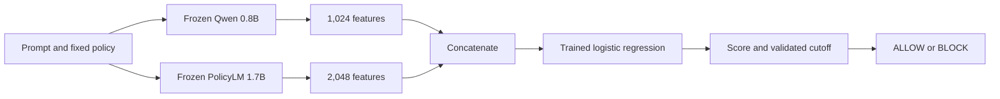

# Can two small models' internal representations improve moderation?

This experiment asks whether useful information remains inside a model even when
its usual classification output misses it. We read fixed representations from
Qwen3.5-0.8B and PolicyLM-1.7B, then train a small logistic-regression classifier.
The main question is whether combining the two representations helps more than
using either one alone.

**Status: experiment in progress.** The protocol, implementation and development
extraction checks are recorded. No test results have been scored yet.

## What changes, and what stays fixed

The language models keep their published weights. The policy also stays fixed:
we use the compact harmfulness policy previously selected for PolicyLM. Qwen
receives its rules as a system prompt; PolicyLM receives its native category
fields. Neither model generates a written answer in this experiment.

For each prompt, Qwen supplies 1,024 numbers and PolicyLM supplies 2,048. The
combined classifier sees the two vectors side by side: 3,072 input features.
It learns how to weight those features from labeled training examples. A cutoff
chosen on validation converts its score into ALLOW or BLOCK.

This is supervised classifier training with frozen representations. It needs
labeled examples and a new classifier artifact. It is different from deploying
a policy text with an otherwise unchanged moderation model.

## The comparison that matters

We compare four primary methods: Qwen features alone, PolicyLM features alone,
their concatenation, and PolicyLM's native score. Every method gets a
validation-selected cutoff. The native score is recomputed in the current
runtime so that small differences from older inference runs do not masquerade
as gains from classifier training.

The primary features come from the final layer. A secondary, bounded search
tries three depths and two pooling methods per model. For Qwen, pooling uses
the submitted-content mean or final input token. For PolicyLM, it uses the
native category position or native content-aligned mean. Long messages remain
one training example: their native window representations are averaged.

The secondary combined classifier uses representations selected separately for
each model on validation. We do not search every possible pairing or select a
winner from test scores.

## How the data are separated

| Role | Prompts | Use |
|---|---:|---|
| Fitting | 4,096 | Learn scaling and classifier coefficients |
| Validation | 1,536 | Choose regularization, representations and cutoffs |
| WildGuardTest | 1,699 | Measure the frozen choices |

These are the exact populations from the first ensemble study. Identifiers,
text hashes and recorded duplicate groups do not cross the three splits.
Only submitted prompt text is classified, not assistant responses. The test
has 754 harmful and 945 benign prompts; the same 26 unlabeled source records
are excluded as in earlier studies.

Balanced accuracy gives equal weight to catching harmful prompts and allowing
benign prompts. We also report both error counts/rates, ordinary accuracy,
macro-F1, MCC, score metrics and category slices. Separate validation selections
target at most 5% false blocks or at least 90% harmful recall; test performance
determines whether those targets actually hold.

## What this study can establish

A combined classifier must improve on both single-representation controls to
justify running two encoders. Beating a native head alone would show the value
of task-specific supervised training, not necessarily the value of combination.
Layer selection may matter, but a useful predictive layer does not locate the
cause of policy understanding.

This pilot fixes one harmfulness policy. It does not test whether the learned
classifier follows a newly edited policy, transfers to HateXplain, or generalizes
to enterprise access rules. The models differ in architecture, training, input
format, cleaning and size; their comparison cannot isolate any one of those
factors. The public test has already been examined in earlier experiments, so
this is an exploratory follow-up with a new pre-test freeze, not a pristine blind
evaluation. Prior exposure of either checkpoint to public data is unknown.

[Registered protocol](PLAN.md) · [Implementation notes](NOTES.md) ·
[Reproduction instructions](RUNNING.md) · [Metric definitions](../leaderboard/METRICS.md)
