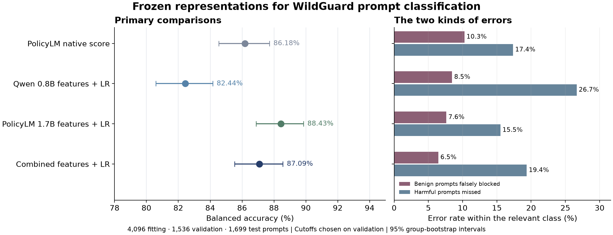
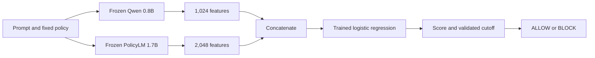

# Can two small models' internal representations improve moderation?

This experiment asks whether useful information remains inside a model even when
its usual classification output misses it. We read fixed representations from
Qwen3.5-0.8B and PolicyLM-1.7B, then train a small logistic-regression classifier.
The main question is whether combining the two representations helps more than
using either one alone.

**The useful result came from PolicyLM alone.** A classifier trained on its final
representation improved over its native score at validation-selected cutoffs.
Adding Qwen's representation reduced performance. None of the new classifiers
exceeded the archived WildGuard model or our earlier specialist score ensemble.

## What we found

All rows below use the same 1,699 test prompts. Cutoffs and regression settings
were selected on validation before the test pass. There were no unresolved cases.

| Primary method | Balanced accuracy | Ordinary accuracy | False blocks / 945 benign | Misses / 754 harmful |
|---|---:|---:|---:|---:|
| PolicyLM native score, tuned cutoff | 86.18% | 86.58% | 97 | 131 |
| Qwen final-layer features + logistic regression | 82.44% | 83.46% | 80 | 201 |
| **PolicyLM final-layer features + logistic regression** | **88.43%** | **88.88%** | **72** | **117** |
| Combined final-layer features + logistic regression | 87.09% | 87.82% | 61 | 146 |

The PolicyLM feature classifier made **25 fewer false blocks and 14 fewer misses**
than the native-score control. Its balanced-accuracy gain was 2.25 percentage
points, with a descriptive paired 95% interval of +1.21 to +3.35 points.

Adding Qwen produced **11 fewer false blocks but 29 more misses** than the
PolicyLM feature classifier. That trade-off lowered balanced accuracy by 1.34
points (paired interval −2.21 to −0.49). The combined method did not meet the
experiment's main hypothesis: it failed to improve on the stronger single model.

The score-ranking result adds nuance. Native PolicyLM had AUROC **0.9418**;
the PolicyLM feature classifier had **0.9403**, and the combined classifier
**0.9396**. The observed classification gain therefore does not establish better
ranking of harmful versus benign prompts. It supports the usefulness of a
task-specific readout at the selected operating point.

These intervals reuse the same 2,000 duplicate-group bootstrap draws. They are
exploratory and unadjusted for multiple comparisons, policy history or model
selection. The complete metrics, selections and additional descriptive contrasts
are in the [frozen results](../../published_runs/2026-10-30-activation-probe/RESULTS.md).

## Searching layers helped validation more than test

The secondary search preferred Qwen layer 12 and PolicyLM layer 21. Its test
balanced accuracies were **83.11%** for Qwen, **86.80%** for PolicyLM and
**86.85%** for their combination. These secondary results do not replace the
registered primary comparison.

PolicyLM illustrates the risk of assuming a validation improvement will carry
over. The selected earlier-layer probe reached 95.39% on validation, compared
with 94.96% for the final-layer probe. On test, it fell behind: 86.80% versus
88.43%. Qwen's earlier-layer gain on test was only 0.67 points, with an interval
that included no difference. We evaluated only frozen selections on test; we
did not search all cached test layers for a better result.

For context, the archived WildGuard 7B model reached **89.81%** and the earlier
PolicyLM/Shieldstral/CoPE equal-log-odds ensemble **91.08%** on these same test
prompts. Those methods used their prior validation procedures. This new study
uses 1,536 validation examples and remains separate from the common-validation
leaderboard; these historical comparisons do not equalize search budgets.

## A useful aggregate score is not a deployment guarantee

Only one of seven configurations selected under the **5% false-block constraint
on validation** stayed below that limit on test: the primary Qwen probe, with
4.55% false blocks but only 63.26% harmful recall. None of the seven selections
under the separate **90% validation-recall constraint** achieved 90% test recall.
This statement concerns those specific selection profiles, not every possible
cutoff. No test cutoffs were retuned to rescue a target.

For a moderation team, the promising follow-up is a lightweight classifier on
one frozen specialist model, evaluated against the team's actual error budgets.
This experiment provides no reason to add the second encoder for balanced
accuracy on this task. A new dataset or policy could change that finding.

## What changes, and what stays fixed

The language models keep their published weights. The policy also stays fixed:
we use the compact harmfulness policy previously selected for PolicyLM. Qwen
receives its rules as a system prompt; PolicyLM receives its native category
fields. Neither model generates a written answer in this experiment.

For each prompt, Qwen supplies 1,024 numbers and PolicyLM supplies 2,048. The
combined classifier sees the two vectors side by side: 3,072 input features.
It learns how to weight those features from labeled training examples. A cutoff
chosen on validation converts its score into ALLOW or BLOCK.

This is supervised classifier training with frozen representations. It needs
labeled examples and a new classifier artifact. It is different from deploying
a policy text with an otherwise unchanged moderation model.

## The comparison that matters

We compare four primary methods: Qwen features alone, PolicyLM features alone,
their concatenation, and PolicyLM's native score. Every method gets a
validation-selected cutoff. The native score is recomputed in the current
runtime so that small differences from older inference runs do not masquerade
as gains from classifier training.

The primary features come from the final layer. A secondary, bounded search
tries three depths and two pooling methods per model. For Qwen, pooling uses
the submitted-content mean or final input token. For PolicyLM, it uses the
native category position or native content-aligned mean. Long messages remain
one training example: their native window representations are averaged.

The secondary combined classifier uses representations selected separately for
each model on validation. We do not search every possible pairing or select a
winner from test scores.

## How the data are separated

| Role | Prompts | Use |
|---|---:|---|
| Fitting | 4,096 | Learn scaling and classifier coefficients |
| Validation | 1,536 | Choose regularization, representations and cutoffs |
| WildGuardTest | 1,699 | Measure the frozen choices |

These are the exact populations from the first ensemble study. Identifiers,
text hashes and recorded duplicate groups do not cross the three splits.
Only submitted prompt text is classified, not assistant responses. The test
has 754 harmful and 945 benign prompts; the same 26 unlabeled source records
are excluded as in earlier studies.

Balanced accuracy gives equal weight to catching harmful prompts and allowing
benign prompts. We also report both error counts/rates, ordinary accuracy,
macro-F1, MCC, score metrics and category slices. Separate validation selections
target at most 5% false blocks or at least 90% harmful recall; test performance
determines whether those targets actually hold.

## What this study can establish

A combined classifier must improve on both single-representation controls to
justify running two encoders. Beating a native head alone would show the value
of task-specific supervised training, not necessarily the value of combination.
Layer selection may matter, but a useful predictive layer does not locate the
cause of policy understanding.

This pilot fixes one harmfulness policy. It does not test whether the learned
classifier follows a newly edited policy, transfers to HateXplain, or generalizes
to enterprise access rules. The models differ in architecture, training, input
format, cleaning and size; their comparison cannot isolate any one of those
factors. The public test has already been examined in earlier experiments, so
this is an exploratory follow-up with a new pre-test freeze, not a pristine blind
evaluation. Prior exposure of either checkpoint to public data is unknown.

## Reproduction and cost

All **70 candidate fits reproduced exactly**, including their coefficient arrays
and validation probabilities. An independent check reproduced all validation
choices, test operating points, category slices and paired intervals. The
pre-test freeze is commit `f2162df`; the registered plan remains unchanged after
that freeze, with completion tracked in [progress.json](progress.json).

The run cost **$0.38** on one GPU.ai RTX6000 Ada, including setup and failed
development attempts. The instance was terminated, temporary SSH credentials
were removed, and cumulative experiment spending is **$14.18 of the $20 cap**.
RunPod was not needed. These are compute charges, excluding engineering time.
This is a deployment record, not a provider endorsement.

In the recorded extraction implementation, median per-example time was about
**37 ms for PolicyLM** and **144 ms for Qwen**. These include tokenization and
pooling and exclude model loading. Qwen used fallback Torch kernels, and
PolicyLM retained native cleaning, windowing and head computation. They are
not production serving benchmarks or hardware-minimum claims. The private
feature caches permit future CPU analysis without another paid extraction.

The [public evidence bundle](../../published_runs/2026-10-30-activation-probe/README.md)
contains prompt-free predictions, all validation candidates, classifier
coefficients, source snapshots, runtime records and checksums. Source text and
pooled embeddings remain private. The reproduction guide explains how an
authorized dataset user can reconstruct the exact inputs.

[Registered protocol](PLAN.md) · [Implementation notes](NOTES.md) ·
[Reproduction instructions](RUNNING.md) · [Metric definitions](../leaderboard/METRICS.md)
