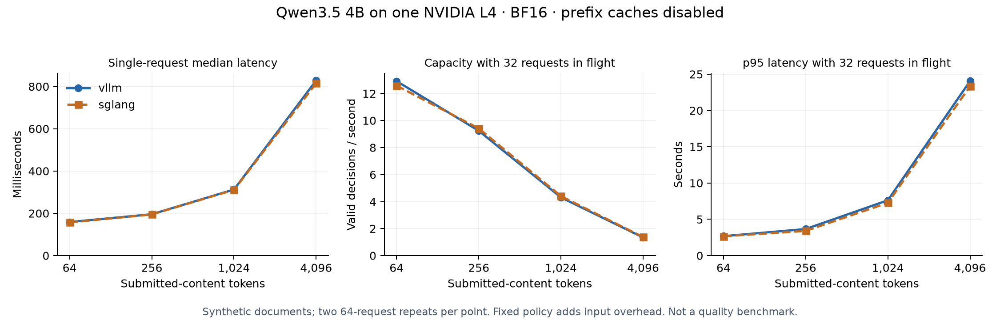

# Hosting moderation models: the workload matters more than the engine label

**On this L4 pilot, vLLM and SGLang delivered similar Qwen performance. Longer
inputs and concurrent traffic changed the experience much more.** The study also
found setup and output differences that a team would need to resolve before
changing its production runtime.

This follows the [seven-model L40S study](../serving/README.md). That study covered
specialist policy models, a general LLM, WildGuard, open decision models and a
fine-tuned Liquid classifier. This follow-up focuses on Qwen3.5 4B, with a
separate Shieldstral 3B scoring-compatibility check. It does not rerun all seven
systems or update their accuracy leaderboard.

## Why an L4?

The 24 GB NVIDIA L4 is offered in [AWS G6](https://aws.amazon.com/ec2/instance-types/g6/)
and [Google Cloud G2](https://docs.cloud.google.com/compute/docs/accelerator-optimized-machines).
We rented one through GPU.ai at $0.59/hour. We did not access AWS or Google Cloud.
The measured GPU reported 23,034 MiB and a 72 W power limit. The advertised
four-core, 19 GB host had an enforced 3.4-core CPU quota.

Matching the GPU gives a useful starting point for cloud planning. It does not
reproduce a cloud VM's CPU/RAM allocation, network, availability, autoscaling or
price. These are local HTTP measurements on one rented machine, not measured
AWS/GCP service performance or a provider recommendation.

## A one-letter answer can still take time

We kept the historical policy and Qwen model revision fixed. Both engines
received identical token IDs and generated the same A/B classification format,
with thinking disabled, BF16 precision and an eight-token output limit. The
length workload consisted of neutral synthetic documents; they had no
benchmark labels. This measures serving behavior, not long-document accuracy.

Each engine tried two processing-chunk sizes on 64 unmodified fitting prompts.
Both selected 2,048 tokens. We then measured four content lengths and an equal
mixture of those lengths, with one, eight or 32 requests in flight. Each point
has two 64-request repeats. Prefix caches were disabled.

| Submitted content | vLLM median, one request | SGLang median, one request | vLLM decisions/s, 8 in flight | SGLang decisions/s, 8 in flight |
|---:|---:|---:|---:|---:|
| 64 tokens | 159 ms | 157 ms | 11.68 | 11.97 |
| 256 tokens | 196 ms | 195 ms | 8.83 | 8.80 |
| 1,024 tokens | 313 ms | 311 ms | 4.31 | 4.27 |
| 4,096 tokens | 829 ms | 815 ms | 1.34 | 1.36 |

The policy and template added **402 tokens**. A 64-token submission therefore
became a 466-token model input; a 4,096-token submission became 4,498 tokens.
Measure the full input, not just the user's text.

Batching helped short submissions: vLLM processed about 6.3 per second alone
and 11.7 with eight requests in flight. For long submissions, capacity rose only
from about 1.21 to 1.34 per second, while median waiting time rose from **0.83 to
6.08 seconds**. At 32 in flight, long-input p95 latency was about 24 seconds.
SGLang showed a similar pattern. Maximum concurrency is not an interactive
service setting by default.

At the experiment's rental rate, sustained vLLM traffic at concurrency eight
implied roughly **$14 per million short classifications** or **$122 per million
long classifications**. These exclude network and engineering costs and assume
the measured utilization. An instance kept on for a 30-day month at $0.59/hour
costs $424.80 even when mostly idle. These are not AWS or Google Cloud quotations.

## What the engine comparison does—and does not—show

The small timing gaps do not establish a generally superior engine. We tried
two serving settings, one model, one GPU, a fixed engine order and short
measurement passes. Longer tuning, other models, shared-policy caching or
production arrival patterns could change the result.

There is also a quality qualification: **one of 32 natural fitting examples
received a different label across the selected engines**. Within each selected
engine, batching also changed one of those 32 labels. We did not evaluate the
full benchmark's accuracy under these runtimes or isolate the cause of the
disagreements. All 3,840 primary timed requests returned valid classifications;
valid means parseable, not correct.

The engines used different dependency stacks: vLLM 0.32.0 with PyTorch 2.13.0,
and SGLang 0.5.23 with PyTorch 2.14.1. SGLang rejected the initially requested
text-only flag for this architecture, so its accepted runs used the default
wrapper, retaining unused vision weights. Its logs reported about 8.62 GB of
loaded weight memory; vLLM's text-only path reported 7.94 GiB. This compares
deployable configurations, not isolated scheduler code or identical resident
tensors. The initial failures and [amendment](RUNTIME-AMENDMENT.json) are retained.

## A larger processing chunk was not a shortcut

After seeing the length curves, we tested the other registered chunk size,
8,192 tokens, on the same long inputs. This was an exploratory control, and it
did not replace the original selection. Neither engine gained throughput.
At eight requests in flight, vLLM fell from 1.34 to 1.30 classifications/second;
SGLang fell from 1.36 to 1.29.

For vLLM, median latency improved from 6.08 to 5.60 seconds, but p95 worsened
from 6.09 to 6.93 seconds. Looking only at the median would tell an incomplete
story. There were no label changes across the 512 paired control requests, but
these synthetic documents still do not establish moderation accuracy. We tried
one alternative, not an exhaustive search for the best long-input settings.

## Shieldstral: the file format mattered

Shieldstral exposes a yes/no scoring interface. We checked whether both engines
could preserve that interface on 32 original fitting prompts, run serially and
with 16 requests in flight. This was a compatibility check, not another
throughput curve.

The first SGLang attempt rejected the text-only flag. After removing that flag,
its default loader encountered a tensor-name error. The pinned model repository
contains both native Mistral and Hugging Face weight files. We selected only
the published Hugging Face files in a local directory, recorded their hashes,
and retried both engines. We did not transform or fine-tune the tensors.

Both engines then passed: no request errors or batch-induced label changes.
Their serial decisions agreed on all 32 prompts, and the largest score gap was
about **0.000002**. Maximum serial-to-batch score changes were 0.00079 for vLLM
and 0.00128 for SGLang, below the registered 0.02 limit. vLLM's scores were
identical before and after selecting the HF-only directory. These small checks
support this loading path; they do not establish equal full-benchmark accuracy
or Shieldstral performance at production load.

## What to do with this evidence

Choose models that meet your task's error requirements, then measure those
configured systems against your actual prompt lengths and traffic. Define a
waiting-time target before choosing concurrency. Test the effect of shared
policies and cache churn separately. Recheck labels and scores when changing
the engine, tokenizer, numerical precision or batching.

Self-hosting gives control over execution, but the team owns the adapter,
dependencies, loading path, input limits, failure behavior and operating cost.
The [deployment guide](DEPLOYMENT.md) explains those responsibilities and how to
divide them between policy owners and engineers. A prompt classifier operates
alongside source permissions, retrieval checks and tool controls; these
experiments do not validate an enterprise authorization system.

## Cost and completion

The primary comparison and exploratory control completed **68 timed passes and
4,352 valid classifications**, in addition to fitting, warm-up and specialist
checks. The rental cost **$0.62** for 3,765 billed GPU-seconds, including setup,
failed attempts and collection. Cumulative accounted project spend is
**$19.36001787256**, within the $20 authorization. The instance was terminated,
temporary local/provider SSH keys were removed, and the provider listed no
remaining active instances. There were no paid inference API, AWS, GCP or
RunPod resources in this study.

Read the [full operating tables](RESULTS.md), [registered plan and amendments](PLAN.md),
[long-input control plan](LONG-INPUT-CONTROL.md), and [reproduction guide](REPRODUCE.md).
The [frozen evidence bundle](../../published_runs/2026-11-01-cloud-serving/README.md)
contains the traces, selected settings, runtime records, compatibility failures
and cost reconciliation.
