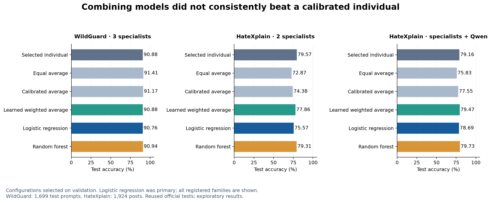

# Does asking several policy models improve moderation?

Imagine two reviewers reading the same post. If they notice different problems, consulting both could improve the decision. But if one reviewer is already more reliable, giving the other an equal say could make things worse.

That is what we tested with policy models. We kept the policies and model weights fixed, then trained a small classifier to combine their scores. **Combining models did not consistently beat a carefully calibrated individual model.** There was a promising result on WildGuardTest, but the HateXplain findings were much less encouraging.

## What we actually ran

For WildGuard, we combined PolicyLM, Shieldstral and CoPE. The separate WildGuard model was the benchmark comparator; its answer was never an ensemble input.

For HateXplain, we first combined the two specialists with existing scores: PolicyLM and Shieldstral. A separate experiment added the general-purpose Qwen 4B model. Each model used the policy previously selected for that model and benchmark, through its existing adapter. We did not write new policies for this experiment. Safeguard was excluded because its archived outputs were categorical decisions rather than numerical scores.

We tried five ways to combine scores: an equal average, an equal average after calibration, a learned weighted average, logistic regression, and a small random forest. Logistic regression was our primary method. It learns how much each model's score should contribute to the final decision. A random forest can learn conditional patterns, such as treating one score differently depending on the other scores.

Each benchmark supplied **4,096 fitting examples and 1,536 validation examples**, excluded from earlier policy development and separated by duplicate group. Fitting taught the combiners their weights or decision rules. Validation selected their settings and blocking thresholds. We froze those choices before evaluating all **1,699 labeled WildGuardTest prompts** and **1,924 HateXplain posts**.

HateXplain's task here is narrow: **block hate speech; allow offensive and normal posts**. Offensive language is therefore not automatically a policy violation. These are binary decisions; we did not test a human-review route.

## The fairest comparison changed the story

An ensemble can look impressive if the individual models use a poor blocking threshold. We therefore gave every individual model the same opportunity to calibrate its score and select a threshold using development data.

This mattered enormously for Shieldstral on HateXplain. With its selected policy and a raw-score cutoff of 0.5, it achieved **53.17% accuracy**. Calibration and threshold selection raised that to **79.57%**, without changing a word of policy or a model weight. A directly tuned raw threshold reached the same test accuracy.

That improvement was not free of trade-offs. False blocks fell from **885 to 177**, but missed hateful posts rose from **16 to 216**. Accuracy rewarded the much larger reduction in false blocks. A team prioritizing hate-speech detection might choose a different operating point.

This is a calibration result, not evidence of better policy authoring. It shows why we must evaluate the policy, model and decision threshold together.

## Did the ensembles win?

The table distinguishes our predeclared primary method from the ensemble selected on validation. The latter is not whichever method happened to score highest on the test.

| Test | Individual selected on validation | Logistic regression: primary | Ensemble selected on validation |
|---|---:|---:|---:|
| WildGuard: three specialists | 90.88% — Shieldstral | 90.76% | 90.88% — weighted average |
| HateXplain: two specialists | 79.57% — Shieldstral | 75.57% | 79.31% — random forest |
| HateXplain: specialists plus Qwen | 79.16% — Qwen | 78.69% | 79.73% — random forest |

**WildGuard: a simple average was promising, but the learned ensemble did not add value.** The weighted average assigned **99.4% of its weight to Shieldstral** and made exactly the same test decisions as the calibrated Shieldstral individual. Logistic regression was two correct answers worse.

The equal raw-score average, another registered comparison, reached **91.41%**. That was above the separate WildGuard model's **90.35%**, a difference of **1.06 percentage points**. Its unadjusted paired 95% interval was **+0.24 to +1.88 points**. Against calibrated Shieldstral, the gain was only **0.53 points**, with an interval of **−0.12 to +1.18**.

The equal average was not the ensemble selected on validation. This secondary result is worth following up, but it does not establish that a learned ensemble beats the strongest individual. Validation accuracy also overstated test accuracy substantially in this benchmark: the selected individual scored 98.70% on validation and 90.88% on test. We cannot assume a combiner chosen on those development examples will rank the same way on a different population.

**HateXplain: the specialist ensemble did not beat Shieldstral.** Logistic regression lost **4.00 percentage points**, with a paired interval of **−5.56 to −2.54**. It corrected 75 of Shieldstral's errors but introduced 152 new ones. The validation-selected random forest came closer, finishing five correct answers behind Shieldstral.

**Adding Qwen produced a small, uncertain gain.** The mixed random forest reached **79.73%**. That was 11 correct answers ahead of the validation-selected Qwen individual, but only **three** ahead of Shieldstral, the strongest individual observed on this test. The latter difference was **0.16 points**, with a descriptive interval of **−1.14 to +1.51**. That is too uncertain to call a reliable improvement over the best individual.

## Three extra correct answers can hide a different policy outcome

The mixed random forest made **135 false blocks and missed 255 hateful posts**. Calibrated Shieldstral made **177 false blocks and missed 216 hateful posts**.

So the forest's three-answer advantage came from **42 fewer false blocks offset by 39 more missed hateful posts**. Its macro-F1 was also lower: **74.73% versus 75.62%**. A moderation team could reasonably prefer Shieldstral despite the forest's slightly higher accuracy.

The models did have complementary strengths. Calibrated PolicyLM correctly handled 134 HateXplain posts that calibrated Shieldstral got wrong. But Shieldstral correctly handled 276 that PolicyLM got wrong. Knowing that useful disagreements exist does not mean a combiner can reliably identify which model to trust using only their scores.

## What this adds to our research

The evidence does not support a general recommendation to add more models. For these fixed policies and development samples, a well-chosen individual was a strong baseline. More complex combinations sometimes damaged performance, and the small gains came with different error trade-offs and additional model evaluations.

For practitioners, the useful sequence is to test the authored policy with its intended model, choose the error trade-off explicitly, calibrate the decision threshold, and then ask whether another model contributes enough complementary value to justify the cost. If an ensemble is used, its weights and thresholds belong in the same versioned release as the policies and model adapters.

This study does not directly measure another gain from policy editing: the policies were frozen. It strengthens the broader message that governance outcomes depend on the entire configured system. It also introduces a small supervised training step, so this approach still requires labeled examples.

## How much confidence should we place in this?

These are exploratory follow-ups on official tests already used in our earlier studies. We excluded earlier policy-development groups from the new fitting and validation sets, but that does not make the tests newly unseen. Upstream model exposure to public benchmarks is also unknown.

The intervals describe uncertainty from resampling these test groups. They do not account for all the earlier policy searches or the many methods compared. We did not measure production latency, enterprise performance, multilingual coverage, or review routing. Serving an ensemble requires two or three model evaluations per item in this implementation; we did not establish that the small gains justify that operational cost.

The new GPU work produced **16,992 scores**, including 96 consistency checks. There were no inference errors, and all 32 consistency-check scores per model exactly matched the earlier runs. WildGuard and official-test scores were reused. The GPU was terminated after **691 billed seconds**, costing **$0.38** and bringing cumulative spending to **$12.50 of $20**.

See the [complete method-by-method results](RESULTS.md), [original plan](PLAN.md), [execution notes](NOTES.md), and [reproducible evidence](../../published_runs/2026-10-27-ensemble/README.md). All failed comparisons are retained alongside the promising ones.
