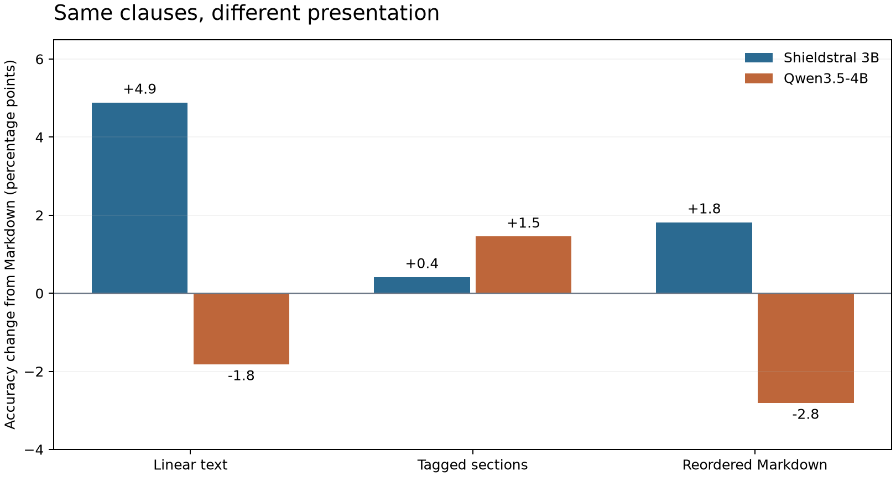
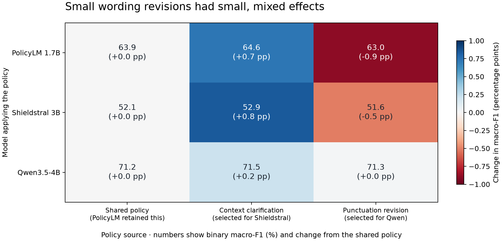

# The same policy edit can help one model and hurt another

*HateXplain study · 26 October 2026 · policy text changed; model weights stayed fixed*

A policy document is part of a moderation system's behavior. Changing its examples,
definitions, or presentation can change which posts the system blocks—even when
the intended rule stays the same. Our new experiment makes that relationship
visible beyond the harmful-prompt task in our earlier WildGuard studies.

The clearest result was a reversal: removing the same four examples improved
Shieldstral's accuracy and reduced Qwen's. Rearranging the presentation also had
different effects across models. The smaller wording revisions we generated,
however, produced little improvement. That distinction matters: this study shows
sensitivity to authoring choices more clearly than it demonstrates an effective
automatic policy optimizer.

## What decision did we ask the models to make?

We used [HateXplain](https://huggingface.co/datasets/Hate-speech-CNERG/hatexplain),
whose annotators labeled social-media posts as hateful, offensive, or normal.
Our rule was deliberately narrow: **block hate speech; allow offensive-but-not-hateful
and normal posts under this rule.** Allowing a post here does not mean a platform
should permit it under every other policy.

The difficult boundary is between an identity-based attack and something that is
rude, discusses discrimination, quotes an attack without endorsing it, or criticizes
an institution. The models had to interpret that boundary, rather than simply
detect offensive words. We evaluated ALLOW and BLOCK; this dataset did not supply
a REVIEW outcome for this experiment.

The final test contained all **1,924 official test posts**: 594 hateful, 548 offensive,
and 782 normal. We used 1,024 training posts for revision feedback and 1,920 validation
posts for choosing a policy. Duplicate checks removed overlapping examples from
earlier splits while preserving the test set. Four demonstrations came only from
training data. No test feedback was used to write or select policies.

We tested two specialists—**PolicyLM 1.7B and Shieldstral 3B**—and the general-purpose
**Qwen3.5-4B**. Each used its supported interface. PolicyLM received native category
fields; Shieldstral received its prescribed instruction wrapper; Qwen received a
system instruction and the post separately. A common authoring document therefore
did not mean an identical complete request to each model.

## We separated three authoring questions

Our reference document contained scope, definitions, blocking rules, permitted
cases, exceptions, and examples. We then tested:

1. **Presentation:** the same clauses as Markdown, linear text, tagged sections,
   or reordered Markdown. This applied to Shieldstral and Qwen. PolicyLM's field
   interface does not preserve those whole-document formats, so we excluded it
   from this comparison.
2. **Missing components:** separately remove definitions, the exception section,
   the ALLOW examples, or all examples. These deliberately change the information
   supplied to the model, while we keep the intended task and evaluation labels fixed.
3. **Wording and transfer:** generate two revisions from each model's training
   errors, select eligible drafts on validation, and try each selected text with
   all three models.

All presentation and omission conditions were specified before the test. They
were diagnostic comparisons, not policies selected after looking at test scores.

## Examples helped one model and hindered another

Here is what happened when we removed all four demonstrations and retained the rules:

| Model | Accuracy with examples | Accuracy without examples |
|---|---:|---:|
| PolicyLM 1.7B | 68.7% | 66.6% |
| Shieldstral 3B | 52.4% | 61.0% |
| Qwen3.5-4B | 72.5% | 61.8% |

For Shieldstral, removal corrected 190 previously wrong decisions and spoiled 25
previously correct ones. For Qwen, it corrected 50 and spoiled 255. The direction
also holds for our primary metric, binary macro-F1, which gives equal weight to
the ALLOW and BLOCK class F1 scores.

This is evidence against assuming that a helpful example set will help every
interpreter. It is not a recommendation to delete examples from Shieldstral
policies generally: we tested one set of four examples, under one task and configuration.
Even its accuracy gain had a cost. False blocks fell by 189, but missed hateful
posts rose from 16 to 40.

## Presentation alone changed outcomes

Turning the Markdown policy into linear text kept the clause wording unchanged.
Shieldstral's accuracy rose from **52.4% to 57.3%**; Qwen's fell from **72.5% to 70.6%**.
The ordering comparison also moved them in opposite directions.

This makes formatting a testable engineering choice. A document that is easier
for a person to scan is not automatically the best model input. The experiment
supports maintaining a common source policy with explicit model adapters; it
does not establish a universally best format or equivalent behavior across models.

## A higher accuracy score can conceal a worse policy outcome

PolicyLM illustrates why policy owners must help define success. Removing the
definitions increased accuracy from **68.7% to 70.2%**. Yet it also caused:

- **36 more hateful posts to pass:** misses increased from 285 to 321 out of 594.
- **64 fewer false blocks:** incorrect blocks decreased from 317 to 253 out of 1,330.

Those changes yield 28 more correct decisions overall, but whether the trade is
acceptable depends on the organization's priorities. Macro-F1 stayed almost
unchanged. Neither aggregate number tells the whole operational story.

The omission conditions also shorten the document, and related ideas remain in
other sections. They show the effect of removing these particular sections; they
do not isolate a universal value of definitions or exceptions.

## What did “selected policy” mean this time?

It meant the eligible candidate with the best validation macro-F1—not the best
possible policy and not the policy that happened to score highest on the test.
The original policy remained a candidate.

Qwen4B served as the editor for every model, using each classifier's training
errors. Its first six calls echoed the input instead of producing usable drafts.
We documented an amendment before validation, constrained the output to editable
rule fields, and made six more calls. That produced little substantive diversity.

For Shieldstral, the chosen revision changed punctuation and added this sentence:

> Context determines if a term is used to attack an identity or merely as a descriptor or insult unrelated to group membership.

Its test macro-F1 increased by **0.84 percentage points**: 16 errors were corrected
and one new error appeared. The paired 95% interval was +0.40 to +1.30 points.

Qwen's chosen revision changed punctuation only. Its test macro-F1 increased by
just **0.02 points**, with an interval spanning a decrease and an increase. Eight
errors were corrected and seven new errors appeared: effectively a tie.

PolicyLM retained the original policy. Its generated drafts introduced an
inconsistent definition and removed the constraint against assuming missing
context, so they were rejected before validation. This review was AI-assisted,
not independent human adjudication. A policy editor needs review for meaning,
not just a well-formed output or a good score.

## Did the revisions transfer?

The results were small and mixed. Qwen's punctuation revision barely changed its
own result, but reduced macro-F1 by **0.90 points on PolicyLM** and **0.51 points on
Shieldstral**. Shieldstral's context clarification raised the point estimates on
both other models, but those macro-F1 intervals included zero.

The transfer pool contained only two new texts plus the unchanged reference.
It therefore supports testing a transferred policy before deployment, rather than
a broad conclusion about which model produces the most transferable policies.

## What policy and engineering teams can take from this

Policy owners should define the intended boundary, check that revisions preserve
it, and specify which errors are costly. Engineers should preserve that meaning
in each model's input interface and measure the resulting decisions. Together,
they should review missed violations and false blocks, including offensive and
normal content separately, before accepting a revision.

The unit to approve is the **policy text, model, interface, and decision settings
together**. A change to any one of them deserves regression testing. This is the
practical sense in which policy authorship resembles software authorship: a text
edit can change system behavior and needs evidence before release.

These are exploratory results, not the models' best attainable scores. Specialist
cutoffs stayed at 0.5 without calibration; some effects may reflect score calibration
as well as interpretation. The data are English social-media posts, labels are
imperfect, and prior model exposure to this public benchmark is unknown. Confidence
intervals are descriptive and unadjusted for multiple comparisons. Repeating 256
posts changed one decision each for Shieldstral and Qwen, reinforcing caution
about tiny gains.

The study completed **45 runs and 73,452 classifications with zero output failures**.
We verified every saved request and replayed every decision. Compute cost **$1.34**;
cumulative project spending is **$12.12 of $20**. The GPU is terminated.

See the [plan](PLAN.md), [lab notebook](NOTES.md), [authoring amendment](AUTHORING-AMENDMENT.md),
[exact wording changes](POLICY-CHANGES.md), and
[complete results and CPU reproduction](../../published_runs/2026-10-26-hatexplain/README.md).
