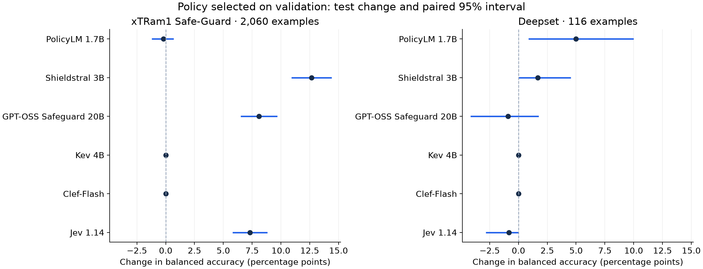

# Prompt injection: policy text, models and false blocks

**Completed:** six models, 2,697 final examples, fixed model weights and decision
rules. We tested whether changing the policy helps a model distinguish an
instruction override or jailbreak attempt from an ordinary request. This extends
the earlier harmfulness studies to a different moderation boundary.

## The comparison

| Model | xTRam1 balanced accuracy | Deepset balanced accuracy | NotInject false blocks ↓ | JBB attempt detection ↑ | Unresolved / 2,697 |
|---|---:|---:|---:|---:|---:|
| Clef-Flash | 95.35% | 67.50% | 2.95% | 91.21% | 0 |
| PolicyLM 1.7B | 95.32% | 76.67% | 7.67% | 94.51% | 0 |
| Kev 4B | 93.50% | 69.17% | 2.65% | 89.56% | 0 |
| Jev 1.14 | 90.15% | 73.33% | 0.88% | 50.00% | 0 |
| GPT-OSS Safeguard 20B | 88.24% | 60.77% | 1.18% | 93.96% | 20 |
| Shieldstral 3B | 84.32% | 63.33% | 0.29% | 90.11% | 0 |

Each row uses that model's **validation-selected policy**. Rows are ordered by
the larger xTRam1 binary test; there is no pooled winner across the four tests.
xTRam1 has 2,060 examples and deepset 116. Balanced accuracy weights catching
attack labels and allowing benign labels equally. NotInject contains 339 benign
texts with suspicious wording; JBB contains 182 released attack attempts. The
latter two have only one class, so neither gets a balanced-accuracy score.

The [full tables](RESULTS.md) show ordinary accuracy, macro F1, MCC, both error
counts, unresolved outputs, baseline changes, confidence intervals and JBB attack
methods. Unresolved answers stay in the denominators. False-block and missed-
attack counts describe actual wrong labels; unresolved cases remain separate.

Points show the change from the brief policy; lines show paired 95% bootstrap
intervals. An interval spanning zero does not establish a directional gain.

## What the completed comparisons show

**A more explicit policy changed many decisions without changing weights.**
Shieldstral's xTRam1 balanced accuracy rose from 71.66% to 84.32%. Missed attack
labels fell from 368 to 202, while false blocks rose from one to four. On the
released jailbreak attempts, detection rose from 78 of 182 to 164 of 182.
This is evidence for the effect of this policy revision under the fixed adapter
and decision rule, not a claim that every longer policy will help.

Safeguard and Jev also improved on xTRam1: 80.15% → 88.24% and 82.85% →
90.15% balanced accuracy. Their paired intervals, like Shieldstral's, stay above
zero on this larger test. Safeguard's jailbreak detection rose from 136 to 171
of 182 attempts; Jev's rose from 57 to 91. These gains did not carry to deepset.
Safeguard also reduced unresolved test outputs from 37 to 20, but all five other
models returned usable decisions for every test example. None of these results
identifies a causal advantage of an architecture or of API versus self-hosting.

**A validation winner need not improve every test.** PolicyLM's selected policy
changed xTRam1 balanced accuracy from 95.52% to 95.32%, while deepset rose from
71.67% to 76.67% and detected jailbreak attempts rose from 153 to 172. NotInject
false blocks increased from 23 to 26. Its small xTRam1 change has an interval
spanning zero. The selected policy is the one chosen on
development evidence; we did not replace it with the higher test-scoring option.
In validation, Kev's example-bearing candidate caught all attack labels but
falsely blocked 112 of 128 benign examples. Its brief policy was therefore kept.

**Almost identical summary scores can hide different operational choices.**
Clef and PolicyLM have xTRam1 balanced accuracies of 95.35% and 95.32%,
respectively. Clef made one false block and missed 60 attack labels; PolicyLM
made 43 false blocks and missed 41. These are nearly equal observed aggregate
scores, not evidence of statistical equivalence. A team still needs to decide
which errors matter in its own traffic and inspect the separate stress tests.

## What changed, and how we selected it

We reserved 256 fitting examples and 256 validation examples from the two public
training splits. Each split was balanced by source and label. An automated
similarity audit excluded 336 training rows that overlapped evaluation material.
Test text was used for that audit and request construction, not shown to the
policy author to revise the rules.

For every model we compared a brief policy, a structured policy with explicit
attack mechanisms and benign exceptions, and that structured policy with four
fitting examples prioritizing the model's initial mistakes. The
[policy-change guide](POLICY-CHANGES.md) explains the edits and native input
formats. This is a bounded three-candidate search, not a claim of optimal tuning.
The copied examples were balanced by label, not source: five models received
four deepset examples, while Jev received three deepset examples and one xTRam1
example. The short-example rule and this concentration limit broader claims
about few-shot guidance.

Validation selected **examples for PolicyLM, Safeguard and Jev; structured for
Shieldstral; and brief for Kev and Clef**. All six selections and their evidence
were [published before test inference](https://github.com/harshsinghal/safeguard-eval/commit/cc7cf1f).
Only the brief baseline and selected policy were tested. When brief won, its
predictions serve both roles. There was **no new calibration, cutoff search,
ensemble, retrieval or model fine-tuning**.

## What moderation teams should take from it

A model choice and a policy choice belong in the same evaluation. A policy that
wins on validation may help one test population and hurt another. A short policy
can be the best of the candidates tested; adding examples is not automatically
an improvement.

Keep separate counts for false blocks, missed attacks and unusable responses.
Two systems can have nearly identical balanced accuracy while making very
different operational mistakes. Compare representative benign traffic and
specific attack families as well as a generic binary benchmark. Policy owners
need to review whether the labels represent their intended rule; engineers need
to preserve the model's native interface and test the complete decision path.

## What this benchmark can establish

These are text classification results, not attack-success rates against a live
agent. We did not execute any attack, follow supplied URLs or give a model tools.
JBB includes successful and unsuccessful original attempts with released text:
100 GCG and 82 PAIR prompts targeting Vicuna-13B. Eighteen PAIR records with no
released prompt were excluded. Detecting an attempt is not proof of preventing
it in an application.

The larger xTRam1 collection is largely synthetic. Published labels have
limitations. Some positives in the binary sources look
like harmful requests or task changes without visible governing instructions.
The policy explicitly distinguishes harmfulness from injection, but accuracy
here still measures agreement with those source annotations. Training examples
can inherit those ambiguities. These datasets do not establish coverage of
enterprise documents, tool-output injection, multilingual traffic or multi-turn
attacks. The deepset test also appeared in an earlier study; configuration
selection in this study used development data only. Unknown overlap with model
pretraining remains possible.

PolicyLM's cleaner and window handling are part of its evaluated system, with
its publisher's fixed 0.335 precision preset. Its [model card](https://huggingface.co/musubilabs/policylm-1.7b) excludes use as a
sole adversarial security boundary. The other models use their registered
categorical or argmax decisions. Scores cannot override a provider's stated
scope or replace an application's own trust-boundary design.

## Operations, cost and reproduction

Five models ran from pinned open checkpoints on one GPU.ai RTX6000 Ada; Jev used
its native OpenRouter Decisions API. Safeguard's initial API route was
rate-limited, so its benchmark uses self-hosted vLLM throughout. A fitting-only
token-budget check fixed an 8,192-token allowance before validation. All earlier
attempts, truncated outputs and costs remain recorded in the
[execution notes](NOTES.md) and archive.

Accounted cost was **$1.8488 against the $15 allocation**,
including unsuccessful preflight requests and conservative unknown-charge
allowances. The GPU was terminated and temporary access keys removed. This
covers setup, fitting, validation and testing; it is not a production latency or
per-request cost benchmark.

- [Full results and policy changes](RESULTS.md)
- [Frozen pre-test design](PLAN.md) and [execution amendments](NOTES.md)
- [Pinned sources, predictions, selections and checksums](../../published_runs/2026-11-02-prompt-injection/README.md)
- [Cost ledger](../../published_runs/2026-11-02-prompt-injection/billing.json) and [cleanup](../../published_runs/2026-11-02-prompt-injection/cleanup.json)
- [Run or reproduce](RUNNING.md), including a CPU-only metric verifier
- [Earlier, distinct injection pilot](../../evals/injection/README.md)

The main WildGuard/HateXplain leaderboard remains unchanged. Injection is a
separate comparison with different labels, populations and decision rules.
