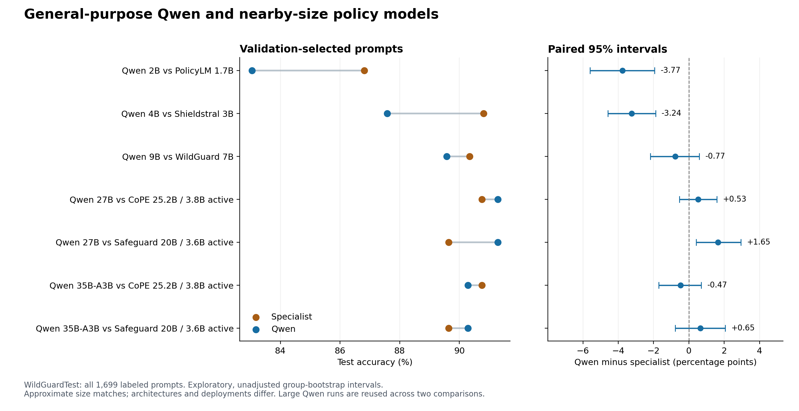

# Can a general-purpose model do the job of a policy model?

We ran the comparison. General-purpose Qwen models can classify requests using a written moderation policy, but the results give us a reason to keep specialized models in the picture. At the two smallest sizes, the specialists won. The larger Qwen configurations produced scores around 90–91%, close to several specialists.

That makes this a useful experiment even though it does not deliver a dramatic new leaderboard winner. We now have evidence about where a general-purpose model works, where it struggles, and how much changing the instructions actually helps.

We used five Qwen3.5 checkpoints: 2B, 4B, 9B, 27B and 35B-A3B. Each received the policy as a system instruction and one request to classify. Its job was to return ALLOW or BLOCK. The model weights stayed fixed throughout. The 35B-A3B name denotes about 35B total and 3B active language-model parameters; it is a mixture-of-experts model, so its size is not directly equivalent to a dense 3B checkpoint.

Here are the results on **all 1,699 labeled WildGuardTest prompts**:

| General-purpose model | Initial accuracy | Selected-prompt accuracy | Selected harmful F1 |
|---|---:|---:|---:|
| Qwen3.5-2B | 79.93% | 83.05% | 81.49% |
| Qwen3.5-4B | 85.64% | 87.58% | 85.87% |
| Qwen3.5-9B | 89.05% | 89.58% | 88.11% |
| Qwen3.5-27B | 89.41% | 91.29% | 90.24% |
| Qwen3.5-35B-A3B | 90.29% | 90.29% | 89.07% |

Accuracy means agreement with the dataset's label. Harmful F1 balances catching harmful requests with avoiding incorrect harmful labels. Every configuration saw the same test examples. All Qwen outputs were valid classifications, so these differences come from decisions rather than refusals or broken formatting.

The nearby-size comparisons tell the main story. Qwen 2B's **83.05%** trails PolicyLM-1.7B's **86.82%**. Qwen 4B's **87.58%** trails Shieldstral 3B's **90.82%**. Those gaps remain below zero in our paired uncertainty intervals, including after the available threshold controls. The smaller specialized models were more accurate in these deployments.

Qwen 9B reaches **89.58%**, compared with WildGuard 7B's **90.35%**. That difference is small enough that our interval includes no difference. Qwen 27B has the best Qwen score, **91.29%**: nine more correct answers than CoPE at **90.76%**, and 28 more than Safeguard at **89.64%**. Its advantage over CoPE remains uncertain; its advantage over this recorded Safeguard deployment has a positive interval. Qwen 35B-A3B scores **90.29%**, with uncertain differences from both CoPE and Safeguard. These are exploratory, unadjusted comparisons, not a claim of universal superiority.

What does “selected prompt” mean? We tried five candidate instruction sets for each model and chose the one with the highest **validation accuracy**. We made that choice before running the new Qwen test evaluations. It means “best on the selection set under our rule,” not “best possible prompt” or “the prompt that looked best on the final test.”

The workflow had three stages:

1. **Use 1,024 fitting examples to understand mistakes.** We evaluated three existing rule sets, inspected fitting errors, and drafted two additional candidates per model.
2. **Use 512 separate validation examples to choose among the five candidates.** We looked at aggregate scores, without using individual validation mistakes to rewrite the prompts. Ties favored shorter text.
3. **Freeze the choices and run the test.** We evaluated the initial prompt, the common checklist, and the selected prompt on the full official test and a separate 512-example internal audit. Identical configurations were run once.

We tuned the language of the policy. Some edits clarified benign cases: imaginary conflict, ordinary discussion and vague wording should not automatically trigger a block. Others made harmful outcomes more explicit, such as sensitive health information or requests to endorse a harmful belief. We also tried shorter formulations. Some candidates therefore changed the stated scope of a rule, as well as its wording. This was an attempt to better match the benchmark's labeling conventions, not just a formatting exercise.

A policy document and a system prompt both communicate instructions. In this experiment, we placed the substantive policy rules into Qwen's system message. The meaningful difference was the model interpreting those rules and its native interface. The [prompt-change ledger](PROMPT-CHANGES.md) links every exact version and explains why it was written.

More writing did not reliably help. Only the 9B tailored candidate strictly beat that model's best inherited prompt on validation, by just **two examples out of 512**. The 35B model's new prompt tied an earlier one and won because it was shorter. The other three models selected existing prompts. Every unsuccessful draft is retained.

On the final test, selection improved 2B by **3.12 percentage points**, 4B by **1.94**, 9B by **0.53**, and 27B by **1.88**. The 35B model's accuracy did not change. The 9B improvement remains uncertain in the paired interval. “Tuning helped” is therefore a model-specific observation, not a guarantee.

There is another useful wrinkle. We also froze a separate control that kept the words unchanged and adjusted only the score cutoff for BLOCK. For 2B, that brought the initial prompt from **79.93% to 82.93%**, almost the selected prompt's **83.05%**. Much of the apparent prompt-tuning gain can therefore be reproduced by changing how readily it blocks. For 4B, the selected wording still beat the calibrated initial prompt by about **2.12 points**. The detailed paired contrasts for this question were added during final inference and are labeled secondary; none changed the frozen prompts, cutoffs or primary results.

The test task here was **general prompt harmfulness**: should an assistant treat the request as harmful or unharmful? We did not evaluate the assistant's answer, an image, or the original religious-iconography policy. Fitting and test examples cover the same broad categories, such as privacy, abuse, violence and deception. This measures performance on different requests within that setting; categories themselves were not held out. Training-source labels are model-generated, while official-test labels are human annotations, which also helps explain why validation and test scores can differ.

This study supports general-purpose models as useful baselines for policy classification. It also shows that a small specialist can be a strong choice on this task. It does not settle whether policy models are generally necessary: size matches are approximate, architectures and training data differ, Qwen ran without thinking, and the historical Safeguard run used a different reasoning/quantization setup. We already knew the earlier specialist test results, and the models' original exposure to WildGuard is not fully known.

A stronger next experiment would test newly written platform rules, including changes that reverse the correct decision for the same request. That would directly probe whether a model follows the supplied policy rather than relying on a familiar harmfulness judgment. It remains future work.

All five Qwen checkpoints ran on GPU.ai. The 83 runs produced **70,634 classification outputs** across repeated evaluations, cost **$2.04**, and brought cumulative GPU spend to **$7.91**. The GPU is terminated. Exact prompts, scores, revisions, costs and unsuccessful candidates are documented; source dataset text and raw traces remain private.

For a deeper look, start with the [complete results](../../published_runs/2026-10-25-qwen/README.md), then the [methods](METHODS.md), [lab notebook](NOTES.md), and [CPU-only reproduction guide](../../published_runs/2026-10-25-qwen/REPRODUCING.md).
