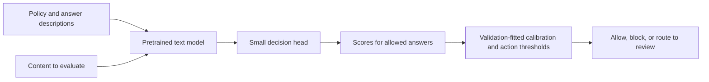

# Jev and local decision models: what we know and what to test next

Recorded 29 October 2026. Status: source review and research proposal. No new
model inference, model training, GPU rental, or paid API use was performed for
this review. The [leaderboard writing notes](../leaderboard/WRITING-NOTES.md)
preserve our completed findings for future articles and paper updates.

## The useful distinction

Jev is broadly applicable across decision tasks, but it is not a general-purpose
chat model. TypeSafe describes a system that consumes state and typed questions
and produces bounded decisions and probabilities, with parallel outputs and a
training method it calls Reinforcement Learning for Calibrated Decisions (RLCD).
This is a specialization in the *kind of work*: deciding among defined outcomes.
[TypeSafe launch](https://typesafe.ai/blog/introducing-system-one-models-and-jev),
[training overview](https://docs.typesafe.ai/introduction/machine-learning-primer).

The public materials reviewed here do not disclose enough to establish Jev's
encoder/decoder layout, parameter count, classification-head design, or a
reproducible full training recipe. An encoder plus a decoder is therefore a
hypothesis, not a documented explanation. Its competitive results do not let us
infer these hidden details. An independent evaluation also explicitly identifies
architecture, size, and training-data opacity as limits on causal interpretation.
[Jev evaluation, section 4.2](https://arxiv.org/html/2609.37647v1).

“System One” is not an architectural specification or an accuracy guarantee.
For this research, compare concrete properties: whether a model reads a policy,
how it scores the allowed answers, what its training exposed it to, and how well
its decisions transfer to a new policy or content distribution.

## First, be precise about our result

These are validation-selected configurations from the balanced leaderboard:

| Benchmark | Jev balanced accuracy | Best individual specialist | Highest observed ensemble |
|---|---:|---:|---:|
| WildGuardTest | 88.69% | CoPE: 90.58% | Three-specialist equal log-odds: 91.08% |
| HateXplain | 78.40% | Shieldstral: 77.02% | Specialists + Qwen log-odds logistic: 79.35% |

On HateXplain, Jev's 1.38-point lead over Shieldstral has a paired 95% interval
from −0.66 to +3.49 points. The ensemble's 0.95-point lead over Jev has an interval
from −1.03 to +2.94. These close differences are unresolved by this analysis.
Jev is competitive; it does not dominate the two tasks.

We tested `typesafe/jev-1.14-20261014` through OpenRouter's Decisions API. We did
not train Jev. The original Jev study and the later leaderboard used different
selection objectives, so their headline scores must not be mixed. See the
[leaderboard](../leaderboard/README.md) and
[original Jev study](../jev/READOUT.md) for the full protocol and limitations.

## Why it might work well—and what we have not established

**The training objective may fit the job.** TypeSafe says RLCD targets decisions
and probabilities rather than preferred prose. A moderation task that asks for
ALLOW or BLOCK fits that output contract. Whether this explains an advantage
over a particular policy model requires a controlled comparison; our leaderboard
does not provide one. [TypeSafe training overview](https://docs.typesafe.ai/introduction/machine-learning-primer).

**The interface eliminates one source of failure.** Typed options remove the
need to extract a label from a paragraph. Our Jev run produced no failed typed
classifications. This is useful engineering behavior, but many specialist models
also expose direct scores. Valid output structure does not establish a correct
judgment.

**The scores let us choose a useful operating point.** On HateXplain, Jev's
brief-policy native accuracy was 69.33%; a validation-selected threshold on that
same brief policy reached 79.47%. The example-bearing policy with its own
threshold reached 80.67%. Much of that particular accuracy improvement therefore
came from the decision cutoff. Higher accuracy also hid lower hate recall.
These are observations from [our Jev experiment](../jev/RESULTS.md), not an
inference about architecture.

**Training exposure and task fit may matter more than the label on the model.**
We do not know the full Jev training corpus or its overlap with our benchmarks.
Knowledge of hate-speech conventions, familiar category boundaries, data quality,
and optimization could all contribute. The present evidence cannot assign a
fraction of the performance to any one explanation.

Finally, calibrated probabilities are an empirical property on a distribution.
Neither a softmax nor an objective that rewards honest probabilities guarantees
calibration after a policy or domain change. TypeSafe's separate `confidence`
field summarizes its output distribution; it is not independent evidence that a
decision is correct. [TypeSafe confidence documentation](https://docs.typesafe.ai/confidence),
[Guo et al., calibration](https://arxiv.org/abs/1706.04599).

## Local options already exist

The following are candidates, not new entries in our leaderboard. Links are to
the publishers' materials. Licenses and architecture descriptions are recorded
as of the review date; deployment claims have not been reproduced by us.
Exact Hub revisions and model-card hashes are in
[the source manifest](JEV-LOCAL-SOURCES.json).

| Candidate | Published design | Relevance to us |
|---|---|---|
| [Kev-4B](https://huggingface.co/jaredpalmer/kev-4b) | Qwen3.5-4B-Base with a trainable LoRA adapter and pointer head; scores options without generating text. Apache-2.0. | Direct example of adapting a decoder backbone for decisions; comparable size to our Qwen 4B arm. Publisher documents Apple Silicon and CUDA inference. |
| [Laya](https://huggingface.co/convaiinnovations/laya) | English checkpoint: ModernBERT-large plus transformer decision head, approximately 421M parameters. Apache-2.0. | Small encoder-based candidate with request-time answer options and a Jev-compatible interface. Its English checkpoint documents a short 512-token per-question budget. |
| [GLiClass v4 Edge](https://huggingface.co/knowledgator/gliclass-v4-edge) | Approximately 0.4B encoder; an instruction and supplied labels determine what is scored. Apache-2.0. | Another small, locally runnable policy/instruction-conditioned classifier. Publisher documents CPU use and a typed-decision adapter. |
| [PolicyLM-1.7B](https://huggingface.co/musubilabs/policylm-1.7b) | Bidirectional BidirLM-derived model with policy-category scoring. Apache-2.0. | Already part of our evidence; the local policy-conditioned classifier idea is present in our existing study. |
| [Clef-Flash](https://huggingface.co/Cloudflare/clef-flash) | Qwen3.5-9B backbone and joint schema-scoring head. Apache-2.0. | Larger open-weight decision-model comparator; publisher also supports multimodal input, which we have not tested. |
| [Wolf Defender Jev](https://huggingface.co/patronus-studio/wolf-defender-jev) | Approximately 151M mmBERT-small model with option scoring. MIT. | A narrower candidate for agent-security decisions. Its domain is not automatically equivalent to hate-speech moderation. |

Kev or Laya may be the open Jev-like project remembered from Hugging Face.
They are independent implementations, not released Jev weights or verified
reconstructions of its internal architecture.

Laya's publisher comparison against Jev combines third-party Jev measurements
with its own tests, and explicitly notes differences in prompts and sample sizes.
It is not a matched demonstration that Laya beats Jev. An independent paired
preprint found Jev stronger on most of its agent-decision tasks and identified
option-order sensitivity in the Laya version it tested. That is a reason to test
our pinned version, not to import those results into our moderation leaderboard.
[Laya comparison](https://huggingface.co/convaiinnovations/laya),
[paired evaluation](https://arxiv.org/abs/2610.02267).

[VEJI-V2](https://huggingface.co/loaiabdalslam/VEJI-V2) is another exploratory
implementation: a frozen MiniLM encoder plus a learned routing/decision module.
Its advertised roughly 3.28M parameters exclude the frozen encoder. Its card
reports limited evaluation and an unmet production-readiness gate, so it belongs
on a secondary research list rather than the first comparison.

Local inference requires the actual decision head and preprocessing to run, not
just the underlying language model. A generic chat endpoint or an automatically
generated Hub usage snippet may bypass those components. Use the publisher's
decision implementation, pin its revision, and verify it against reference
outputs. No Ollama compatibility or Mac performance has been established by
this review. Local hosting also still has hardware and operational costs.

## Do we need to build an encoder-decoder hybrid?

No. For text classification, a useful starting design is:

This is a proposed design pattern, not a diagram of Jev. REVIEW here is an
application action whose quality and workload must be evaluated separately; our
completed benchmarks contain only the two ground-truth classes.

The pretrained model can be a bidirectional encoder or a decoder used only to
read the input and compute representations. A classification head converts those
representations into label scores. It need not generate an answer token by token.
Standard encoder classification is documented in
[Hugging Face's training guide](https://huggingface.co/docs/transformers/tasks/sequence_classification).

Kev provides a concrete decoder-based example: the adapter and option head are
trained together with cross-entropy while most base weights remain frozen. Its
repository includes continued fine-tuning from a released checkpoint. This
demonstrates a practical implementation route without needing to reproduce
TypeSafe's undisclosed RLCD recipe. It does not establish equal capability.
[Kev implementation and training](https://github.com/jaredpalmer/kev).

## Two different things we could train

**A fixed-task classifier** learns one boundary, such as this dataset's definition
of hate. A small encoder and classification head can be fine-tuned on labeled
examples. An alternative baseline is
[SetFit](https://huggingface.co/docs/setfit/index), which adapts sentence
representations and a classifier. This is useful when the policy is stable,
but it does not demonstrate that an author can change a rule through text alone.

**A policy-conditioned classifier** learns to apply the policy supplied with each
example. Its training records need content, policy, candidate answers, and the
correct answer *under that policy*. Different policies must sometimes give
different correct answers for the same content. Otherwise, the model can learn
the old dataset label while ignoring the policy.

We can start from an existing decision model and fine-tune its head and adapters,
or compare that with a frozen-backbone head-only baseline. A randomly initialized
head is not automatically a capable evaluator. The labeling, policy diversity,
and evaluation design are likely to be the central work.

This would be a distinct fine-tuning study. Our earlier claim remains that our
policy/ensemble experiments did not update language-model weights; a later
training experiment must not be blended into that claim.

## Recommended next study: does a local model follow the changed policy?

**Primary question:** can a small, locally hosted decision model apply a written
policy and its revisions at useful false-block and missed-violation rates, and
when does adapting its weights add value?

Keep the first round small. Test **Laya and Kev-4B** as released, using the
existing WildGuard and HateXplain harness and comparable policy-search budgets.
Use GLiClass Edge as an alternative if Laya's input budget makes the existing
policies infeasible; record that eligibility decision before running benchmark
tests. Keep the existing Jev, Qwen 4B, and specialist results as historical
anchors, clearly separated from any new matched experiment.

For a direct matched comparison, render the same policy meaning through each
native interface and run the same fresh cases. An identical JSON wrapper does
not mean models consume an identical representation. Record all rendering and
tokenization. Report cases exceeding a model's input budget; do not silently
truncate, simplify its policy, or remove difficult examples to improve its rank.

Add a small, freshly adjudicated policy-change test. For example:

- Policy A blocks hate speech and allows offensive non-hate content.
- Policy B also blocks directed personal insults.
- Policy C adds a specific exception for non-endorsing quotation in reporting.

These are proposed policies, not a relabeling of HateXplain's test by assumption.
Its “offensive” class alone does not establish a directed insult, endorsement, or
quotation context. Policy authors must review and label those cases under each
policy. Include cases that should flip and cases that should remain unchanged.

Measure correct responses to changed rules, unnecessary decision changes, and
robustness to equivalent wording and reordered answers. Include a missing-policy
control to check whether supplying policy actually helps. Keep paraphrases and
variants of one content item in the same split. Hold out policy families or
exception patterns, not only new sentences that repeat familiar rules.

If frozen local models fall short, then run a bounded training extension:

1. Train a conventional fixed-task encoder as the simple baseline.
2. Adapt one decision model on reviewed content-policy-answer records. Start
   with supervised learning; compare head-only with adapter-plus-head training
   when resources allow. Treat any synthetic or teacher-generated examples as
   training data, not independent test ground truth.
3. Use distinct fitting, calibration/selection, and locked test data; report
   repeated seeds and learning curves if training variance or sample size is
   material. Fresh policy-change cases provide a test less shaped by our prior
   inspection of the public benchmarks.

Retain balanced accuracy, macro-F1, both error rates, unresolved outputs, and
paired uncertainty. Add Brier score/reliability plots, coverage versus error
under review thresholds, and measured latency/memory on a specified device.
Compare API end-to-end latency separately from local model-only time. Count
annotation effort, training cost, policy-editing effort, and ongoing operation.

This study could show where policy text alone suffices, where a small amount of
training helps, and whether a locally controlled interpreter follows policy
updates. It could not reverse-engineer Jev or establish a generally superior
architecture. If architecture itself becomes the question, we need a separate
comparison with matched data, backbones, training budgets, and ablations.

A related proposal is
[Narrow Decision Models](https://arxiv.org/abs/2610.25553), which describes a
bidirectional encoder for organization-specific typed decisions and explicit
invariance properties. It is a useful design reference, not a validated drop-in
replacement for our tasks.

The recommendation is recorded for discussion. New training, provider calls,
and paid deployment have not started.
