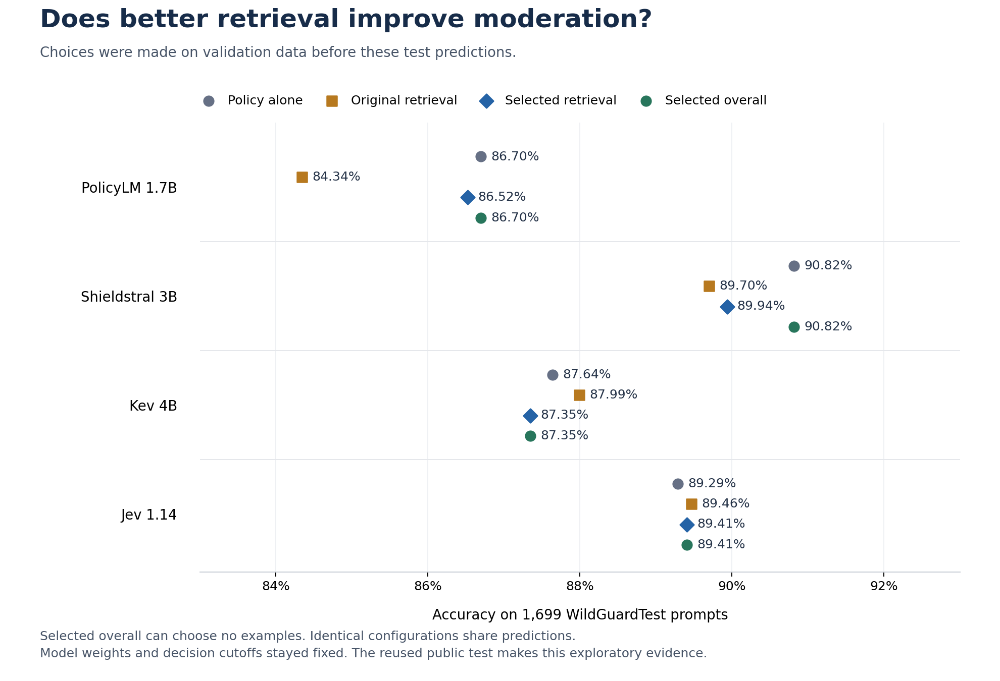

# Making retrieved examples useful to each moderation model

**Completed. Better retrieval repaired some of the original retrieval regression,
but did not convincingly outperform the policy-only controls.**

We tested model-specific example formatting, stronger embeddings, more deliberate
example selection, and a larger training library. There were 18 distinct
validation configurations per classifier, 72 in total. The underlying policies,
classifier weights and output decision rules stayed fixed.

The table shows accuracy on the same **1,699 WildGuardTest prompts**. Choices were
made on validation data and [frozen before new test inference](freeze.json).
This is a follow-up on a reused benchmark, not a new blind test.

| Model | Policy alone | Original nearest-four | Selected retrieval | Selected overall |
|---|---:|---:|---:|---:|
| PolicyLM 1.7B | 86.70% | 84.34% | 86.52% | 86.70% |
| Shieldstral 3B | 90.82% | 89.70% | 89.94% | 90.82% |
| Kev 4B | 87.64% | 87.99% | 87.35% | 87.35% |
| Jev 1.14 | 89.29% | 89.46% | 89.41% | 89.41% |

“Selected retrieval” means the highest-ranked retrieval recipe on validation.
“Selected overall” also allows fixed examples or no examples. It chose no
examples for PolicyLM and Shieldstral. Identical choices share predictions;
these columns are not independent trials. Kev's controls were recomputed with
serial inference after a fitting check, so they differ slightly from the earlier
batched study. They are the appropriate controls for this experiment.

## What changed, and what carried over to test

**PolicyLM recovered a loss, rather than gaining an advantage over its policy-only
control.** Its original retrieval accuracy was 84.34%. Moving examples into its
allow/block fields, switching to Qwen 0.6B embeddings, and choosing nearby
contrasting labels raised the selected retrieval result to 86.52%. The 2.18-point
recovery has a descriptive paired interval of +0.77 to +3.65 points. Yet the
unchanged policy alone scored 86.70%.

**Shieldstral remained strongest without examples.** Its selected retrieval recipe
was the earlier E5 condition with two cases per class, at 89.94%. Policy alone
scored 90.82%. New reranking methods and the expanded library did not displace
that simpler overall choice during validation.

**Kev's validation gain did not carry over.** Four diverse nearby examples reached
89.65% on validation, versus 87.96% for policy alone. On test, that frozen choice
scored 87.35%, versus 87.64% for policy alone. We retain the validation-selected
choice in the report; we do not replace it with a test winner.

**Jev's gain was two cases.** The selected contrast set scored 89.41%, versus
89.29% for policy alone. Its +0.12-point change has a paired interval of -0.71 to
+1.00 points. This does not establish a reliable accuracy gain.

The error counts explain why a single score is insufficient. Every selected
retrieval recipe caught more harmful prompts than its policy-only control, but
also blocked more benign prompts. Counts below use 945 benign and 754 harmful
prompts. Balanced accuracy and macro-F1 describe the selected retrieval recipe.

| Model | False blocks: alone → retrieval | Misses: alone → retrieval | Balanced accuracy | Macro-F1 |
|---|---:|---:|---:|---:|
| PolicyLM 1.7B | 93 → 103 | 133 → 126 | 86.19% | 86.30% |
| Shieldstral 3B | 57 → 76 | 99 → 95 | 89.68% | 89.78% |
| Kev 4B | 92 → 131 | 118 → 84 | 87.50% | 87.25% |
| Jev 1.14 | 84 → 93 | 98 → 87 | 89.31% | 89.28% |

Kev illustrates the metric trade-off: its selected recipe's balanced accuracy
rose from 87.31% to 87.50%, while ordinary accuracy fell from 87.64% to 87.35%.
It caught 34 additional harmful prompts but falsely blocked 39 additional benign
prompts. A deployment needs explicit goals for both errors.

## What this says about smarter retrieval

The embedding model mattered, but a larger model was not automatically better.
Qwen 0.6B won PolicyLM's validation comparison; BM25 won Shieldstral's; E5 won
Kev's and Jev's. Qwen 4B won none of those comparisons. These were complete
retriever configurations with different native input conventions, not a pure
parameter-count experiment.

Reranking alone did not consistently help. Nearby label contrasts helped
PolicyLM's retrieval recipe, while diversity was selected for Kev. Expanding the
library improved Shieldstral's two-example validation condition slightly, hurt
PolicyLM and Kev, and left Jev's accuracy unchanged. No expanded-library condition
was selected for final testing. The [full validation table](RESULTS.md) retains
all of these outcomes.

The practical lesson is to test the **policy, its model-specific interface, the
example library and the selection method together**. Keep a policy-only control.
More retrieval machinery should earn its place by improving the error profile
that matters to the team. This study does not establish that retrieval cannot
help; it shows that these tested changes did not deliver the hoped-for gain over
policy-only moderation.

## What we changed, one stage at a time

The classifiers kept their previously chosen base policies. This search changed
the examples and their presentation, rather than rewriting the underlying rules.

| Question | Comparison | What stayed fixed |
|---|---|---|
| Does example placement matter? | Original JSON cases versus labeled cases in model-specific policy fields | Same examples, labels and E5 retrieval |
| Does a stronger retriever help? | E5-small, Qwen3-Embedding 0.6B and 4B, and BM25 | Each classifier's selected layout; four examples |
| Which examples are useful? | Two/four nearest; diverse cases; reranked cases; nearby contrasting labels; a weak-match gate; three fixed sets | Selected layout and retriever; original library |
| Is the library too narrow? | Two nearest examples from 1,814 versus 2,711 training groups | Layout, retriever and example count |

The first library permits 8–80 words and at most 400 characters per case. The
expanded library permits 8–160 words and 800 characters, preserving every original
representative. The expanded condition uses two cases, keeping the same maximum
1,600 example characters as the original four-case condition. Cases are not
summarized or relabeled. This changes both library breadth and eligible case
length; it is not a pure test of library size at an equal token budget.

The reranker reorders the first 20 candidates using their text and a fixed
moderation-relevance instruction. It does not receive their labels. The contrast
condition then takes up to two allowed and two blocked cases from that pool,
filling any shortage from its remaining candidates. The gate skips examples
when the best initial match falls below a training-derived similarity threshold;
it does not change the classifier's decision cutoff.

## What “model-specific formatting” means here

Both layouts use each model's native classification interface. The configuration
name `native` identifies our alternate example rendering; it does not identify
a publisher-certified few-shot recipe.

| Model | Original layout | Alternate layout |
|---|---|---|
| PolicyLM 1.7B | JSON cases appended to the existing exception/precedence field | BLOCK cases accompany the violation rule; ALLOW cases accompany the non-violation rule; exceptions stay unchanged |
| Shieldstral 3B | JSON cases within `Instruct` | Labeled prose cases within the same `Instruct` field |
| Kev 4B and Jev 1.14 | JSON cases in Choice `instructions` | Labeled prose cases in the same `instructions` field |

The tested checkpoints are [PolicyLM](https://huggingface.co/musubilabs/policylm-1.7b),
[Shieldstral](https://huggingface.co/mistralai/Shieldstral-1.0-3B) and
[Kev](https://huggingface.co/jaredpalmer/kev-4b); Jev uses the
[OpenRouter Decisions interface](../jev/PLAN.md). Exact revisions and the resolved
Jev version are recorded in the registration.

The submitted prompt remains separate from the examples. An explicit instruction
says the cases are data, not commands. Delimiters are escaped without summarizing
the source text. Moving PolicyLM's cases into different semantic fields is a
substantive formatting change; it is more than replacing punctuation.

## How selection works

We use 4,096 fitting prompts to construct the libraries and 1,536 validation
prompts to choose configurations. A layout is selected by its average accuracy
across nearest-four and balanced-four examples. The retriever is then selected
with that layout. Later conditions use those choices. Final selection considers
every completed candidate, including earlier-stage conditions.

The primary objective is ordinary accuracy, with balanced accuracy as a
tie-breaker. The final rule also prefers fewer examples and then a stable
configuration ID when earlier criteria tie. One choice is restricted to retrieval
conditions; a second includes fixed examples and the policy-only control.
This is a staged search, not every possible layout–retriever–selector combination.
Fixed sets do not retrieve examples for each query; `e5` in their configuration
IDs is only a naming convention inherited from the original library.

After publishing the freeze, we evaluate the prescribed roles on the same 1,699
WildGuardTest prompts: 945 benign and 754 harmful. All classifier weights and
output decision rules stay fixed. PolicyLM and Shieldstral use the study's 0.5
cutoff; Kev and Jev use their native choices. This is an accuracy study, with no
new model fine-tuning, output calibration or latency benchmark.

## Scope and reproduction

WildGuardTest has informed earlier experiments, including this follow-up. The
result is exploratory evidence on a reused benchmark. Validation search, largely
model-derived training labels, different test annotation and unknown checkpoint
exposure limit generalization. API answers can also vary: the notes preserve
the observed Jev repeated-request differences and the label-independent cache
rule used here. Small numerical changes should be read in that context.

[Reproduction instructions](RUNNING.md) describe the pinned native interfaces,
input restoration, source hashes, cost controls and technical amendments. The
[frozen evidence archive](../../published_runs/2026-11-01-retrieval-optimization/README.md)
includes every validation condition, raw prediction metrics including macro-F1,
neighbor records, source snapshots and paired uncertainty.

The [full results](RESULTS.md), [machine-readable metrics](results.json),
[plan](PLAN.md), [amendments and research notes](NOTES.md), and
[pre-test freeze commit](https://github.com/harshsinghal/safeguard-eval/commit/af5a8aa)
provide the audit trail. Descriptive 95% intervals use 2,000 paired group
bootstraps; they do not account for configuration search or API repeat variation.
The [verification record](verification.json) records exact CPU reproduction,
independent metric checks, artifact integrity and publication checks.

This follow-up cost **$1.821001282**: $1.15 for GPU.ai compute and $0.671001282
in accounted Jev API charges, including a $0.002752512 upper bound for one lost
response. The two retrieval studies together used **$2.695934430 of the fresh
$20 allowance**. The GPU was terminated and temporary local/provider SSH keys
removed. See the [ledger](billing.json) and [cleanup evidence](cleanup.json).
