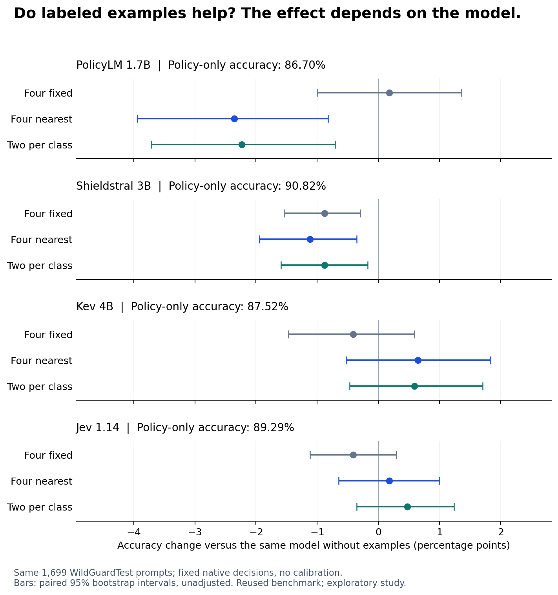

# Do relevant examples improve a moderation policy?

**The effect depended on the model.** Retrieved training examples slightly raised
Kev and Jev's test accuracy, but those gains were uncertain. They reduced accuracy
for PolicyLM and Shieldstral. The strongest result in this comparison was still
**Shieldstral with its existing policy and no examples: 90.82%**.

We tested the same 1,699 labeled WildGuardTest prompts under four conditions per
model. Model weights, base policy clauses and output decision rules stayed fixed.
There was **no new calibration, cutoff search or latency benchmark**.

## The full accuracy comparison

Bold cells mark the condition selected on validation **before** test inference.
They do not mark each row's highest test score.

| Model | Policy only | Four fixed examples | Four nearest examples | Two nearest per class |
|---|---:|---:|---:|---:|
| PolicyLM 1.7B | **86.70%** | 86.87% | 84.34% | 84.46% |
| Shieldstral 3B | **90.82%** | 89.94% | 89.70% | 89.94% |
| Kev 4B | 87.52% | 87.11% | 88.17% | **88.11%** |
| Jev 1.14 | 89.29% | 88.88% | 89.46% | **89.76%** |

The shared **four-neighbor voting control scored 70.04% accuracy** and 71.18%
balanced accuracy. It used the same retrieved neighbors and their training labels,
without a moderation model. In this setup, similarity and a label vote alone
provided a much weaker classifier.

[All metrics and paired comparisons](RESULTS.md) include balanced accuracy,
false blocks, misses and corrected/introduced errors. The
[full-precision results](../../published_runs/2026-11-01-retrieved-examples/results.json)
also contain macro-F1, harmful recall, specificity and unresolved counts. All
**27,184 model test classifications** returned valid decisions; the neighbor
control adds 1,699 local predictions. These are repeated conditions on the same
prompts, not independent new test populations.

## What happened to the mistakes?

The primary comparison is four nearest examples versus the same model's policy
alone. A false block rejects a prompt labeled benign; a miss allows one labeled
harmful. There are 945 benign and 754 harmful test prompts.

| Model | False blocks: policy → nearest | Misses: policy → nearest | Net change in correct decisions |
|---|---:|---:|---:|
| PolicyLM | 93 → 190 | 133 → 76 | 40 fewer |
| Shieldstral | 57 → 84 | 99 → 91 | 19 fewer |
| Kev | 94 → 121 | 118 → 80 | 11 more |
| Jev | 84 → 83 | 98 → 96 | 3 more |

PolicyLM caught 57 additional harmful prompts but created 97 additional false
blocks. Shieldstral made the same kind of trade, on a smaller scale. Kev also
blocked more benign prompts, but its reduction in misses was larger. These are
different operational outcomes, even when one accuracy number looks better.

Validation selected **balanced nearest examples** for the two decision models.
Kev then improved by 10 correct decisions: 36 fewer misses and 26 more false
blocks. Jev improved by eight: six fewer misses and two fewer false blocks.
Their accuracy changes were **+0.59 and +0.47 percentage points**, respectively.
The paired 95% intervals include zero (Kev: −0.47 to +1.71; Jev: −0.35 to +1.24).
These are modest observed gains, not convincing evidence of a reliable upgrade.

Even identical accuracy can hide a different trade. Shieldstral's fixed and
balanced examples both scored 89.94%, but balanced examples produced 15 fewer
misses and 15 more false blocks. Policy owners need to inspect both errors.

## What we actually changed

The existing policy remains authoritative. We append four labeled illustrations,
explicitly marked as data, while keeping the target prompt separate. The choices
are: the same fixed two benign and two harmful examples for every target; its four
nearest neighbors; or its two nearest neighbors from each class. The voting
control uses the four nearest, with the closest neighbor breaking a 2–2 tie.

The library contains **1,814 distinct fitting groups**, drawn from the existing
4,096 fitting prompts: 756 benign and 1,058 harmful. Eligibility requires 8–80
words and at most 400 characters so four complete examples fit the policy inputs.
This excludes 2,138 fitting rows by length/content and collapses 144 eligible
duplicates. We are testing retrieval from that subset, not all of WildGuardTrain.

A frozen E5-small-v2 encoder selects neighbors by cosine similarity. Long queries
use complete windows rather than clipping. Validation and test labels never enter
retrieval or model requests; only training labels describe the examples. The
library and evaluation populations have disjoint duplicate groups.

There is no universal example wrapper. PolicyLM receives single-line examples in
its native exception/context field; Shieldstral receives them in `Instruct`, with
the target in `Document`. Jev and Kev use native Choice instructions and put only
the target in `state.content`. PolicyLM's format is an experimental use of its
category interface, not a publisher guarantee of few-shot support. See the
[exact rendering and runtime details](RUNNING.md).

## Why validation and test both mattered

The 1,536-row validation set nominated policy-only for PolicyLM and Shieldstral,
and balanced examples for Kev and Jev. We published the
[freeze](validation-freeze.json) in commit `78e2768` before creating test jobs.
Every test condition is still reported. PolicyLM's fixed examples scored slightly
higher on test than its nominated policy-only condition; we did not substitute
that test winner for the frozen selection.

Jev's balanced-example gain shrank from 2.21 points on validation to 0.47 on test.
Validation uses WildGuardTrain's largely model-derived labels, while the official
test has a different annotation process. That gap reinforces the need for a
separate assessment. It does not identify the cause of the change.

## What a moderation team can take from this

Treat the example library, retriever and selection rule as part of the versioned
policy configuration. Similar wording or subject matter does not guarantee a
similar moderation decision. Test the complete combination with the intended
model, retain a policy-only control, and decide which error trade is acceptable
before looking at the final test.

This experiment supports **testing retrieval per model**. It does not establish
that retrieved examples are always helpful, always harmful, or inherently better
for a particular model family. We tested one encoder, one fixed example set,
four-example conditions and specific native wrappers. Input length changes with
examples; we did not isolate all effects of content, order or formatting.

The [retrieval and format audit](RETRIEVAL-AUDIT.md) examines those limitations
using saved validation outputs and proposes separate tests of native example
placement, stronger embeddings and decision-relevant selection. It is a post-hoc
diagnosis and a follow-up proposal; no new inference results are claimed.

This is an exploratory follow-up on a public test used in earlier project work.
Unknown checkpoint exposure, training-label quality, repeated benchmark use and
unadjusted comparisons limit generalization. There is no new HateXplain,
enterprise-data, multilingual or image-moderation result here. Retrieval adds a
component and longer inputs; its serving impact was not measured. This study has
its own validation and fixed-decision protocol, so it is reported separately from
the repository's common calibrated leaderboard.

## Cost, evidence and reproduction

The completed study cost **$0.874933148 of the fresh $20 allowance**: $0.53 for
2,929 GPU.ai RTX6000 Ada seconds, and $0.344933148 for 13,068 Jev API requests.
The rental had a four-hour provider cutoff and was terminated early. No GPU
instances remained active, temporary local/provider SSH keys were removed, and
RunPod was not needed. The bill includes setup and failed compatibility attempts;
local electricity and engineering time are excluded. This is a study bill, not a
production cost estimate.

[Registered plan](PLAN.md) · [Amendments and research notes](NOTES.md) ·
[Full results](RESULTS.md) · [CPU reproduction](RUNNING.md) ·
[Immutable evidence bundle](../../published_runs/2026-11-01-retrieved-examples/README.md) ·
[Metric definitions](../leaderboard/METRICS.md)
