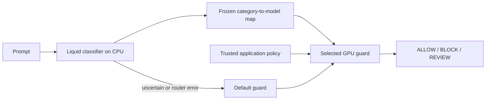

# A routed guard system on one 5090

The CPU category classifier, frozen routing map and selected guard model achieved
**72.32% final-decision accuracy on 112 pilot cases**, versus
**75.00% for Clef**, the single guard selected on calibration.
Every routed case received a successful guard check. This pilot **did not show
an accuracy improvement from routing**. The service works; the routing policy
needs stronger validation before it can be recommended as an upgrade.

[Serving API and reproduction](RUNNING.md) · [Registered plan](PLAN.md) ·
[Text-free evidence](../../published_runs/2026-11-05-routed-guard-pilot/README.md)

## Whole-system scores

| Configured system | Raw accuracy | Enterprise blend /100 | Equal-task blend /100 |
|---|---:|---:|---:|
| clef | 75.00% | 69.27 | 74.40 |
| kev | 68.75% | 66.77 | 68.45 |
| policylm | 68.75% | 63.65 | 67.86 |
| shieldstral | 66.96% | 61.15 | 66.37 |
| **CPU classifier + routed guard** | **72.32%** | **66.32** | **71.23** |

All five systems use the same 112 cases, complete source inputs and source-aligned
policies. The enterprise profile weights agent behavior 35%, injection 25%,
artifacts 20%, cyber 10%, content 5% and custom policy 5%, then gives equal
influence to tasks and reference classes within those domains. Equal-task scoring
weights all 14 tasks equally and balances reference classes. These priorities
are normative, not measured enterprise incident frequencies.

The routed system corrected **4** of the selected Clef control's errors
and introduced **7** new errors: a net loss of three correct decisions,
or -2.68 percentage points. The descriptive paired
source-group bootstrap 95% interval is -8.93 to +2.70 points.
This small pilot uses reused benchmark tests and does not establish a universal
ranking or deployment effect. Failed/missing outputs count wrong, including
failed requests that operationally return REVIEW. None occurred in the completed
primary routed pilot or single-model controls.

## Routing was frozen before the pilot

Each guard made fresh decisions on all 192 separate calibration cases. For each
of seven families, selection used equal available-task mean reference-class
recall. The default used the same metric across calibration tasks. Model ties
followed the fixed PolicyLM, Shieldstral, Kev, Clef order. Pilot outcomes did not
replace these choices, policies, thresholds or the frozen Liquid checkpoint.

| Predicted benchmark family | Selected guard |
|---|---|
| agent_safety | clef |
| code_safety | kev |
| cyber_safety | shieldstral |
| harmful_requests | shieldstral |
| hate_speech | shieldstral |
| prompt_injection | policylm |
| skill_safety | policylm |

The default is **Clef**. Low confidence, missing category mappings or classifier
errors select that guard, never an automatic ALLOW. Selected-backend failure
attempts the default when different. An unresolved check returns REVIEW with
explicit error status and earns no accuracy credit.

The caller supplies a trusted application policy. The classifier receives only
prompt text, not policy IDs, benchmark task names, gold labels or source metadata.
It chooses a model and does not replace the application's policy. This pilot
scores a mixture of source-specific rules. It does not establish that every
possible rule passes simultaneously under one combined enterprise policy; that
would need complete cross-policy reference annotations.

NotInject and JBB have no calibration cases. Category labels describe benchmark
membership and are not exhaustive semantic harm annotations. Custom-policy
recognition was unsupported by the preceding classifier; its cases still receive
a guard check here under their supplied application policy.

## Where the gap remains

The known-family comparator, composed from fresh single-model controls using
reference benchmark families, scored **73.21%**,
still below Clef. Improving category classification alone would therefore not
resolve this pilot's gap. The calibration-to-model mapping also failed to improve
on the default in this sample. This comparator is counterfactual, is not a
promised upper bound and has no measured endpoint latency.

The classifier matched the reference family on 91.35%
of 104 supported-family pilot cases. That is separate from final policy
accuracy. Successful guard coverage was **100%**, with zero technical fallbacks.
Routed decisions differed from fresh controls using the same actual guard on
0 cases. An unchanged operational repeat later reproduced all 112 primary
decisions exactly; its results remain supplementary.

| Task | Cases | Routed accuracy | Clef control accuracy |
|---|---:|---:|---:|
| agent_actions | 8 | 50.00% | 50.00% |
| agent_runs | 8 | 62.50% | 62.50% |
| benign_lookalikes | 8 | 100.00% | 100.00% |
| custom_policy | 8 | 62.50% | 87.50% |
| cyber_requests | 8 | 62.50% | 62.50% |
| harmful_requests | 8 | 100.00% | 87.50% |
| hate_speech | 8 | 62.50% | 62.50% |
| injection_context | 8 | 75.00% | 87.50% |
| injection_deepset | 8 | 62.50% | 62.50% |
| injection_xtram | 8 | 87.50% | 87.50% |
| jailbreak_attempts | 8 | 87.50% | 75.00% |
| skill_packages | 8 | 75.00% | 87.50% |
| skill_text | 8 | 37.50% | 50.00% |
| source_code | 8 | 87.50% | 87.50% |

## Serving and hardware

All four open-weight models ran individually on the local RTX5090: PolicyLM
1.7B, Shieldstral 3B, Kev 4B with its adapter/base, and Clef-Flash 9B. Their combined
BF16 weights are roughly 35GB before runtime memory, exceeding this card's 32GB.
The gateway keeps the Liquid classifier on CPU and one guard worker on GPU,
unloading a worker before loading another. It supports all four logical models
on demand; it does not keep four simultaneous BF16 copies resident.

PolicyLM, Kev and Clef retain their native scoring heads. Shieldstral uses native
yes/no criterion logits through Transformers. The first pilot uses native
reference runtimes rather than forcing every head into a chat endpoint. No local
vLLM speed or parity result is claimed. PolicyLM uses isolated Transformers 4.57.6;
the other workers use 5.10.2. Responses record runtime versions and BF16 backbone
configuration, with vendor fused kernels and CUDA graphs disabled.

The 448 single-model control calls and 112 primary routed calls were fresh local
HTTP inference, not a replay of earlier predictions. Routed requests were grouped
by predicted destination to amortize swaps, and the classifier ran again inside
each actual `/v1/moderate` request. Recorded client timing includes HTTP/queueing,
CPU classification, any guard load, native inference and intentional cooldown.
Median client latency was 261.5ms, p95 2050.5ms and p99
52659.5ms. Warm requests had median 238.7ms; there were
4 cold loads during routed requests. This is serial grouped scheduling,
not a natural arrival stream or maximum-throughput measurement. Cold model
switching is a material limitation of this single-card configuration.

## Moderate load, retained telemetry and cleanup

Both passes used batch one, four host threads and a nominal 20% software
operation-duty target with temperature/power monitoring and cooldown/stop rules.
Clocks, voltage and hardware power limits were unchanged. During the primary run,
spot observations included 51C and 158W at different times. Full primary-run
peaks are unavailable: successful workers did not flush their context summaries
when Uvicorn re-raised SIGTERM. That logging gap is retained as a limitation,
rather than treating the few startup-failure summaries as complete telemetry.

A separately registered **unchanged 112-case operational repeat** used a durable
external sampler and retained 456 samples. All 112 requests again got a
successful guard decision, with **zero changed decisions** from the primary run.
Repeat device samples peaked at **56C and 265W**;
mean sampled power was 80.0W and p95 was
157.6W. Samples include other applications
and can miss instantaneous peaks. These are repeat measurements, not retroactive
primary-run peaks. No paid compute or hosted inference was used; local electricity
and engineering time are not priced.

GPU workers are unloaded. The CPU gateway remains available on loopback, with its
local address in ignored `work/routed-guard-pilot/gateway.private.json`. Later
requests load their required guard. The primary result and routing freeze remain
unchanged. Durable external sampling should accompany future serving measurements.

## Protocol and limits

The pilot selected eight cases per each of 14 tasks by stable stratified hash,
with balanced reference-class quotas and disjoint calibration groups. The full
983-case suite remains unchanged. Complete input and policy hashes bind every
prediction. No guard silently truncates input; context overflow is a scored
failure. Single-class stress panels retain both possible model outputs.

For the two ternary policies, PolicyLM and Shieldstral use explicit BLOCK/REVIEW
criterion wrappers with BLOCK precedence. Kev and Clef use native Choice over
two or three outcomes. These are new explicit configurations, not a native
three-way-head claim for the binary scorers. Source-aligned baseline policies
are held fixed; the pilot does not reproduce each historical study's individually
optimized model-specific policy and operating cutoff.

Preflight retained an offline cache check that required an unused duplicate
Shieldstral weight file, and Clef's missing Torchvision dependency. Both were
resolved before affected calibration calls. All four native interfaces and the
real routed endpoint passed synthetic checks. All 56 relevant regression tests
pass. Public evidence recomputes the calibration map, system scores and successful
guard traces without model inference. Source text, weights, private paths,
configuration and worker logs remain local. Sources include human, model-derived
and synthetic references with pending policy/label review.

The next study should validate category-to-guard choices with more support and
require evidence before overriding the default guard. A larger classifier score
alone is not an end-to-end routing gain. Additional Qwen guard tests and
quantization/runtime sweeps were not run; Kev and Clef use their own pinned Qwen
backbones as part of their released architectures.

Model interfaces: [PolicyLM](https://huggingface.co/musubilabs/policylm-1.7b),
[Shieldstral](https://huggingface.co/mistralai/Shieldstral-1.0-3B),
[Kev](https://huggingface.co/jaredpalmer/kev-4b),
[Clef-Flash](https://huggingface.co/Cloudflare/clef-flash).
