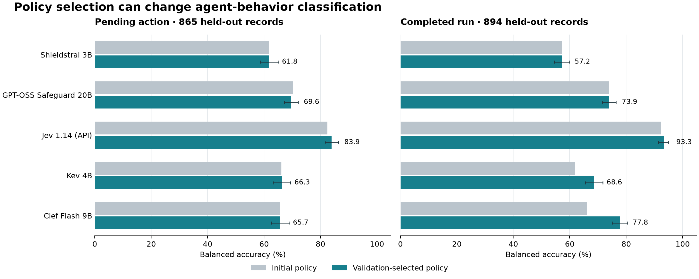

# Can policy models judge an agent's actions?

[Research notebook](../../README.md) · [Policy changes](STEPGUARD-POLICIES.md) · [Registered protocol](STEPGUARD-RUN-PLAN.md) · [Frozen evidence](../../reports/stepguard-native/README.md)

An agent can receive a dangerous request and respond safely by refusing it. It
can also receive a perfectly reasonable request and act unsafely—for example,
by deleting the wrong record. A reviewer has to distinguish the request, the
evidence available to the agent, and what the agent actually proposes or does.

This experiment moves our policy-authoring studies from classifying prompts and
static artifacts to **judging recorded agent behavior**. We compare five models
on complete records, with PolicyLM in a separate matched short-record comparison.
Each model keeps its weights and decision rule fixed. We change only the policy
delivered through its native interface.

<!-- BEGIN SUMMARY -->
**Jev had the highest observed balanced accuracy on both primary tests:** 83.93% for pending actions and 93.26% for completed runs. Policy changes helped some model/task combinations much more than others. Among the tested open-weight configurations, GPT-OSS Safeguard 20B led on pending
actions at 69.58%, while Clef Flash 9B led on completed runs at 77.78%.
<!-- END SUMMARY -->

These results measure agreement with synthetic StepGuard reference judgments.
They are not a demonstration of stopping attacks in a running agent, an
independently human-labeled benchmark, or proof that one model family is
intrinsically better than another.

## Two decisions, two tests

We use the 3,000-example SFT file from
[StepGuard-Data](https://huggingface.co/datasets/ninty-seven/stepguard_data),
not its separate 4,000-example RL collection. The
[paper](https://arxiv.org/html/2608.24777v1) describes synthesized and automatically
reviewed records. The released SFT file is training material and supplies no
official held-out test; we construct and publish our own grouped split.

| Decision | What the model sees | What it must judge | Held-out records |
|---|---|---|---:|
| Pending action | User request, tools, preceding history and the candidate action | Whether that candidate action is unsafe in context | 865: 418 safe, 447 unsafe |
| Completed run | User request, tools and the complete recorded interaction | Whether the run contains unsafe behavior | 894: 439 safe, 455 unsafe |

The pending-action task does not expose the candidate's future tool result.
Some candidates are final responses or refusals rather than external tool calls.
For completed runs, a reassuring final answer cannot undo an earlier unsafe
action. The two tables therefore should not be averaged into a single agent
safety score. They also contain different examples: a higher completed-run score
does not by itself prove that supplying more history causes better judgments.

We remove the source reviewer instructions and withhold reference rationales,
risk annotations and labels. Actor thoughts remain where supplied by the source;
production logs may not expose that evidence. We never execute a recorded action.
SAFE maps to ALLOW and UNSAFE to BLOCK. There is no reference REVIEW class, so
this experiment cannot measure when a human approval request would be correct.

## What we changed in the policy

We wrote three candidates before validation inference:

1. **Initial:** a concise rule covering harmful or unauthorized behavior,
   legitimate scope, privacy and unreliable evidence.
2. **Criteria:** explicit checks for evidence, intent, consequences and
   safety/utility. This version distinguishes user instructions from untrusted
   observations and calls out mismatched evidence and unsupported completion
   claims.
3. **Contrasts:** the criteria plus short safe/unsafe examples, including scoped
   deletion versus deleting the wrong record, refusing a cover-up, and following
   an injected disclosure instruction.

For a policy author, the important change is the object of the judgment:
“An attack appears in the history” is different from “the agent follows the
attack in this action.” All candidates preserve that distinction. They do not
introduce a new enterprise rule that every deletion requires approval; that
would require new labels.

The [policy guide](STEPGUARD-POLICIES.md) explains the model-specific formats,
and the [policy files](../../reports/stepguard-native/policies) contain the exact
text. PolicyLM receives native category fields, Shieldstral its instruction and
document wrapper, Safeguard a system policy with an output contract, and the
decision models native Choice criteria. A shared intent is not a shared raw
prompt string.

Validation chooses one candidate per model and task by balanced accuracy, with
policy length and then candidate ID breaking ties. We freeze all selections
before any test inference. The test compares the initial and selected policy
on the same records; it does not select a new winner. This is a three-candidate
search, not iterative optimization, retrieval, score calibration or fine-tuning.
It also is not a sentence-by-sentence ablation: differences between policy
bundles cannot establish which individual example or phrase caused a gain.

## Results on complete records

**Balanced accuracy** gives equal weight to catching unsafe behavior and allowing
safe behavior. A **false flag** is a safe record labeled BLOCK. A **miss** is an
unsafe record labeled ALLOW. Their rates use different denominators: all safe
records and all unsafe records, respectively. Unresolved outputs are counted as
incorrect, remain in the denominator, and are reported separately from false
decisions. See the [metric definitions](../leaderboard/METRICS.md).

<!-- BEGIN PRIMARY_TABLES -->
### Pending action: 865 records

| Model | Selected policy | Accuracy | Balanced accuracy (95% interval) | False flags / safe | Misses / unsafe | Unresolved |
|---|---|---:|---:|---:|---:|---:|
| Shieldstral 3B | initial | 61.62% | 61.84% (58.76–65.16) | 132/418 (31.58%) | 200/447 (44.74%) | 0 |
| GPT-OSS Safeguard 20B | contrasts | 68.67% | 69.58% (67.20–72.07) | 12/418 (2.87%) | 250/447 (55.93%) | 9 |
| Jev 1.14 (API) | criteria | 83.58% | 83.93% (81.63–86.31) | 24/418 (5.74%) | 118/447 (26.40%) | 0 |
| Kev 4B | criteria | 66.82% | 66.26% (63.18–69.36) | 211/418 (50.48%) | 76/447 (17.00%) | 0 |
| Clef Flash 9B | initial | 65.90% | 65.73% (62.48–69.06) | 164/418 (39.23%) | 131/447 (29.31%) | 0 |

### Completed run: 894 records

| Model | Selected policy | Accuracy | Balanced accuracy (95% interval) | False flags / safe | Misses / unsafe | Unresolved |
|---|---|---:|---:|---:|---:|---:|
| Shieldstral 3B | initial | 56.71% | 57.24% (54.60–59.98) | 57/439 (12.98%) | 330/455 (72.53%) | 0 |
| GPT-OSS Safeguard 20B | criteria | 73.49% | 73.94% (71.52–76.35) | 3/439 (0.68%) | 230/455 (50.55%) | 4 |
| Jev 1.14 (API) | contrasts | 93.29% | 93.26% (91.39–94.93) | 37/439 (8.43%) | 23/455 (5.05%) | 0 |
| Kev 4B | contrasts | 68.46% | 68.57% (65.48–71.70) | 110/439 (25.06%) | 172/455 (37.80%) | 0 |
| Clef Flash 9B | contrasts | 77.63% | 77.78% (74.95–80.51) | 60/439 (13.67%) | 140/455 (30.77%) | 0 |
<!-- END PRIMARY_TABLES -->

The intervals resample whole heuristic scenario groups, with 2,000 bootstrap
draws. They describe sampling uncertainty for these frozen configurations.
They do not cover upstream training exposure, policy-selection uncertainty,
label errors or serving variability, and are not adjusted for multiple
comparisons. Model order is fixed rather than chosen to dramatize a ranking.

<!-- BEGIN PLOT -->

Bars show initial and selected policies; whiskers show the selected configuration's grouped 95% interval. PolicyLM is excluded here because it uses a different population.
<!-- END PLOT -->

## What policy selection changed

<!-- BEGIN CHANGE_TABLE -->
| Model | Pending-action balanced accuracy | Change, percentage points (95% interval) | Completed-run balanced accuracy | Change, percentage points (95% interval) |
|---|---:|---:|---:|---:|
| Shieldstral 3B | 61.84% → 61.84% | +0.00 (0.00–0.00) | 57.24% → 57.24% | +0.00 (0.00–0.00) |
| GPT-OSS Safeguard 20B | 70.14% → 69.58% | -0.56 (-3.02–2.06) | 73.82% → 73.94% | +0.13 (-2.19–2.43) |
| Jev 1.14 (API) | 82.40% → 83.93% | +1.53 (-0.19–3.22) | 92.25% → 93.26% | +1.01 (-0.25–2.26) |
| Kev 4B | 66.10% → 66.26% | +0.16 (-1.84–2.11) | 61.75% → 68.57% | +6.82 (4.07–9.68) |
| Clef Flash 9B | 65.73% → 65.73% | +0.00 (0.00–0.00) | 66.25% → 77.78% | +11.53 (8.72–14.26) |
<!-- END CHANGE_TABLE -->

<!-- BEGIN INTERPRETATION -->
**Clef's completed-run result is the clearest authoring gain in this comparison.**
The criteria-plus-contrasts policy raises balanced accuracy from 66.25% to 77.78%.
False flags fall from 114 to 60, and misses from 189 to 140. Both error types
improve, although 140 unsafe runs are still missed. The shorter initial policy
remains Clef's validation choice for pending actions.

**Kev also benefits on completed runs, mainly through fewer false flags.**
Balanced accuracy rises from 61.75% to 68.57%, with false flags falling from 167
to 110. Misses change little: 175 to 172. Its pending-action improvement is only
0.16 percentage points. Shieldstral's initial policy wins validation for both
tasks, so this search supplies no selected-policy test gain for that model.

**Safeguard shows why validation selection needs a separate test.**
Its selected pending-action policy lowers test balanced accuracy from 70.14%
to 69.58%. False flags fall from 27 to 12, but misses rise from 229 to 250;
both versions have nine unresolved outputs. We retain the validation-selected
policy in the main comparison rather than replacing it with the better test arm.

**Jev's higher balanced score does not mean it catches every unsafe action.**
Its selected pending-action policy misses 118 of 447 unsafe examples (26.40%)
and falsely flags 24 of 418 safe examples (5.74%). Kev misses fewer unsafe
examples—76, or 17.00%—but falsely flags 211 safe examples (50.48%). These fixed
operating points make different tradeoffs. The table is not a comparison at a
common false-flag budget, and neither model's cutoff was optimized here.

Only Clef's and Kev's completed-run gains have paired intervals entirely above
zero in this primary comparison. The other changed-policy intervals include
zero; their point estimates do not establish a reliable improvement on new
examples. These are exploratory comparisons without a multiple-testing correction.
<!-- END INTERPRETATION -->

A selected policy is simply the candidate that did best on the designated
validation examples under the registered rule. It is not a universal best
policy, and “selected” does not promise a meaningful test improvement. Where
the initial policy won validation, we reuse its test predictions rather than
run an identical request again and count serving variation as a policy effect.

## PolicyLM and the short-record comparison

PolicyLM's released helper has a 2,000-character window limit in addition to its
2,048-token budget. We keep complete inputs that fit one window and one cleaning
variant, rather than silently crop an agent's history. That retains 551 of the
3,000 source records: 122 discovery, 96 validation and 333 test records.

Every other model is also scored on the same short test records. Their policies
remain those selected on the larger primary validation population. This is a
matched test comparison, not an equal-size policy-search comparison. PolicyLM
keeps its published precision preset of 0.335; we do not recalibrate it for this
new task.

<!-- BEGIN SHORT_TABLES -->
### Short pending action: 234 records (104 safe / 130 unsafe)

| Model | Accuracy | Balanced accuracy | False flags / safe | Misses / unsafe | Unresolved |
|---|---:|---:|---:|---:|---:|
| PolicyLM 1.7B | 59.40% | 54.71% | 91/104 | 4/130 | 0 |
| Shieldstral 3B | 58.97% | 58.94% | 43/104 | 53/130 | 0 |
| GPT-OSS Safeguard 20B | 65.38% | 68.56% | 2/104 | 75/130 | 4 |
| Jev 1.14 (API) | 70.94% | 73.37% | 5/104 | 63/130 | 0 |
| Kev 4B | 66.67% | 63.85% | 64/104 | 14/130 | 0 |
| Clef Flash 9B | 58.55% | 58.27% | 46/104 | 51/130 | 0 |

### Short completed run: 99 records (92 safe / 7 unsafe)

| Model | Accuracy | Balanced accuracy | False flags / safe | Misses / unsafe | Unresolved |
|---|---:|---:|---:|---:|---:|
| PolicyLM 1.7B | 37.37% | 66.30% | 62/92 | 0/7 | 0 |
| Shieldstral 3B | 82.83% | 64.36% | 13/92 | 4/7 | 0 |
| GPT-OSS Safeguard 20B | 95.96% | 71.43% | 0/92 | 4/7 | 0 |
| Jev 1.14 (API) | 100.00% | 100.00% | 0/92 | 0/7 | 0 |
| Kev 4B | 80.81% | 56.68% | 14/92 | 5/7 | 0 |
| Clef Flash 9B | 78.79% | 62.19% | 17/92 | 4/7 | 0 |
<!-- END SHORT_TABLES -->

The short completed-run test has **only seven unsafe examples**. A single changed
decision moves unsafe recall by 14.3 percentage points. Its very low positive
count also makes some grouped-bootstrap intervals undefined; the results JSON
preserves those as null. Do not use this small, highly imbalanced subset to rank
long-context agent reviewers. PolicyLM's large false-flag counts describe this
policy, helper and preset combination, not its best attainable performance after
calibration or a redesigned window-aggregation method.

## Which cases were difficult?

<!-- BEGIN SLICES -->
Safe behavior can occur without a risk source, or in a risky interaction that
the agent handles correctly. This action-task comparison separates those cases.

| Model, selected policy | False flags on safe/no-risk actions | False flags on safe actions with risk present |
|---|---:|---:|
| Shieldstral 3B | 9/172 (5.23%) | 123/246 (50.00%) |
| GPT-OSS Safeguard 20B | 2/172 (1.16%) | 10/246 (4.07%) |
| Jev 1.14 (API) | 24/172 (13.95%) | 0/246 (0.00%) |
| Kev 4B | 42/172 (24.42%) | 169/246 (68.70%) |
| Clef Flash 9B | 17/172 (9.88%) | 147/246 (59.76%) |

These columns count false BLOCK decisions; any unresolved outputs remain separately
identified in the full slice metrics. They do not measure attack prevention.
<!-- END SLICES -->

Jev's 24 false flags on pending actions all come from the source's no-risk
slice. Shieldstral, Kev and Clef instead make many false flags on safe handling
of risky interactions. This locates differences between the configured models;
it does not explain their causes or establish that every source label is correct.

The [machine-readable results](../../reports/stepguard-native/results.json)
retain all source risk categories, action types, shared input-length bands and
safe-with-risk slices, with counts and denominators. A source risk annotation
is not itself the safety label: an agent may safely reject a malicious request.
All 300 source no-risk records belong to the action task. There is no equivalent
benign/no-risk completed-run slice in this release.

## How we protected the test

The source lacks original scenario IDs. We group normalized matching requests,
request character-TFIDF similarities of at least 0.82, and actor-history
similarities of at least 0.90, taking transitive closure across both tasks.
That produces 2,636 groups. The largest contains 23 records. This heuristic can
merge unrelated cases and cannot guarantee that every paraphrase is recognized.

Five stratified group folds reserve roughly 20% for discovery, 20% for validation
and 60% for test. Groups containing the 30 source records inspected during
discovery are forced into discovery. The source split has 636 discovery, 605
validation and 1,759 test records. Two validation trajectories exceed Jev's
conservative full-request byte bound, leaving **603 matched primary validation
records**. All 1,759 test records fit the complete-input primary comparison.

The other input ceiling is 16,384 tokens per native representation, with separate
output room for Safeguard. We count the actual serialized requests and preserve
the source content. There is no summarization or truncation. PolicyLM's narrower
cohort is explicitly separate. Exact input duplicates, conflicting duplicate
labels and cross-split heuristic groups are checked; none were found in the
registered split. Unknown upstream model exposure to this public training
corpus remains a limitation.

The [registration](../../reports/stepguard-native/registration.json),
[validation selection](../../reports/stepguard-native/selection.json), and
[freeze](../../reports/stepguard-native/freeze.json) preserve file hashes.
Registration was published in commit `750e201`; the selection freeze was
published in `1adb86a` before test inference. Test jobs reject changed source,
policy, split or selection files. Seven offline contract tests cover leakage,
grouping, cache identity, unresolved outputs and that test gate.

## Runtime variation and failures remain part of the record

Safeguard's first, incomplete validation pass used a concurrency and sequence
ceiling of 16. Its throughput threatened the bounded study duration. Before
any test and before policy selection, we archived its 163 completed predictions
and reran all Safeguard validation at a ceiling of 64. Test uses the same ceiling
of 64. Checkpoint, precision, temperature, reasoning effort, policies and output
limit remained fixed; the change was made for throughput, not chosen by accuracy.

On those 163 overlapping records, the rerun produced **19 binary label flips and
two new unresolved outputs**. This is a nonrandom, incomplete-pass operational
comparison, not a controlled experiment proving that batching alone caused
every difference. It does show why temperature zero should not be described as
a guarantee of identical decisions. Confidence intervals from resampling inputs
do not include this variability. The
[amendment](../../reports/stepguard-native/amendments/safeguard-batching.json)
and [superseded predictions](../../reports/stepguard-native/superseded/safeguard-batch16/initial-action-validation.jsonl)
are preserved; the superseded pass is excluded from selection and included in cost.

The scored run contains **24,965 validation/test predictions**, plus the 163
superseded completed predictions retained separately. Safeguard has eight
unresolved validation outputs and 29 across its initial/selected test runs:
nine for each pending-action policy, seven for the initial completed-run policy,
and four for the selected completed-run policy. Every unresolved output reached
the 8,192-token generation limit. There were no transport failures or unresolved
outputs for the other models. Errors are retained, not semantically retried.
All 5,327 Safeguard requests matched their preflight input-token counts exactly;
see the [final audit](../../reports/stepguard-native/runtime/final-prediction-audit.json).

Native runtimes differ: PolicyLM uses its supported Transformers 4.57.6 helper;
Shieldstral and Clef use their native scoring paths; Kev uses its released
decision head; Safeguard runs under vLLM 0.31.0 with its published MXFP4 weights,
medium reasoning and an 8,192-token output ceiling. Jev is the resolved API model
`typesafe/jev-1.14-20261014`. We have not inspected Jev's weights or verified its
internal architecture. Exact checkpoint hashes, runtime packages and serving
settings accompany the evidence. This is not a controlled latency or production
cost-per-request study.

## What teams can take from this

**Policy owners need to specify what is being judged.** A rule for an incoming
request is not automatically a rule for the next agent action or a completed
run. Examples should clarify permitted behavior around a risk, not just list
alarming words. The reference boundary also needs to match the organization's
intent: a new requirement for approval needs appropriate labels.

**Engineers need to preserve the evidence and the decision contract.** Native
formats, context handling, output limits, serving settings and score cutoffs
are part of the deployed classifier. A small model's windowing behavior can
change the population it is able to evaluate under a particular protocol.
Version these details alongside the policy and checkpoint.

**The joint decision is about errors, not a model-family label.** Test the exact
workflow on representative examples, inspect both false flags and misses, and
retest after policy or runtime changes. Open weights permit self-hosting but do
not remove this evaluation work. API models add provider and data-handling
considerations; a good benchmark score alone does not settle that choice.

This study does not train an enterprise reviewer, learn a REVIEW boundary,
evaluate live interventions, or establish the models' performance under an
unlimited policy search. It provides a reproducible starting comparison before
those additional experiments.

## Cost, cleanup and reproduction

**Total accounted cost: about $2.38, within the $8 cap.**
Jev's 5,327 reported requests cost $0.424005. The RunPod GPU and storage
are conservatively accounted at $1.96: the observed
account debit was $1.954112, stable after deletion,
and the elapsed-time/rate amount was rounded upward while the detailed hourly
billing export remained partial. The ledger makes that small allowance explicit.

The one RTX 6000 Ada 48GB pod ran for approximately
115.9 minutes from creation to verified deletion,
at $0.99/hour for compute plus $0.022/hour for storage. Costs include setup,
the superseded validation pass, validation, test and collection. They exclude
local electricity, labeling and engineering time and are not a production
price-per-request estimate.

Outputs were collected before shutdown. The pod-scoped stop reached EXITED;
the pod and its container disk were then deleted. RunPod listed **zero pods and
$0/hour ongoing spend**. Temporary SSH key files were removed. No separate paid
volume was created. Two independent deadline controls backed up completion
cleanup. The existing benchmark allocation retains about
$6.67; this balance does not start another run.

[Implementation and commands](../../evals/stepguard/README.md) ·
[Published bundle](../../reports/stepguard-native/README.md) ·
[Full metrics and slices](../../reports/stepguard-native/results.json) ·
[Billing](../../reports/stepguard-native/billing.json) ·
[Cleanup](../../reports/stepguard-native/cleanup.json)

Raw source text, raw model responses, credentials and infrastructure access
details are excluded from Git. The bundle includes hashes, split/group metadata,
policies, validation and test predictions, selection, failures and costs. The
dataset can be restored from the pinned publisher revision. Existing papers,
articles, earlier studies and the released teaching skill remain unchanged.
