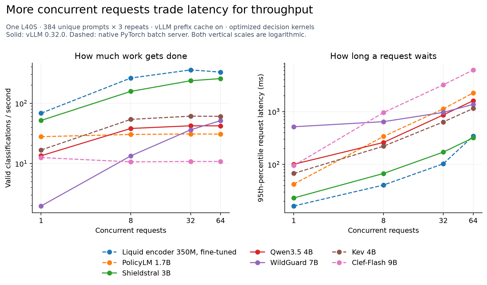

# What does it take to serve a moderation model?

A classifier's benchmark score answers whether it draws the right boundary.
It does not tell an engineer how long a user will wait, how many requests a GPU
can handle, or what keeping that GPU running will cost. This experiment adds
those operational measurements to our earlier classification studies.

We served seven previously studied systems on one NVIDIA L40S, rented for
$0.80/hour. Shieldstral, Qwen and WildGuard ran through vLLM 0.32.0. PolicyLM,
Kev, Clef-Flash and our fine-tuned Liquid encoder used their native scoring
implementations behind a small HTTP batching server. Those backend differences
are part of the result, not a detail to hide in a model ranking.
Jev was excluded because our Jev experiments use an API rather than downloadable
weights.

## What we found

Serving settings changed capacity while the policy and weights stayed fixed.
Shared-policy caching increased Shieldstral's throughput **6.6 times** at the
same 32-request load. Kev's optimized native runtime roughly doubled throughput.
Larger batches did not help every system, and PolicyLM's attempted larger
internal batch budget was rejected.

The table shows a common load point, **32 requests in flight**, alongside the
median latency when only one request is active. It is not an accuracy ranking or
each model's maximum throughput. The cost column applies to the 32-request
condition.

| Configured system | Runtime | One request: median | 32 in flight: valid requests/s | 32 in flight: p95 | GPU-only $/million |
|---|---|---:|---:|---:|---:|
| PolicyLM 1.7B | native; reference | 34.7 ms | 31.0 | 1127.4 ms | $7.18 |
| Shieldstral 3B | vLLM; prefix cache on | 18.8 ms | 237.0 | 171.3 ms | $0.94 |
| Qwen3.5 4B | vLLM; prefix cache on | 65.1 ms | 42.3 | 865.5 ms | $5.25 |
| WildGuard 7B | vLLM; prefix cache on | 504.3 ms | 36.3 | 967.3 ms | $6.12 |
| Kev 4B | native; optimized kernels | 58.6 ms | 61.2 | 638.2 ms | $3.63 |
| Clef-Flash 9B | native; optimized kernels | 73.2 ms | 10.8 | 3214.3 ms | $20.54 |
| Fine-tuned Liquid encoder 350M | native; reference | 14.5 ms | 358.4 | 103.1 ms | $0.62 |

Qwen's cache was enabled but recorded no prefix hits for this workload. Native
runtimes are not vLLM measurements. Clef's kernel extension is partial; its
convolution remains the reference implementation. All systems ran serially on
the same GPU, with their own policies, adapters and output formats.

The curves matter more than a single peak number. For example, cached WildGuard
rose from about **2 classifications/second with one request active** to
**51.5/second with 64 active**, while p95 latency rose from about **0.52 to 1.37
seconds**. Clef's optimized native server instead handled single requests at
about 12.6/second and fell to about 10.8/second under larger concurrent loads.
Choose the waiting time your workflow can tolerate, then assess its capacity.

The [full tables](RESULTS.md) include all conditions, repeat ranges, output
agreement and input/output lengths. The [reference-runtime plot](figures/reference/concurrency.png)
shows the original profiles with vLLM prefix caching off.

## How to read these measurements

**Latency** is the time from constructing a request to receiving and parsing its
complete classification; it is not time to the first generated token. The median
describes a typical request. The p95 tells us the
point below which 95% of measured requests finished. Both include server queueing
and batching waits, but exclude Internet travel: the client ran on the GPU host.

**Throughput** is the number of valid classifications completed each second.
“Valid” means the response could be parsed under the model's output contract;
it does not mean every classification was correct. This serving study does not
replace the earlier accuracy evaluations.

**Concurrency** is the number of simulated clients with an outstanding request.
Each client submits its next request after receiving a reply. It gives the server
an opportunity to batch work. It is different from telling a server to wait until
it has exactly that many prompts, and it is not an arrival-rate stress test.

**Prefix caching** reuses computation for an unchanged beginning of a request,
such as a shared policy. We report it separately. Each measured pass had unique
submitted prompts; caches were reset between passes and warmed with separate
inputs. Thus cached results reflect shared-prefix reuse rather than exact repeated
measurement inputs. A shared policy does not guarantee a cache hit: the model
architecture and runtime determine what can be reused.

## Serving settings changed capacity without changing the policy

The same Shieldstral policy and weights became much faster when vLLM could reuse
the shared policy prefix. Qwen did not gain that benefit in this configuration:
the runtime reported zero prefix-cache hits. Its common prefix ended before a
reusable cache boundary. This is a result for this model, runtime and workload,
not a general verdict on prefix caching.

Separate native-kernel runs improved Kev and Clef's profiles. Clef still handled
single requests more efficiently than our larger concurrent loads. Its extension
uses optimized linear attention but retains the reference convolution, so this
is not a claim about its maximum attainable serving speed.

PolicyLM's attempted larger internal token budget was rejected. At eight outer
batch rows, fitting throughput fell and a score shifted by 0.02951, beyond our
0.02 check limit, although none of the 32 checked labels changed. At 32 rows it
ran out of GPU memory during warm-up. We retain its successful original profile;
there are no final timings for the rejected extension.

| Same model, changed serving setting | C32 reference requests/s | C32 changed requests/s | Throughput ratio |
|---|---:|---:|---:|
| Shieldstral 3B: prefix cache off → on | 35.9 | 237.0 | 6.60× |
| Qwen3.5 4B: prefix cache off → on | 42.6 | 42.3 | 0.99× |
| WildGuard 7B: prefix cache off → on | 30.5 | 36.3 | 1.19× |
| Kev 4B: reference → optimized kernels | 29.0 | 61.2 | 2.11× |
| Clef-Flash 9B: reference → optimized kernels | 7.1 | 10.8 | 1.52× |

All accepted measurement requests returned parseable decisions. Output agreement
was not exact: a small number of decisions changed across batching conditions or
relative to archived predictions. The [complete results](RESULTS.md) expose those
counts. Throughput improvements do not, by themselves, establish equal accuracy.

## A cheap decision still needs enough traffic

The table's cost projection divides the GPU's hourly rate by its measured
throughput. It assumes sustained load on a warm GPU with this workload. It excludes
engineering, redundancy, monitoring, networking, idle time and model startup.
A dedicated GPU kept on for a 30-day month at this rate costs **$576**, regardless
of how few requests arrive. At 10% of the measured throughput, its GPU cost per
decision is ten times the fully utilized projection. Autoscaling changes that
calculation but introduces startup and capacity-management work.

This is why “dollars per million” is an operating scenario, not a provider price
quote or a complete business case. We used GPU.ai for the experiment because it
was the project's available capacity. This is not a comparison or endorsement of
GPU providers; RunPod remained available as a fallback.

## What was held fixed

We reused historical policy selections, native adapters and decision cutoffs.
These are representative historical configurations, rather than every model’s
latest accuracy-leaderboard selection. For Liquid we used the primary selected
fine-tuned encoder and classification head. It reads the submitted prompt without
a policy document. The policy and
decision models read their policies or typed classification instructions as well.
The amount of work therefore differs even when the submitted prompt is identical.
WildGuard generates its standard three fields, although this study uses only
prompt harmfulness; Shieldstral generates one token. We preserve those existing
interfaces rather than introduce a new output format for the speed test.

We chose serving settings on 96 WildGuardTrain prompts, then timed 384 separate
WildGuardTest prompts three times per condition. Labels were not used to select
serving settings. The measurements concern prompt
harmfulness only. Median submitted text length was 179 characters; the longest
was 3,013 characters. They do not characterize long enterprise documents, full
agent histories, images, multilingual traffic, simultaneous policy questions,
or ensembles sharing a GPU. No prompt truncation,
quantization, policy shortening, or threshold retuning was introduced for speed.

The vLLM search compared 2,048 and 8,192 scheduled tokens per iteration, with
normal compilation and CUDA graphs. Native servers compared maximum batches of
8 and 32, using a 2 ms admission window. We then swept concurrency 1, 8, 32 and
64, with an additional shared-prefix-cache condition for vLLM. The separate native
extensions test optimized decision kernels and PolicyLM’s
internal token budget, with fitting-only output checks before measurement. This
bounded search produces useful profiles; it does not establish any model's maximum
possible performance or the smallest GPU on which it could run. Native fused
kernels can still compile for an unseen batch shape after warm-up; all measured
repeats are retained, including that overhead.

## What an engineering team should do next

Start with the model-policy combinations that meet your error requirements.
Evaluate their classification quality under the intended serving configuration.
Then
measure them with your actual input lengths, traffic pattern and policy reuse.
Choose a concurrency and batching level that meets the waiting-time budget;
maximum throughput alone is insufficient. Repeat score and decision checks when
changing the inference engine, numerical precision or batching configuration.

Also consider the kind of flexibility you need. The
[Liquid study](../liquid-finetune/README.md), for example, evaluates a supervised
classifier with a fixed learned boundary; it does not establish that a fast
encoder can interpret a newly written policy.

Treat the deployment as a versioned combination of weights, policy, adapter,
cutoff and serving configuration. The accuracy studies and this serving study
answer complementary questions about that combination.

## Cost, evidence and reproduction

The complete experiment cost **$1.65**, including setup, downloads, failed
attempts, compilation, warm-up, inference and collection. The L40S ran for 7,434
billed seconds. It was terminated, temporary SSH keys were removed, and the
provider listed no remaining active instances. No paid inference API was used.
Cumulative accounted project spend is **$18.74001787256**, still within the earlier
$20 allowance; this pilot also stayed within its separately announced $5 ceiling.

Read the [registered plan](PLAN.md), [model-interface notes](COMPATIBILITY.md),
[complete profiles](RESULTS.md), [reproduction guide](REPRODUCE.md), and
[frozen evidence bundle](../../published_runs/2026-10-31-serving/README.md).
The bundle includes all 144 accepted timed passes—55,296 parsed classifications—
plus fitting attempts, failures, exact settings, environment records and billing.
Its public verification runs locally without a GPU or paid inference call.
