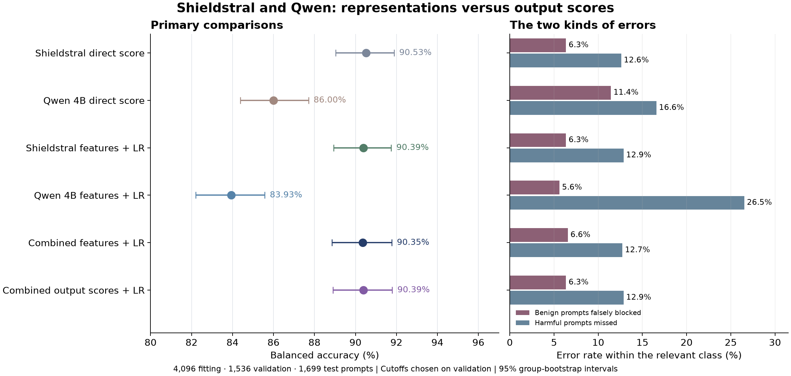

# Does reading inside Shieldstral improve its moderation decisions?

**In this experiment, Shieldstral's usual output score was already as useful as
the classifiers we trained on its internal representations. Adding Qwen did not
produce a clear improvement.** This is a useful negative result: extra features
and a second model did not earn their additional complexity on this task.

We tested Shieldstral-1.0-3B and Qwen3.5-4B on WildGuard prompt harmfulness. Both
received the same fixed policy through their respective input formats. We read
their internal vectors, trained logistic regressions on labeled examples, and
compared those classifiers with the models' direct label scores. Neither language
model's weights changed. No policy revisions were made in this experiment.

## The main results

These are the frozen choices evaluated on **1,699 test prompts: 945 benign and
754 harmful**. Balanced accuracy gives equal weight to correctly allowing benign
prompts and catching harmful ones. Every test prompt produced a usable score.
Direct scores normalize over the canonical yes/no or BLOCK/ALLOW token pair;
they do not measure unconstrained generated answers or calibrated risk.

| Method | Balanced accuracy | False blocks / 945 benign | Misses / 754 harmful |
|---|---:|---:|---:|
| Shieldstral direct score, validation-selected cutoff | **90.53%** | 60 | 95 |
| Qwen direct score, validation-selected cutoff | 86.00% | 108 | 125 |
| Shieldstral final-layer vector + logistic regression | 90.39% | 60 | 97 |
| Qwen final-layer content mean + logistic regression | 83.93% | 53 | 200 |
| Combined final-layer vectors + logistic regression | 90.35% | 62 | 96 |
| Logistic combination of the two output scores | 90.39% | 60 | 97 |

Against the Shieldstral-only feature classifier, the combined classifier caught
one more harmful prompt but falsely blocked two more benign prompts. It corrected
six individual mistakes and introduced seven new ones. The balanced-accuracy
difference was **−0.04 percentage points**, with a paired 95% interval from
**−0.48 to +0.39**. This does not demonstrate an advantage from combining vectors.

The Shieldstral feature classifier itself missed two more harmful prompts than
the direct-score control, with the same number of false blocks. Its difference
was −0.13 points, with an interval spanning zero. A learned head was useful in
our [earlier PolicyLM study](../activation-probe/README.md); that benefit did not
repeat here. Internal features are an option to test, not an automatic upgrade.

## Qwen's representation choice mattered

We registered a separate search over three layers and two ways of reading each
layer. Validation selected **Qwen layer 24's last input vector**, rather than
the final layer's average across content tokens. That classifier reached
**88.81% balanced accuracy**, with 56 false blocks and 124 misses. The primary
final-layer mean reached 83.93%, with 53 false blocks and 200 misses.

This comparison changes both layer and pooling, so it does not isolate a layer's
effect. It also does not locate where the model "understands policy." It shows
that the choice of representation can materially affect a supervised classifier.

For Shieldstral, validation selected the same final-layer representation as the
primary experiment. Combining it with the selected Qwen representation reached
**90.14%**. The broader search still did not establish a gain from two encoders.

## A better ranking is not necessarily a better allow/block decision

A simple equal-log-odds average of the two output scores had an observed AUROC
of **0.9556**, compared with 0.9485 for Shieldstral alone. Yet its frozen cutoff
produced **90.35% balanced accuracy**: four fewer false blocks and five more
misses than Shieldstral. We did not retune that cutoff on test.

The combined feature classifier's AUROC was 0.9452. It also had worse log loss
than the simple probability average, 0.729 versus 0.268. These are descriptive
diagnostics, not evidence that a raw score is a calibrated probability of harm.
They illustrate why a single accuracy figure cannot answer every deployment
question. See the [metric definitions](../leaderboard/METRICS.md).

## Validation looked much easier than test

Shieldstral's direct-score balanced accuracy fell from **98.73% on validation to
90.53% on test**. The primary combined classifier fell from 98.90% to 90.35%.
The gap was present before adding a learned feature classifier, so it cannot be
attributed solely to that classifier overfitting.

Our validation sample came from WildGuardTrain. Its prompt-harmfulness labels
were produced by GPT-4; WildGuardTest uses human annotations and a different
data mixture. That is a plausible contributor to the gap, not a causal finding
of this experiment. [WildGuardMix dataset documentation](https://huggingface.co/datasets/allenai/wildguardmix).

None of the **11 configurations selected under a 5% validation false-block
limit** stayed within that limit on test. None of the **11 selected under a 90%
validation recall target** reached 90% test recall. These are separate operating
profiles, each with its own frozen choices. They do not show that no possible
configuration could meet a target; they show that these validation guarantees
did not carry over.

The predefined adversarial slice was also harder: Shieldstral's direct score
reached 87.03% balanced accuracy on 796 adversarial examples, versus 93.61% on
903 non-adversarial examples. All category and adversarial slices are retained
in the results, including those that look less favorable.

## How we kept the experiment accountable

We fitted on 4,096 prompts, selected settings on a separate 1,536, and froze all
choices before uploading the 1,699 test prompts. These are the exact populations
and duplicate exclusions from the earlier representation study. Only prompt
harmfulness was tested, not assistant responses or HateXplain.

The primary classifier combines 3,072 Shieldstral features and 2,560 Qwen features.
The complete registered search fitted 75 small regressions, including output-score
controls. Scaling was fitted on training rows only. All fits converged and an
independent CPU refit reproduced every coefficient and validation score exactly.
Native output scores also matched full model-forward scores on 16 fitting cases
for each model. See the [protocol](PLAN.md), [full results](RESULTS.md), and
[reproduction guide](RUNNING.md).

This is a follow-up on an already examined public test, not a pristine blind
evaluation. Confidence intervals are descriptive and do not adjust for repeated
test use or model selection. Upstream checkpoint exposure to these public data
cannot be independently audited. Shieldstral's paper describes training on public
safety data and says its evaluation samples were held out, but does not give us
a complete sample-level training inventory. [Shieldstral paper, Sections 3 and 7](https://arxiv.org/html/2607.25857v1).

For historical context, WildGuard 7B scored 89.81% and the earlier
PolicyLM/Shieldstral/CoPE score ensemble scored 91.08% on these same test prompts.
They used earlier validation procedures. The primary combined probe's difference
from WildGuard was +0.55 points, with a paired interval of −0.25 to +1.33: no
clear improvement was established. This study remains separate from the common
512-row-validation leaderboard.

## What this means for the next experiment

For this policy and task, Shieldstral's direct score is the simpler baseline to
retain. The evidence does not justify adding a second encoder or a new feature
classifier solely to improve balanced accuracy. It does not prove that larger
representations, other heads, or other datasets cannot help.

The next question concerns **policy text**: can training mistakes guide a small
set of better definitions, exceptions, or examples? The
[training-error correction experiment](../research-directions/TRAINING-ERROR-CORRECTIONS.md)
is recorded and has not started. It will separate error discovery, validation
selection and an additional untouched holdout. Mistakes from this test will not
be recycled into claimed blind-test improvements. A classifier learned under
one fixed policy also needs reevaluation when that policy changes.

## Compute and evidence

One GPU.ai L40S run cost **$0.37**, including setup and the recorded pre-fit
tokenizer-container repair. The GPU was terminated, billing reconciled and
temporary SSH credentials removed. Cumulative recorded spend is **$14.5454 of
the $20 cap**. RunPod was not needed.

The [evidence bundle](../../published_runs/2026-10-30-shield-probe/README.md)
contains the policy, pinned model revisions, selections, fitted coefficients,
prompt-free predictions, full metrics, runtime records and source snapshot.
Source prompts and embedding vectors remain private. Extraction timing includes
instrumentation, and Qwen used a fallback attention implementation; these records
are not a matched serving-speed or minimum-GPU comparison.
