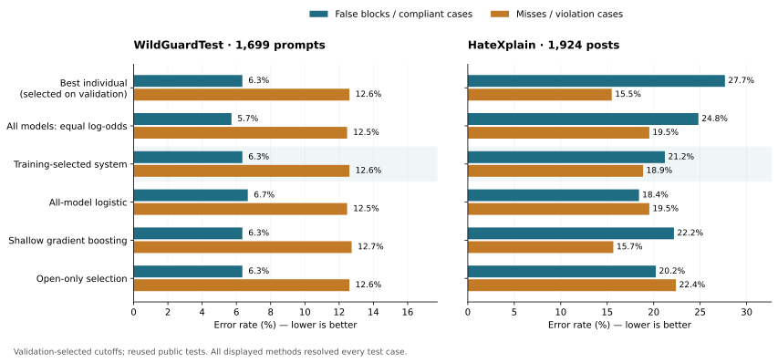

# Can models help correct each other's moderation mistakes?

**Sometimes—but a more elaborate combination was not a consistent upgrade.**
On HateXplain, learning how to combine model scores worked better than simply
averaging them. Against the strongest validation-selected individual, however,
the improvement traded fewer false blocks for more missed hate and remained
uncertain. On WildGuard, the training procedure chose to keep one specialist.

We tested seven model-policy configurations on WildGuard and six on HateXplain.
They included specialists, a general-purpose Qwen model, and Jev, Kev and Clef
decision models. Policies and language-model weights stayed fixed. The new
learning happened in a small score combiner.

## What “smart” meant in this experiment

Each model supplied a BLOCK score for the same content. We asked a logistic
regression to learn how much influence each score should have. To keep the
combination small, a model earned its place only if adding it improved predictions
on training folds that its combiner had not fitted.

We used 4,096 fitting examples and 1,536 separate validation examples per dataset.
Training folds chose components and regularization. Validation chose the final
decision cutoffs. We [published the freeze](SELECTION-FREEZE.json) before scoring
the tests. The official tests contain 1,699 WildGuard prompts and 1,924 HateXplain
posts. They have been used in earlier project studies, so this is exploratory
evidence on reused public tests, not a fresh blind evaluation.

The search could retain a single model. It could add up to four, with a minimum
0.2-percentage-point training-fold improvement for each addition. We also kept
predeclared controls: all-model logistic regression, one shallow gradient-boosting
model, simple averages, individual models, family-specific combinations, and an
open-weight-only pool. Nothing was replaced after seeing test results.

## HateXplain: useful combination, with a tradeoff

Training retained **Jev + Shieldstral + Kev**. Jev and Shieldstral did make different
mistakes in the fitting folds: Shieldstral was right on 318 cases Jev got wrong,
while Jev was right on 432 cases Shieldstral got wrong. That disagreement created
an opportunity; the learned combination still had to turn it into better decisions.

Under this benchmark's policy, hate is blocked; normal and offensive-but-not-hateful
posts are allowed. “False block” therefore means blocking a post labeled non-hate.

| Frozen system | Balanced accuracy | Ordinary accuracy | False blocks / 1,330 | Missed hate / 594 |
|---|---:|---:|---:|---:|
| Best individual selected on validation: Jev | 78.42% | 76.09% | 368 | 92 |
| Equal log-odds average of all six models | 77.83% | 76.82% | 330 | 116 |
| **Selected Jev + Shieldstral + Kev** | **79.97%** | **79.52%** | **282** | **112** |
| All six scores, logistic regression | 81.03% | 81.24% | 245 | 116 |
| All six scores, shallow gradient boosting | 81.08% | 79.83% | 295 | 93 |
| Open-only selection: Kev + Qwen 4B + Shieldstral | 78.69% | 79.11% | 269 | 133 |

Compared with equal averaging, the selected combination made **48 fewer false
blocks and four fewer misses**. Its balanced-accuracy gain was **2.14 points**,
with an exploratory paired 95% interval of **1.00 to 3.29 points**. This is the
clearest evidence here that how we combine scores matters.

Compared with the selected Jev individual, it made **86 fewer false blocks but
20 more misses**. That is 66 fewer mistakes overall, but not a reduction in both
types of error. The balanced-accuracy change was **+1.55 points**, with a paired
interval of **−0.04 to +3.14**. We cannot claim a clear advantage over that individual
from this comparison alone.

The two all-model learned controls had higher test point estimates than the small
selected system. They were registered before testing; they were not promoted to
the primary result afterward. The experiment does not establish a single winning
method. It also shows a limit of the greedy search: a small selected subset need
not be the best way to use all available scores.

## WildGuard: selection kept one specialist

Shieldstral was already very strong on the fitting folds. None of the attempted
additions met the preset improvement rule, so the primary result is a one-feature
logistic rescaling of Shieldstral's score.

| Frozen system | Balanced accuracy | Ordinary accuracy | False blocks / 945 | Missed harmful prompts / 754 |
|---|---:|---:|---:|---:|
| **Selected system / best individual: Shieldstral** | **90.53%** | **90.88%** | **60** | **95** |
| Equal log-odds average of all seven models | 90.91% | 91.29% | 54 | 94 |
| Equal log-odds average of three specialists | 90.79% | 90.94% | 75 | 79 |
| All seven scores, logistic regression | 90.43% | 90.76% | 63 | 94 |
| All seven scores, shallow gradient boosting | 90.46% | 90.82% | 60 | 96 |
| Decision-only selection: Jev + Kev | 89.68% | 90.11% | 61 | 107 |

The all-model equal average made seven fewer errors than Shieldstral, with a
**+0.38-point** balanced-accuracy change. Its paired interval, **−0.44 to +1.18
points**, includes zero. Learned coefficients did not produce a clear improvement.
Open-only and specialist-only forward selection also retained Shieldstral alone.

There is another important gap: the selected system scored **98.73% on validation
and 90.53% on test**. WildGuardTrain's model-derived labels and the human-labeled
test are different evidence sources. This study does not establish the cause of
the gap, but it shows why excellent development performance is insufficient.

The earlier common leaderboard reported 91.08% for a specialist average and 89.81%
for the released WildGuard model. Those are historical references with a different
validation protocol. We have preserved that leaderboard rather than mixing its
selections with the new study's 1,536-example validation population.

The highlighted training-selected system is Shieldstral alone on WildGuard and
Jev + Kev + Shieldstral on HateXplain. Lower bars mean fewer errors within each
label class. All displayed methods resolved every test case.

## Which models were complementary?

On HateXplain, removing Jev from the selected combination and refitting increased
false blocks from 282 to 287 and misses from 112 to 136. The full combination's
balanced-accuracy advantage was **2.21 points**, with a paired interval of **1.01
to 3.43**. That supports a useful Jev contribution within this particular setup.

Removing Shieldstral also increased both errors, but the paired interval included
zero. Removing Kev reduced misses by three while increasing false blocks by 11;
the small aggregate difference was uncertain. A model can pass a training-selection
rule without establishing a clear individual contribution on test.

Qwen, PolicyLM and Clef were not retained by the primary search on either task.
That does not establish that these models are unnecessary. Qwen was retained by
the HateXplain open-only search, and the all-model controls used every score.
These are results for fixed policies and score interfaces, with a bounded search.
We cannot infer the cause from proprietary or incompletely documented training data.

## A better aggregate score is not an operating guarantee

We separately froze cutoffs targeting a 5% false-block limit and 90% violation
recall. On WildGuard, neither selected target carried to test: the false-block
profile produced **8.47%** false blocks, while the recall profile caught **80.90%**
of harmful prompts.

On HateXplain, both targets carried to test, but each had a substantial cost.
The low-false-block profile blocked **4.06%** of compliant posts while catching
only **35.69%** of hate. The high-recall profile caught **91.25%** of hate while
falsely blocking **37.82%** of compliant posts. Teams need to choose that tradeoff
explicitly; a single leaderboard number cannot choose it for them.

## What a moderation team can take from this

- **Measure useful complementarity.** Different model families and different
  answers do not automatically produce a better combination. Test equal averages,
  learned combinations and strong single models under the same protocol.
- **Version the whole decision system.** Policy text, native adapter, model
  revision, score extraction, fitted coefficients and cutoff belong together.
  A policy edit or model replacement needs development evaluation again.
- **Keep both error types visible.** A method can reduce total mistakes while
  missing more violations. Set the operational objective with policy owners.
- **Budget for evaluation as well as inference.** The backbone weights stayed
  frozen, but the combiner required labeled examples and supervised training.
  More retained models also create serving requirements; combined production
  latency and cost were not benchmarked here.

The open-only HateXplain system reached 78.69% balanced accuracy. The API-dependent
primary reached 79.97%; their paired difference remained uncertain. This provides
an option to investigate for local deployment, not a claim that API access is
necessary or that the two approaches are equivalent.

## Evidence, cost and reproduction

New GPU cost was **$0.54**. Reported Jev API charges were **$0.873602268**, with an
additional **$0.011010048** conservatively accounted for four transport failures.
Total accounted cost was **$1.424612316**, bringing cumulative project spending
to **$16.69001787256 of the $20 cap**. The GPU was terminated and temporary SSH
keys removed. RunPod was not needed.

Jev canary scores varied for identical requests, so its development and test
outputs were recollected, with test calls made only after freezing. Kev and Clef
passed fixed development canary tolerances before archived test scores were reused.
One empty WildGuard fitting prompt remained unresolved for the decision models.
These issues and their handling are recorded in the amendments and run log.

The 2,000-draw paired intervals are exploratory, unadjusted, and conditional on
saved outputs. They do not cover API variability, policy search or repeated use
of these public tests. These findings support further evaluation on a fresh,
representative benchmark; they do not establish a production error guarantee.

- [Methods in plain language](METHODS.md) · [registered plan](PLAN.md) · [amendments](AMENDMENTS.md)
- [Frozen selections](SELECTED-SYSTEMS.json) · [full results, equations and controls](RESULTS.md)
- [Reproducible evidence bundle](../../published_runs/2026-10-31-smart-ensemble/README.md)
- [Machine-readable results](../../published_runs/2026-10-31-smart-ensemble/results.json) · [flat comparison table](../../published_runs/2026-10-31-smart-ensemble/results.csv)
- [Metric definitions](../leaderboard/METRICS.md) · [figure generator](../../tools/plot_smart_ensemble.py)

The CPU reproduction refits the combinations, repeats selection and verifies all
scores, metrics and intervals. It makes no API calls and requires no GPU. The
paper, magazine/media articles and pinned skill release have not been rewritten;
this bundle records the evidence for their next revision.
