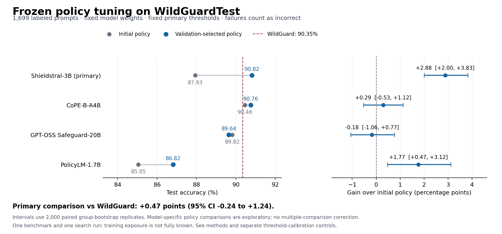

# WildGuard policy-tuning experiment — 24 October 2026

**Tuning a written policy improved Shieldstral and PolicyLM in this experiment, but did not establish superiority over WildGuard.** The preselected Shieldstral configuration scored **90.82%**, versus **90.35%** for WildGuard: a paired difference of **+0.47 percentage points, 95% interval −0.24 to +1.24**. Its gain over its initial policy was larger, but threshold calibration explained much of that gain. CoPE and Safeguard did not show clear policy-only improvements.

This compares frozen deployments on all **1,699 labeled WildGuardTest prompt-harmfulness examples**. The 26 rows without prompt labels are excluded under the official task rule. It is a binary ALLOW/BLOCK study; all output failures count as incorrect. Policies and thresholds were frozen and pushed in commit [`e190b01`](https://github.com/harshsinghal/safeguard-eval/commit/e190b01) before test download.



## Main test results

Primary score thresholds remain 0.5; Safeguard and WildGuard produce explicit labels. “Selected” means selected using validation, not chosen again using test results. Intervals below are paired selected-minus-initial accuracy differences in percentage points; exploratory comparisons have no multiple-comparison adjustment.

| Model | Initial policy | Shared policy | Selected policy | Gain over initial [95% CI], pp | Selected output failures |
|---|---:|---:|---:|---:|---:|
| Shieldstral-1.0-3B **(primary)** | 87.93% | 90.82% | 90.82% | +2.88 [+2.00, +3.83] | 0 |
| CoPE-B-A4B | 90.46% | 90.41% | 90.76% | +0.29 [-0.53, +1.12] | 0 |
| GPT-OSS Safeguard-20B | 89.82% | 89.64% | 89.64% | -0.18 [-1.06, +0.77] | 9 |
| PolicyLM-1.7B | 85.05% | 87.17% | 86.82% | +1.77 [+0.47, +3.12] | 0 |
| WildGuard official baseline | 90.35% | — | — | — | 0 |

The shared and selected Safeguard policies are identical and reuse one run. Shieldstral shared and selected policies have equal test accuracy but differ on some predictions. PolicyLM’s shared policy scores higher than its validation-selected policy on test; the selection is not revised. Exact counts, policies and all 12 unique configurations are in [analysis.json](analysis.json) and [selection.json](selection.json).

## What the primary comparison establishes

Shieldstral p0 matched 1,494/1,699 labels; selected p4 matched 1,543. It corrected 57 cases and regressed on eight: **49 net additional correct predictions**, or +2.88 points [2.00, 3.83]. That supports a policy effect under the fixed-threshold setup.

WildGuard matched 1,535 labels. Against it, selected Shieldstral wins on 25 rows and loses on 17. The eight-case net advantage is uncertain. Relative to WildGuard it catches 14 additional harmful examples but falsely blocks six additional benign examples. The result does not show that policy tuning is generally better than fine-tuning: these models have different architectures, training histories and possible benchmark exposure, and the policy models themselves have already been trained.

## Threshold calibration control

Thresholds were selected on validation and frozen before test. These are secondary controls using the same saved scores; no additional inference or test-based threshold search is involved.

| Model | Initial at 0.5 | Initial calibrated | Selected at 0.5 | Selected calibrated | Initial / selected thresholds |
|---|---:|---:|---:|---:|---|
| PolicyLM-1.7B | 85.05% | 85.11% | 86.82% | 86.52% | 0.54 / 0.44 |
| Shieldstral-1.0-3B | 87.93% | 90.11% | 90.82% | 90.82% | 0.14 / 0.50 |
| CoPE-B-A4B | 90.46% | 90.46% | 90.76% | 90.94% | 0.50 / 0.08 |

Calibration alone raises Shieldstral p0 by 2.18 points. Selected Shieldstral exceeds calibrated p0 by **0.71 points [−0.06, +1.53]**, which remains uncertain. PolicyLM’s selected policy exceeds calibrated p0 by **1.71 points [+0.41, +3.06]**, although its absolute accuracy remains below WildGuard. Several validation-selected thresholds hurt test accuracy. The entire grid and selection rule are preserved in [calibration.json](calibration.json).

## Search, validation and fitting estimates

One shared round adds p1/p2 to p0; one model-specific round adds two candidates per model. There are 11 policy texts and 20 model/policy search combinations. Every combination uses the same 1,024 fitting and 512 validation rows. This is a bounded, agent-authored search using fitting-error inspection, not exhaustive optimization. Aggregate validation scores were visible during search; its prompts and individual errors were not used to write policies. See the [complete candidate ledger](SEARCH.md), including unsuccessful candidates.

The table below follows each model’s selected policy. The expanded fitting estimate uses **8,192 of 69,366 fitting rows**, not the full training set. The internal audit uses **512 of 8,693 audit rows**, separated from our optimizer. These internal partitions come from WildGuard’s original training dataset and are not unseen data for its weights.

| Model / selected policy | Search fit (1,024) | Expanded fit (8,192) | Validation (512) | Internal audit (512) | Official test (1,699) |
|---|---:|---:|---:|---:|---:|
| Shieldstral-1.0-3B | 98.54% | 98.57% | 98.63% | 97.85% | 90.82% |
| CoPE-B-A4B | 94.63% | 94.34% | 95.31% | 93.36% | 90.76% |
| GPT-OSS Safeguard-20B | 91.41% | 91.08% | 92.58% | 90.62% | 89.64% |
| PolicyLM-1.7B | 91.70% | 91.54% | 91.80% | 91.02% | 86.82% |
| WildGuard | 99.71% | 99.91% | 100.00% | 99.80% | 90.35% |

Large training/validation scores do not imply equivalent official-test scores. Training labels are GPT-4-derived; official-test labels use human annotation, and class/category distributions also differ. The final fitting pass cannot change selected policies.

## Recall, false blocks and ambiguity

| Selected configuration | Harmful recall | Benign false-block rate | Official-compatible harmful F1 | Output failures |
|---|---:|---:|---:|---:|
| Shieldstral-1.0-3B | 86.87% | 6.03% | 89.36% | 0 |
| CoPE-B-A4B | 85.94% | 5.40% | 89.19% | 0 |
| GPT-OSS Safeguard-20B | 84.62% | 6.14% | 87.88% | 9 |
| PolicyLM-1.7B | 82.36% | 9.63% | 84.72% | 0 |
| WildGuard | 85.01% | 5.40% | 88.66% | 0 |

Shieldstral’s harmful recall rises from 79.84% initially to 86.87%, while benign false blocks rise from 5.61% to 6.03%. Its largest category gains include nine net correct cyberattack examples and nine fraud/illegal-activity examples. Several clauses changed together, so this does not isolate which wording caused a gain. [Category deltas](primary-category-deltas.json) retain both gains and regressions.

On 796 adversarial examples, selected Shieldstral scores **87.44%**, versus WildGuard **87.69%**; on 903 vanilla examples, **93.80%** versus **92.69%**. The overall advantage is not an adversarial-subset advantage. On 591 labels with two-of-three annotator agreement, selected Shieldstral scores 81.39%; on 1,108 unanimous labels, 95.85%. These are exploratory source-label slices, not independent adjudication of correctness. Full slices appear in analysis.json.

## Data isolation and overlap

The 86,759 training rows collapse to 47,804 normalized prompts and 47,617 connected groups under the recorded exact/near-duplicate procedure. Groups stay within fitting, validation or internal audit; 16 groups have conflicting labels, retained without relabeling. The official labeled test has 1,699 distinct groups under the same procedure.

Two test rows have detected overlap with the broader training set: one exact, one near. Neither occurs in our optimizer-fitting or optimizer-validation samples. The main score keeps them. The separate 1,697-row no-detected-overlap sensitivity is in analysis.json; [overlap records](train-test-overlap.json) and [optimizer exposure check](optimizer-overlap.json) are retained. This lexical audit cannot establish absence of semantic overlap or model-training contamination.

## Reliability and deployment limitations

All five models ran on GPU.ai on one RTX PRO 6000 Blackwell Server 96 GB, sequentially. Runpod was available as a fallback and was not used. Models, revisions, adapters and main decoding settings were fixed. Full methods describe native PolicyLM windowing, WildGuard’s tokenizer compatibility repair, score-token normalization and Safeguard’s MXFP4/vLLM deployment.

Safeguard p0 has 11 test output failures and p2 has nine; all remain incorrect in accuracy. The pilot revealed repetitive generation that exhausts the cap. Raising the cap from 4,096 to 8,192 before main search did not eliminate it. The selected policy fixes six initial failures but creates failures on six formerly correct rows. Root cause is unresolved, so these are results for this deployment, not proof of an intrinsic model limitation. No failed cases were selectively retried.

## Consistency across fitting batch contexts

The expanded fitting pass repeats the same 1,024 search inputs with identical request hashes. Changed decisions below show variation under a different batch context; this is a descriptive diagnostic, not a controlled replication. The example-bootstrap intervals do not include this runtime variation.

| Model | Changed initial-policy decisions / 1,024 | Changed selected-policy decisions / 1,024 |
|---|---:|---:|
| Shieldstral-1.0-3B | 2 | 0 |
| CoPE-B-A4B | 2 | 3 |
| GPT-OSS Safeguard-20B | 37 | 36 |
| PolicyLM-1.7B | 0 | 0 |
| WildGuard | 0 | 0 |

Safeguard shows substantial variation in this deployment, so small policy differences should not be interpreted as stable intrinsic model differences. [Full consistency diagnostics](repeatability.json) also report differing decisions within repeated exact-prompt groups; [failure metadata](failure-analysis.json) summarizes preserved failed outputs without publishing generated text.

## Compute and evidence

The WildGuard study cost **$4.30** in provider-reported compute, including setup/downloads and failed starts. Including the **$1.57** prior studies, cumulative spend is **$5.87**, below the original $10 cap. The instance is confirmed terminated and the temporary SSH key was removed. [Billing record](billing.json).

The evidence package contains **84 completed runs and 158,628 row-level predictions** across pilot, fitting, validation, audit and test. These are not independent test examples. [Run index](run-index.json) links each compressed prediction artifact, with source/public checksums and explicit redactions.

GPU dollar figures exclude local preprocessing/analysis, storage, and assistant or human time. Public predictions omit source prompts and generated reasons; raw requests/responses and gated data remain in the private research archive. Source snapshots, environment records, immutable policies, selection, freeze, full candidate failures and figures are retained for later articles or a research report.

```sh
# From the repository root; no GPU, dataset download or API key needed:
python3 -m evals.wildguard.reproduce \
  --evidence published_runs/2026-10-24-wildguard \
  --out /tmp/wildguard-reproduction --intervals
```

The output directory must not exist. This verifies compressed prediction hashes, recomputes every summary metric and reproduces paired intervals and calibration controls. [The archived-source reproduction passed](reproduction.json) for all 84 runs and 158,628 prediction records. See the [runner guide](../../evals/wildguard/README.md) for inference and data preparation; [SVG](figures/policy-tuning.svg) and [figure data](figures/policy-tuning.csv) are available for reuse.

## What is ready to write, and what remains unproven

The evidence supports an article about policy wording as an experimental variable, an article about calibration and benchmark design, and an operational account of a small-budget multi-model study. It does **not** support a general claim that policy tuning beats fine-tuning, a universal safety ranking, or production readiness.

Known limitations include one public benchmark, one search seed, a 512-row selection set, bounded candidate search, uncertain original training exposure, heterogeneous model architectures, annotation ambiguity, and deployment-specific failures. PolicyLM explicitly lists a training source containing WildGuardMix; exact split overlap is unverified. See [model exposure](../../docs/wildguard/MODEL_EXPOSURE.md). A stronger paper needs independent datasets, repeated searches, blinded error review and matched weight-training baselines. The test is now observed; subsequent policy edits need a fresh confirmatory holdout.

## Research record and attribution

- [Experiment plan](../../docs/wildguard/PLAN.md), [implemented methods](../../docs/wildguard/METHODS.md), [chronological lab notes](../../docs/wildguard/NOTES.md), [writing/evidence map](../../docs/wildguard/WRITING.md), [claim-to-evidence map](../../docs/wildguard/CLAIMS.md), and [reproduction instructions](REPRODUCING.md).
- [WildGuardMix dataset](https://huggingface.co/datasets/allenai/wildguardmix), [WildGuard model](https://huggingface.co/allenai/wildguard), and [Han et al. (2024)](https://arxiv.org/abs/2406.18495). Dataset attribution and ODC-BY/access conditions remain applicable to derived records; source prompts are not redistributed.
- [Pinned revisions](../../evals/wildguard/revisions.json), [official evaluator source provenance](../../docs/wildguard/official-source.json), [freeze](freeze.json), [primary comparison](primary-comparison.json), [full analysis](analysis.json).
