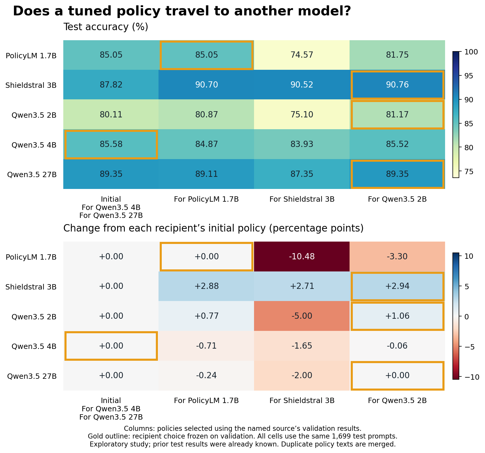

# Policy transfer across five frozen classifiers

Read the [plain-language findings](../../docs/policy-transfer/READOUT.md),
[policy changes](../../docs/policy-transfer/POLICY-CHANGES.md),
[prospective protocol](../../docs/policy-transfer/PLAN.md), and
[lab notebook](../../docs/policy-transfer/NOTES.md).

This exploratory study generated 20 fresh revisions using isolated source-model
fitting feedback, selected on validation, and transferred the source winners across
PolicyLM 1.7B, Shieldstral 3B, and Qwen3.5 2B/4B/27B. Qwen 4B and 27B retained p0,
so the transfer pool contained four distinct policy texts. The full test matrix has
20 unique model–policy combinations. All use the same 1,699 labeled WildGuardTest
prompts; response-harmfulness and refusal labels are not prediction targets.

## Frozen recipient choices: official test

| Model | Policy chosen on validation | Accuracy | Harmful F1 | Harmful recall | Benign false-block rate | Output failures |
|---|---|---:|---:|---:|---:|---:|
| PolicyLM 1.7B | For PolicyLM | 85.05% | 83.74% | 86.74% | 16.30% | 0 |
| Shieldstral 3B | For Qwen 2B | 90.76% | 89.18% | 85.81% | 5.29% | 0 |
| Qwen3.5 2B | For Qwen 2B | 81.17% | 80.07% | 85.28% | 22.12% | 0 |
| Qwen3.5 4B | Initial | 85.58% | 83.25% | 80.77% | 10.58% | 0 |
| Qwen3.5 27B | For Qwen 2B | 89.35% | 88.32% | 90.72% | 11.75% | 0 |



Qwen 2B's policy improved Shieldstral by **2.94 points** versus its initial policy
(unadjusted paired 95% interval **+2.00 to +3.94**). The reverse transfer reduced
Qwen 2B by **5.00 points** (**−6.42 to −3.65**). Applying Shieldstral's policy to
PolicyLM reduced accuracy by **10.48 points** (**−12.48 to −8.48**).

Under the frozen shared-pool choices, Shieldstral exceeds Qwen 27B by **1.41 points**
(**+0.06 to +2.77**). This narrow unadjusted edge is conditional on this search. The
[earlier Qwen experiment](../2026-10-25-qwen/) achieved **91.29%** with a different
27B policy; those shared historical policies were excluded here to isolate source
feedback. This is not a ranking of the models' best known capabilities.

The official test has 1,699 distinct stored group IDs, so the registered group
bootstrap is effectively case-level on this split. Intervals are descriptive,
unadjusted for multiple comparisons, and exclude search/runtime variation. The
already observed benchmark, one editor, limited search, differing model interfaces,
and unverified policy-scope preservation constrain interpretation. A pre-test text
review found an omitted explicit sexual-content category in the Shieldstral draft.
The full matrix retains that policy and all other candidates unchanged.

## What is preserved

- **92 new runs, 81,084 new classifications**, plus **10 reused baseline runs and
  7,680 classifications**; 20 editor calls, with no repair or fallback needed.
- `new-runs/` and `baseline/`: prompt-free predictions, manifests, policies and
  summaries. Every request returned a valid classification; label disagreements
  remain in the accuracy/F1/recall/false-block scores.
- `policies/`, `candidates.json`, `source-selection.json`, `freeze.json`: all drafts,
  source winners, shared-pool choices, exact hashes and selection provenance.
- `analysis.json`: full audit/test matrices and paired comparisons, including losses.
- `registration.json`, `registry.json`, `source/`, `runtime/`: registered inputs,
  pinned revisions, inference/analysis code and captured environments.
- `collection-verification.json`: all new requests reconstructed exactly, raw output
  decisions replayed, and source-only fitting feedback verified. Probability replay
  allows 1e-12 absolute rounding tolerance; the largest observed difference was
  1.39e-17. Labels matched exactly.
- `reproduction.json`, `archived-source-reproduction.json`, `repeatability.json`:
  CPU reproduction and comparison with previous p0 runs. Repeated p0 inference
  changed 17 of 8,495 labels; no results were changed in response.
- `figures/`: checked PNG, editable SVG, vector PDF and plotted-data CSV.
- `billing.json`, `compute.json`: GPU.ai cost **$2.32**, cumulative **$10.78/$20**,
  terminated instance and temporary-key cleanup. RunPod capacity was not required.
- `private-archive.json`: hash/size of the separately retained private archive.
  Gated prompts, full requests/responses, editor traces and server logs are not
  included in this public download. No API tokens or private SSH keys are published.

## Reproduce

From the repository root, using Python's standard library:

```sh
python3 docs/policy-transfer/reproduce.py --bundle published_runs/2026-10-25-policy-transfer
```

This recomputes all recorded metrics, validates selections, and reproduces the full
matrix and paired intervals. It does not require a GPU, API key or gated prompt text.
See the [running guide](../../docs/policy-transfer/RUNNING.md) for data reconstruction
and a new paid inference run. `SHA256SUMS` covers the public artifacts.

Dataset: [AllenAI WildGuardMix](https://huggingface.co/datasets/allenai/wildguardmix),
pinned revision `d29c47f41c8b51348b5c8e8c81c039b3132b66d1`; preserve its access
conditions and ODC-BY attribution. Exact model revisions are in `registry.json`.
Model sources: [PolicyLM](https://huggingface.co/musubilabs/policylm-1.7b),
[Shieldstral](https://huggingface.co/mistralai/Shieldstral-1.0-3B), and
[Qwen3.5](https://huggingface.co/Qwen). The shared editor is pinned Qwen3.5-27B.
