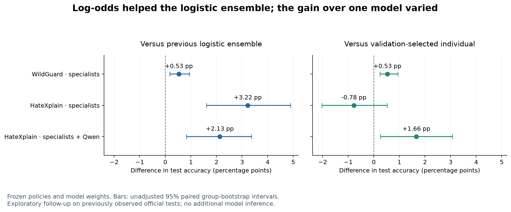

# Can we improve policy decisions without fine-tuning a language model?

**Yes, these experiments demonstrate a practical route—and the log-odds follow-up improved the ensemble results.** We used released models, kept their weights fixed, and changed how their scores were combined. That required no additional GPU inference.

The strongest defensible message is that a team can adapt released policy models through written policies, labeled evaluation, calibration and small learned combiners, without running its own language-model fine-tuning pipeline. The evidence does not show that a policy document alone is sufficient, or that this process always beats fine-tuning.

## What changed this time?

Our earlier ensemble combined each model's score between zero and one. This experiment converted those same scores into **log-odds**: a measure of how strongly a model favors blocking over allowing. A score of 0.5 becomes zero; a score above 0.5 becomes positive; one below 0.5 becomes negative.

We then fitted logistic regression to those values. It learns how much each model's opinion should contribute and where to draw the final decision boundary. It can assign a negative coefficient, so this is more flexible than a weighted vote with positive weights.

We reconstructed log-odds from the saved scores; we did not capture new model activations or full-vocabulary logits. The transformation adds no new information. It changes the shape of the inputs that a linear combiner can use.

The policies, models and examples stayed exactly the same. Each benchmark used **4,096 fitting examples and 1,536 validation examples**. Validation selected the regularization and decision threshold. We froze all three cohorts before evaluating this extension on the same official tests: **1,699 WildGuardTest prompts and 1,924 HateXplain posts**.

## The results improved, but not equally

| Test | Previous logistic ensemble | Log-odds logistic ensemble | Change |
|---|---:|---:|---:|
| WildGuard: PolicyLM + Shieldstral + CoPE | 90.76% | **91.29%** | +0.53 points |
| HateXplain: PolicyLM + Shieldstral | 75.57% | **78.79%** | +3.22 points |
| HateXplain: the two specialists + Qwen 4B | 78.69% | **80.82%** | +2.13 points |

These are the configurations chosen on validation, not whichever setting later scored highest on the test. The corresponding unadjusted paired 95% intervals for the accuracy changes were **+0.18 to +0.94**, **+1.61 to +4.89**, and **+0.83 to +3.37** percentage points. They describe these reused test sets, rather than an independent confirmation.

**WildGuard provides a useful demonstration of the approach.** The log-odds ensemble scored **91.29%**, compared with **90.35%** for the released WildGuard model: 16 additional correct decisions. The difference was **+0.94 points**, with an unadjusted interval of **+0.06 to +1.77**. It missed 87 harmful prompts versus WildGuard's 113, while making 61 false blocks versus 51. The gain was not free of trade-offs.

The strongest individual observed in the registered WildGuard controls scored **90.88%**. The ensemble exceeded it by seven correct answers. Our earlier simple probability average reached **91.41%**, so the log-odds method did not set a new highest observed score across the entire research history. It improved our predeclared logistic method.

**HateXplain specialists alone still did not win.** Their log-odds ensemble's **78.79%** remained below calibrated Shieldstral's **79.57%**. It made fewer false blocks, but missed 303 hateful posts versus Shieldstral's 216. This negative result is part of the finding.

**The mixed HateXplain ensemble was more promising.** Its **80.82%** exceeded the validation-selected Qwen individual at **79.16%**, a gain of 32 correct answers. It also exceeded Shieldstral, the strongest individual observed on this test, by **24 correct answers**, or **1.25 points**. That latter comparison is descriptive; its unadjusted interval was **+0.10 to +2.44** points.

Against Shieldstral, the mixed ensemble reduced false blocks from 177 to 143 but increased missed hateful posts from 216 to 226. Macro-F1 rose from **75.62% to 76.58%**, while hate recall fell from **63.64% to 61.95%**. A team must still choose which errors it is willing to accept. Here, HateXplain's policy blocks hate speech and allows offensive and normal posts; it does not block all offensive content.

The secondary equal-log-odds average scored 90.94%, 77.34% and 78.74% across the same three cohorts. Merely switching the averaging scale was not enough to reproduce the learned combiner's gains.

## What we can say about avoiding fine-tuning

A useful statement for the paper or an article is:

> Teams can adapt released policy models through policy authoring, labeled evaluation and lightweight calibration or ensembling, without updating the underlying language-model weights. In our exploratory WildGuard comparison, this approach achieved accuracy competitive with the released task-specific WildGuard classifier. Gains depended on the benchmark and configuration, and did not eliminate false-block and missed-violation trade-offs.

There are three distinctions behind that statement.

First, **we avoided additional language-model fine-tuning by the deploying team**. The models were already trained by their creators. Some policy models' documented training sources include safety benchmarks relevant to this study; exact split exposure is not fully known. This is not a demonstration of learning the task entirely from policy text with no prior task knowledge.

Second, **the ensemble still learns from labeled examples**. We trained small calibrators and combiners. Policy authors and engineers still need representative examples, validation criteria, error review and release tests. The work changes; it does not disappear.

Third, **we have not measured whether this is easier or cheaper overall than fine-tuning**. We did not fine-tune a matched base model, compare equal engineering budgets, or track human effort. The released WildGuard model is a performance comparator, not a controlled comparison of two development processes. Our reported GPU costs omit local CPU and researcher/assistant time.

## How this connects to policy authoring

The earlier experiments showed that policy wording can change a model's decisions and that policies do not transfer uniformly between interpreters. This extension held the wording fixed and tested the combination layer. It therefore cannot be presented as another improvement caused by policy editing.

Together, the studies show a workflow a team can actually follow: articulate the policy, test it with the intended model, inspect the errors, calibrate the decision threshold, and add another model only if the measured gain justifies the added complexity. Version the policy, adapter, model, threshold and combiner together.

That is a concrete option for teams that cannot operate a language-model fine-tuning pipeline. Our contribution is demonstrating and documenting that option—not declaring fine-tuning obsolete or promising that an ensemble always wins.

## Evidence and limits

All 58 new configurations were specified before fitting. The original ensemble archive is unchanged, and the individual models received matching log-odds calibration controls. No valid score was zero or one, so no clipping parameter was introduced. The tests had already been observed in earlier experiments; these are exploratory follow-ups with unadjusted intervals and unknown upstream benchmark exposure.

This extension used **no new model inference and no additional paid compute**. Cumulative spending remains **$12.50 of $20**. See the [complete results](RESULTS.md), [claim-to-evidence guide](CLAIMS.md), [original plan](PLAN.md), and [reproducible evidence package](README.md).
