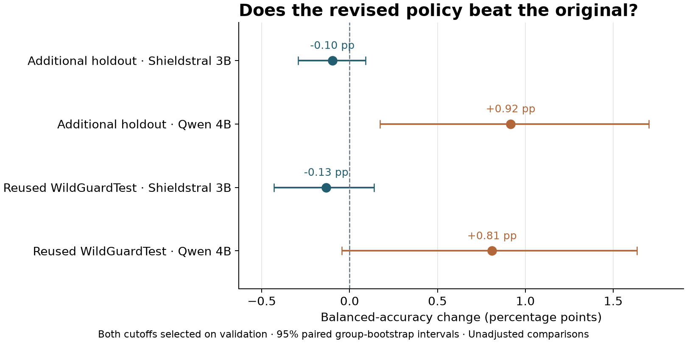

# Can training mistakes help us write a better policy?

**One round of corrections did not improve Shieldstral, but the same revision
helped Qwen on an additional project holdout.** Its gain on reused WildGuardTest
was smaller and uncertain. This is evidence that a policy edit can behave
differently with different interpreters—not that error-driven editing always
works, or that we found an optimal policy.

We kept the model weights fixed. The only changes were the policy text and the
cutoff that converts a model score into ALLOW or BLOCK. The starting policy was
already tuned in earlier work, so this tests the value of another authoring round.

## What we changed

We reviewed Shieldstral's 58 mistakes on 4,096 discovery prompts: 18 false blocks
and 40 missed violations. Nineteen cases suggested clarifications. The other 39
had insufficient context or an uncertain relationship between policy and label;
we recorded those concerns and kept every original label. This was agent-assisted
authoring, not an independent expert review of the dataset.

We prepared four revisions before running validation: clarify permitted cases,
clarify prohibited cases, combine both, and add two contrasting example pairs.
The [exact edits](POLICY-EDITS.md) explain each addition and link it to its source
training errors.

Validation selected **p1**, which adds 120 words about permitted cases. For
example, asking a factual question about a dangerous substance is different from
asking how to harm someone with it. Aggressive business language can describe
ordinary competition. Fictional records are different from a real person's
private information. The original prohibitions remain.

More text did not automatically help. The combined revision and the version
with examples scored below the simpler permitted-case revision on validation.
At cutoff 0.5, p1 fixed six discovery mistakes but introduced six others.

## How we avoided choosing edits from test mistakes

| Population | Examples | Role |
|---|---:|---|
| Discovery | 4,096 | Review errors and draft four revisions; previously used project data. |
| Fresh validation | 1,536 | Choose the Shieldstral revision and each model's cutoffs. |
| Additional project holdout | 2,048 | Evaluate the frozen choices on groups unused in recorded project development. |
| Reused WildGuardTest | 1,699 | A separate historical comparison, already inspected in earlier studies. |

A prior-use audit excluded 9,225 recorded training IDs and their duplicate
groups, plus test overlaps and conflicting-label groups. The additional holdout
comes from **WildGuardTrain, with model-derived labels**. It does not replace
the human-labeled WildGuardTest, and project-level non-use does not establish
that a released checkpoint never saw those public data.

We froze p1 before Qwen validation. Qwen received that exact revision through its
own native adapter, with no Qwen-specific wording search. All cutoffs were then
frozen before uploading final inputs. The [registered plan](PLAN.md),
[selection records](freeze.json) and [research notes](NOTES.md) preserve
this sequence. No policy edits followed final evaluation.

## What happened on held-out examples

These comparisons use a validation-selected cutoff for each policy and model.
Balanced accuracy gives equal weight to catching harmful requests and correctly
allowing legitimate ones. A false block rejects a labeled legitimate request;
a miss allows a labeled harmful one.

| Population | Model | Original → revised balanced accuracy | False blocks | Misses |
|---|---|---:|---:|---:|
| Additional project holdout | Shieldstral 3B | 98.23% → 98.13% | 7 → 8 | 30 → 31 |
| Additional project holdout | Qwen3.5 4B | 88.85% → 89.77% | 100 → 110 | 129 → 99 |
| Reused WildGuardTest | Shieldstral 3B | 90.29% → 90.15% | 57 → 57 | 101 → 103 |
| Reused WildGuardTest | Qwen3.5 4B | 86.01% → 86.82% | 119 → 130 | 116 → 95 |

For Shieldstral, the small validation improvement did not carry over. On the
additional holdout, p1 corrected one case but introduced three errors. Its
balanced-accuracy difference was −0.10 percentage points, with a descriptive
95% interval of −0.29 to +0.09. There is no measured reason here to replace the
original Shieldstral policy.

Qwen gained **0.92 points** on that holdout, with an interval of **+0.17 to +1.70**.
It corrected 42 cases and introduced 22. That gain includes a tradeoff: 30 fewer
misses, but 10 additional false blocks. On reused WildGuardTest, the +0.81-point
change had an interval of **−0.04 to +1.63**, so that comparison remains uncertain.
These intervals do not adjust for multiple comparisons or earlier public-test use.

The edit did not make Qwen outperform Shieldstral. It changed Qwen's behavior
more usefully on the additional holdout, despite having been written from
Shieldstral's errors. This is one transfer check, not a ranking of either model's
best achievable performance.

## Why the cutoff control matters

At the same cutoff of 0.5, Qwen's holdout score also improved: **88.73% to 89.77%**.
In that comparison, false blocks fell by 30 while misses increased by 10. Against
the independently tuned original cutoff, the tradeoff reverses: more false blocks,
fewer misses. Both statements are correct; they answer different questions.

On reused WildGuardTest, the fixed-cutoff gain was only **0.35 points**, also
uncertain. Shieldstral did not improve at a fixed cutoff on either population.
The [full tables](RESULTS.md) and [four-configuration chart](figures/policy-and-cutoff.png)
keep wording changes, cutoff changes and their combination visible.

We also tested separate operating targets: at most 5% false blocks, or at least
90% harmful recall. None of the eight model/policy/target selections carried its
respective target to WildGuardTest. A validation target is not a deployment guarantee.

## What teams can take from this

**Policy authors should treat corrections as hypotheses.** A convincing
explanation of a training mistake does not show that a new clause will help.
Review benchmark intent and ambiguous labels, then count newly introduced errors
as carefully as corrected ones. We tested bundles of clauses; we cannot attribute
a change to one particular sentence.

**Engineers should version the complete decision system.** The policy, model
revision, native adapter and cutoff jointly determine the outcome. Keep the
existing policy as a control, freeze choices before evaluation, and repeat the
check when the interpreter changes.

**The shared responsibility is the evaluation boundary.** Policy owners define
acceptable mistakes and help judge whether labels reflect the intended policy.
Engineering makes the comparison reproducible. Neither a validation win nor a
high score on training-source data establishes readiness for a different workflow.

This is a binary harmful-prompt study using conditional two-label scores, not
an evaluation of free-generated answers, human review routing, enterprise access
controls or fine-tuning alternatives. Four Qwen records had a top vocabulary
token outside the label pair; they retain their conditional scores under the
registered protocol. No new model weights or classifier heads were trained.

## Evidence and cost

All 46,220 score records are available, with no truncation or unresolved scores.
The 192 native-forward consistency checks matched exactly. CPU reproduction
matched validation choices, all final metrics and all 12 paired bootstrap
contrasts. The [evidence bundle](../../published_runs/2026-10-30-policy-corrections/README.md)
contains scores, source, hashes, slices, runtime records and billing; source
prompts and credentials are excluded. See [reproduction instructions](RUNNING.md).

GPU.ai billed **$0.72** for the L40S run. The GPU was terminated and temporary
SSH keys removed. Cumulative spending is **$15.26540555656 of $20**. RunPod was not
needed. This study remains separate from the [common-validation leaderboard](../../docs/leaderboard/README.md).
