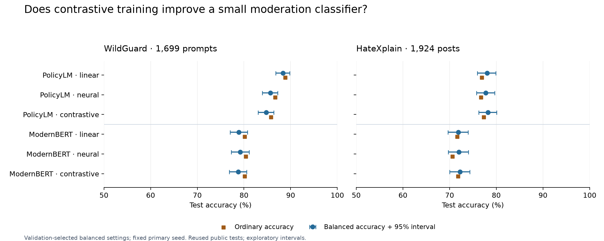

# Can a small trained classifier make better use of frozen model features?

**We obtained useful task-specific classifiers, but contrastive training did not
produce a clear, consistent improvement.** The simple PolicyLM linear classifier
remained a strong control. Increasing the classifier's complexity sometimes
changed which mistakes it made without improving the overall result.

We trained classifiers on 4,096 labeled examples per task, used a separate 1,536
examples to select settings, and then tested the frozen choices on 1,699 WildGuard
prompts and 1,924 HateXplain posts. Both public tests have been used in earlier
project studies; this is an exploratory follow-up, not a new blind confirmation.

## What we trained

The pipeline is **submitted text → frozen representation → trained classifier →
score and validated cutoff**. No language-model weights were updated.

PolicyLM 1.7B supplied its final policy-category representation under a fixed
prior policy. ModernBERT-base, a 149M-parameter encoder, supplied the final
content-token average from submitted text alone. For each backend we compared:

1. **Linear:** logistic regression, our simple baseline.
2. **Neural:** a small network that can learn more complex feature combinations.
3. **Contrastive:** the same network, also trained to bring same-label examples
   together and separate differently labeled examples in its learned representation.

The neural arms had matched architectures, initialization seeds, batches and
search budgets. Each was trained with three seeds. Hyperparameters and a shared
cutoff were selected using mean validation performance, with no best-seed selection
or seed ensemble. The tables below use the predeclared primary seed; all repetitions
and operating profiles are in the [complete results](RESULTS.md).

## WildGuard: a validation gain did not carry over

These settings were selected to balance correctly allowing benign prompts and
catching harmful ones. There were 945 benign and 754 harmful test prompts.

| Backend and classifier | Accuracy | Balanced accuracy | False blocks | Harmful prompts missed |
|---|---:|---:|---:|---:|
| PolicyLM + linear | 88.82% | 88.37% | 72 | 118 |
| PolicyLM + neural | 86.70% | 85.64% | 47 | 179 |
| PolicyLM + contrastive | 85.76% | 84.78% | 62 | 180 |
| ModernBERT + linear | 80.16% | 78.90% | 93 | 244 |
| ModernBERT + neural | 80.40% | 79.22% | 97 | 236 |
| ModernBERT + contrastive | 80.16% | 78.75% | 82 | 255 |

Validation had selected **PolicyLM + contrastive** as the overall configuration:
95.27% mean balanced accuracy, slightly above the linear classifier's 95.04%.
Its primary test result was 84.78%. We preserve that selection; we do not replace
it with the linear classifier after seeing the test results.

Compared with the linear control, that contrastive run made **10 fewer false
blocks but missed 62 more harmful prompts**. Its balanced-accuracy difference
was −3.58 percentage points, with a paired interval of −4.68 to −2.44 points.
The ordinary neural head also fell behind the linear control.

The seed repetitions add nuance. PolicyLM contrastive balanced accuracy ranged
from 84.78% to 86.80%, averaging 85.85%; the ordinary neural head averaged 85.29%.
Thus the contrastive head was not worse than the ordinary network in every seed,
but none of its three runs exceeded the linear control. The primary contrastive
versus ordinary-network interval included no difference.

This establishes a failure of the small validation advantage to generalize here.
It does not identify a single cause. A flexible head can overfit, and WildGuard's
training and test mixtures and label provenance differ; this experiment does not
separate those explanations.

## HateXplain: small differences between heads

Here the rule blocks hate speech and allows normal and offensive-but-not-hateful
posts. The test contains 1,330 ALLOW and 594 BLOCK examples.

| Backend and classifier | Accuracy | Balanced accuracy | False blocks | Hate posts missed |
|---|---:|---:|---:|---:|
| PolicyLM + linear | 76.87% | 78.01% | 332 | 113 |
| PolicyLM + neural | 76.72% | 77.75% | 332 | 116 |
| PolicyLM + contrastive | 77.34% | 78.21% | 320 | 116 |
| ModernBERT + linear | 71.62% | 71.88% | 383 | 163 |
| ModernBERT + neural | 70.58% | 71.97% | 421 | 145 |
| ModernBERT + contrastive | 71.78% | 72.23% | 385 | 158 |

Validation selected **PolicyLM + linear**. The contrastive head's primary test
score was slightly higher, but its +0.20-point balanced-accuracy difference from
linear had an interval of −1.20 to +1.63 points. It made 12 fewer false blocks
and three more misses. Across its three seeds, contrastive mean balanced accuracy
was 78.01%, effectively the same point estimate as the linear control.

The small ModernBERT differences were also uncertain. The contrastive head's
primary balanced accuracy was 72.23%, but its three-seed mean was 71.49%, versus
71.84% for the ordinary neural head. Reporting only the most attractive seed
would give a misleading impression.

## What if we optimize ordinary accuracy instead?

We also froze a separate selection for this goal. On HateXplain, the selected
PolicyLM linear classifier reached **80.46% accuracy**, versus 76.87% at the
balanced setting. It made 140 false blocks instead of 332, but missed **236 hate
posts instead of 113**. Balanced accuracy fell to 74.87%.

This comparison changes the validation-selected regularization and cutoff; it
is not an isolated cutoff experiment. It shows why the highest accuracy number
is not automatically the best moderation system. The majority of this test is
ALLOW, so allowing more content can improve accuracy while reducing harmful recall.
The WildGuard accuracy objective selected the same PolicyLM contrastive configuration
as the balanced objective, with the same primary test result.

The separately selected error-budget profiles have further tradeoffs. For example,
HateXplain's PolicyLM linear 5%-false-block profile achieved 3.98% false blocks
on test but caught only 40.07% of hate posts. WildGuard's corresponding profile
missed its validation target, reaching 6.24% false blocks. These profiles are
reported rather than retuned after test.

## What this adds to the research

Frozen representations can support useful classifiers with modest additional
training. At the balanced settings, the PolicyLM configurations outperformed
the ModernBERT configurations, but that comparison changes size, pretraining,
architecture, representation and policy conditioning together. It does not show
that one factor caused the gap, or measure ModernBERT after backbone fine-tuning.

Extra head complexity and a contrastive objective did not establish an accuracy
upgrade over a simple linear control. The study does not establish a ceiling for
contrastive learning, other embeddings, more labeled data or backbone adaptation.
Earlier project systems also remain competitive: historical WildGuard and specialist
ensemble balanced accuracies were 89.81% and 91.08%, while the recent HateXplain
smart ensemble reached 79.97%. Those studies had different selection procedures;
they are context, not equal-search-budget controls in this experiment.

These heads learn a fixed task from labels. We have not shown that editing the
policy makes a trained head follow the new boundary without retraining. Teams
considering this approach need to own both the labels and the operating objective,
then test the complete model, representation, classifier and cutoff together.

## Evidence and cost

All 164 candidate checkpoints reproduced exactly, including validation outputs.
Verification also reproduced all 112 selected test metric rows and 12 paired
bootstrap intervals. All test examples resolved. Intervals are exploratory and
unadjusted, and exclude search and training uncertainty; seed variation is shown
separately. The pre-test freeze is commit `fae8fd8`.

GPU.ai extraction cost **$0.11**. Head fitting and reproduction ran locally;
there were no inference API calls. Cumulative accounted project spending is
**$16.80001787256 of $20**, including earlier conservative API allowances. The GPU
was terminated and temporary credentials removed. These charges exclude local
electricity and engineering time and are not a provider endorsement.

[Full results and seeds](RESULTS.md) · [Methods](METHODS.md) · [Registered plan](PLAN.md) ·
[Technical amendment](AMENDMENTS.md) · [Reproduction](RUNNING.md) ·
[Public evidence bundle](README.md)
